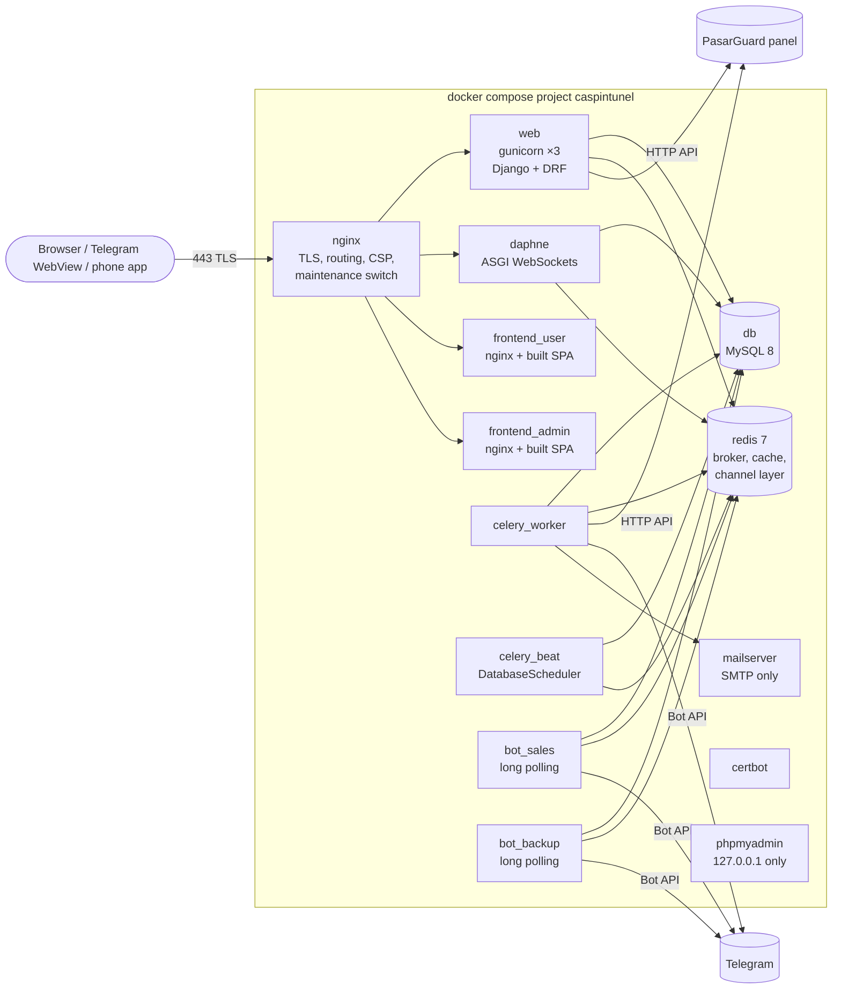
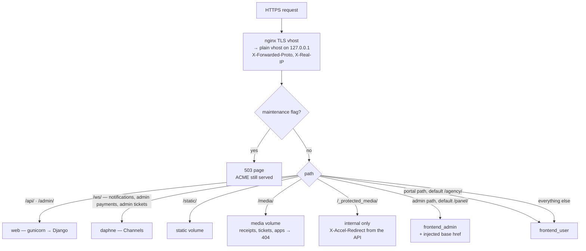

# Architecture

API-first Django. One backend, versioned API (`/api/v1/`, JWT), several
independent frontends (user site, admin panel, reseller portal, Telegram bots,
operator phone tools). Jalali calendar in the presentation layer (UTC stored).
Bilingual fa/en, Latin digits everywhere.

Related: [erd.md](erd.md) (data model) · [flows.md](flows.md) (sequence diagrams) ·
[roadmap.md](roadmap.md) (planned phases) · [deploy.md](deploy.md) · [operations.md](operations.md).

> **Rule:** every phase that changes models, services, tasks, containers or a
> user-visible flow updates `architecture.md`, `erd.md` and `flows.md` in the
> same release (see `CLAUDE.md`).

## Production server

| | |
|---|---|
| Location | Finland (Hetzner, Helsinki), host `ubuntu-4gb-hel1-2` |
| Public IP | `46.62.192.189` — `aicaspin.ir`, `www.aicaspin.ir`, `mail.aicaspin.ir` (Cloudflare DNS, DNS-only, TTL Auto) |
| Since | 2026-10-21, migrated from the previous server with the migration toolkit ([migration.md](migration.md)) |
| Compose | `docker-compose.yml` + `docker-compose.prod.yml` (selected by `COMPOSE_FILE` in `.env`) |
| Also on the host | two PasarGuard **node** containers (`hel-tun1`, `hel-cdn1`) and `x-ui` — VPN data plane, **not** part of this project; never restarted by `update.sh` |
| Docker daemon | `live-restore: true`, json-file logs capped at 10 MB × 3 per container; journald capped at 200 MB |

Secrets live only in `.env` (git-ignored) and in encrypted DB fields — none
are written in these docs.

## Containers (production)



| Service | Image | Role |
|---|---|---|
| `nginx` | own (`nginx/`) | TLS (Let's Encrypt or manual cert), routing below, security headers / two CSPs, `nginx/flags/maintenance` → 503, admin + portal paths from `nginx/paths/active.conf` |
| `web` | `caspintunel-backend` | gunicorn, 3 workers, Django + DRF (`/api/`, `/admin/`), healthcheck `/api/v1/health/` |
| `daphne` | `caspintunel-backend` | ASGI for `/ws/` (Channels; Redis channel layer) |
| `frontend_user` | `caspintunel-frontend-user` | built user SPA (also the Mini App and the reseller portal at `/agency/`) |
| `frontend_admin` | `caspintunel-frontend-admin` | built admin SPA, served under the admin path (default `/panel/`) |
| `celery_worker` | `caspintunel-backend` | all async work (provisioning, sync, backups, notifications, agency sync) |
| `celery_beat` | `caspintunel-backend` | periodic tasks, stored in the DB (`django_celery_beat`) |
| `bot_sales` | `caspintunel-backend` | `manage.py run_sales_bot` (pyTelegramBotAPI, long polling) |
| `bot_backup` | `caspintunel-backend` | `manage.py run_backup_bot` (backup chat commands, long polling) |
| `db` | `mysql:8.0` | the only database |
| `redis` | `redis:7-alpine` | Celery broker, Django cache (public-config cache, bot state, rate limits), Channels layer |
| `mailserver` | docker-mailserver 14 | `SMTP_ONLY=1`, outbound relay ([email-relay.md](email-relay.md)) |
| `certbot` | `certbot/certbot` | certificate renewal (webroot) |
| `phpmyadmin` | phpmyadmin | bound to `127.0.0.1` only (SSH tunnel) |

## Request flow



- Upstreams are nginx **variables** with `resolver 127.0.0.11 valid=2s`, so
  during a rolling deploy nginx balances over old + new containers and retries
  (`proxy_next_upstream`, 3 tries).
- Django gets exactly **one** trusted client IP (`$client_ip`; `X-Forwarded-For`
  overwritten) and DRF uses `NUM_PROXIES = 1`.
- Two CSPs: `/api`, `/admin`, admin path → locked down (`frame-ancestors 'none'`);
  the user site may be framed by Telegram (Mini App) and loads nothing from a CDN
  (the Telegram SDK is bundled).
- Admin and portal paths are configurable (Settings → Paths, [paths.md](paths.md)).
  The admin SPA is built with relative assets; nginx injects `<base href>` and
  `ct-admin-base`. The user site gets the portal path from an nginx-injected meta.
- Receipts and ticket attachments are never public (`/media/receipts/`,
  `/media/tickets/`, `/media/apps/` → 404): the API checks access, then
  `X-Accel-Redirect` to `/_protected_media/` (no-store).

Token audiences: customer JWT (`Authorization: Bearer`), staff JWT (separate
`Staff` model, `tv` claim = `token_version`), SMS device token
(`X-Device-Token`), reseller session (`Authorization: Agency <token>`, only a
SHA-256 stored).

## Backend apps (`backend/apps/`)

| App | Responsibility |
|-----|----------------|
| `common` | base model, encrypted fields (`FIELD_ENCRYPTION_KEY` / Fernet), Jalali helpers, `AuditLog` + `write_audit`, `DynamicAllowedHostsMiddleware`, health/root views, `mail.DynamicEmailBackend`, `public_cache`, `qrcard` (subscription QR on the active background), `xlsx` (Excel export without a dependency) |
| `accounts` | customer `User` (`AUTH_USER_MODEL`), independent RBAC — `Permission` / `Role` / `Staff`; JWT auth (password-hash claim revokes sessions), registration, phone normalization / Iran-only rule, email verification, 3-path password reset, legacy import, bot↔site account merge, Mini App initData validation, **soft delete + `DeletedUserArchive`** |
| `panel` | multi-panel `Panel` + `PasarGuardClient` (token cache, typed errors), `Service`, payload mappers, idempotent provision / renew / sync, scheduled renewals (reset / carry-over), admin full edit, manual create, link an existing panel account |
| `plans` | `Plan` (fixed / custom-volume), `group_ids` per plan with panel-default fallback, renewal mode + carry-over |
| `orders` | `Order` (new / renew / add-on / manual / imported), atomic unique-amount reservation (`amount_unique_lock`), checkout resume, `ScheduledRenewal`, `fulfill_order` + `retry_unfulfilled_orders` |
| `payments_sms` | `BankCard`, `Payment`, card-to-card receipts, `SmsSource` / `SmsAppDevice` / `SmsMessage`, unit-aware parser, **exact-match auto-confirm + near-miss review** (`matching.py`), `approve_payment` / `reject_payment` |
| `notifications` | `Notification` / `NotificationDelivery`, `dispatch.notify_user` (site / bot / email, each channel isolated), WebSockets: customer notifications + staff live payments queue |
| `telegram` | `TelegramClient`, `ensure_bot_user`, forced-channel + phone gate, sales bot (pure `bot/screens.py` + fa/en `bot/texts.py`), backup bot + `run_database_backup`, channel member stats ([bots.md](bots.md)) |
| `settings_app` | `Setting` (typed KV), `SiteConfig` (branding singleton), `Theme`, `Page` (CMS), `AppRelease` (operator apps), `EmailSettings`, iPhone Shortcut builder, `paths` (admin / portal paths), `seed` |
| `ops` | `HealthCheck` / `ResourceStat` / `BackupLog` / `CleanupRun`, health probes, `psutil` sampling, service alerts, **backup retention** (`retention.py`), beat-interval reconcile, Cloudflare `configure_dns` |
| `agency` | **Agency panel** — 1:1 port of PAMP v1.5.3: `PanelAdmin` (reseller admins), `AdminLimit`, `UserTrafficSnapshot`, `SyncLog`, `AdminGroup`; sync + deleted-user tracking + enforcement; reseller portal (`ResellerSession`); accounting (`AdminPrice`, `LedgerEntry`, reports) ([agency.md](agency.md)) |
| `tickets` | **support tickets** — `TicketTopic` (+ staff topic scopes), `Ticket`, `TicketMessage`, `TicketAttachment`, `TicketEvent`; rules in `services.py` (active-service gate, open limit, reopen window, auto-close), notifications in `notify.py`, staff Telegram linking (`staff_link.py`), user API `/api/v1/tickets/`, staff API `/api/v1/admin/tickets/`, WebSocket `/ws/admin/tickets/` |
| `crm` | **CRM** — `CustomerProfile` (lifecycle stage + manual override, owner, tags), notes, `FollowUpCase` (inactivity / lead / manual, reason, outcome, linked ticket), `CaseReason`, `MessageTemplate`, `CrmEvent` (timeline); stage rules + detection in `services.py`, hourly beat, links connection-problem tickets to open cases (`signals.py`); staff API `/api/v1/admin/crm/` |
| `adminpanel` | operator API under `/api/v1/admin/` — staff JWT + `StaffPermission` (`perms_map` / `action_perms`), every management endpoint, SMS log, system/update, read-only `docs/*.md` for the Documentation page |

## Async — Celery beat schedule

Defined by `manage.py seed` (idempotent, runs on every update) and stored in
the DB scheduler. Two intervals follow settings and are reconciled when the
setting is saved (`apps/ops/schedule.py`).

| Periodic task | Task | Every |
|---|---|---|
| panel: sync all services | `panel.tasks.sync_all_services` → one `sync_service_task` per live service | `service_sync_interval_minutes` (default 60) |
| orders: expire stale reservations | `orders.tasks.expire_stale_reservations_task` | 5 min |
| panel: apply due scheduled renewals | `panel.tasks.apply_due_scheduled_renewals` | 5 min |
| orders: retry unfulfilled | `orders.tasks.retry_unfulfilled_orders` (paid > 2 min, not provisioned) | 10 min |
| ops: database backup | `telegram.tasks.run_backup_task` | `backup_interval_minutes` (default 1440) |
| agency: sync panel admins | `agency.tasks.sync_panel_admins` (no-op while `agency_sync_enabled` is off; enforcement inside, gated by `agency_enforcement_enabled`) | `agency_sync_interval_minutes` (seed default 15; production 10) |
| telegram: required-channel member counts | `telegram.tasks.sync_required_channels_task` | 60 min |
| ops: health checks | `ops.tasks.health_check_task` | 2 min |
| ops: resource sample | `ops.tasks.resource_sample_task` | 5 min |
| ops: service alerts | `ops.tasks.service_alerts_task` → `crm.retention.run_warnings` (pre-expiry warnings; the old fixed alert only when `retention_warnings_enabled` is off) | 30 min |
| ops: prune old backups | `ops.tasks.prune_backups_task` → `retention.run_cleanup` | 60 min |
| crm: inactivity detection + stages | `crm.tasks.crm_detect_task` (inactivity cases, auto-close on reconnect, optional friendly message, win-back queue + auto won-back, stage refresh) | 60 min |
| tickets: auto-close stale | `tickets.tasks.auto_close_tickets_task` (awaiting the customer for `tickets_auto_close_days`) | 60 min |

On-demand tasks: `fulfill_order`, `provision_service_task`, `renew_service_task`,
`sync_service_task`, `apply_scheduled_renewal_task`,
`deliver_notification_task`, `reconcile_backup_schedule_task`,
`notify_ticket_task` (ticket notifications, queued on commit). Panel tasks
retry on `PanelUnavailable`; a permanent `PanelError` is audited and flagged.

## Bots

- **Sales bot** (`bot_sales`): site parity — buy / renew / custom volume /
  receipt upload / services (each as a QR photo + tap-to-copy link) / purchase
  history / account / rules / guide / support message. Gate: forced channels +
  shared phone (asked again on any message). First contact creates a site
  account with a random username + password (`ensure_bot_user`); a contact
  that matches an existing site phone merges into that account. Screens are
  pure functions; the router edits the current message; typed steps live in
  Redis (`tgbot:state:<tg_id>`).
- **Mini App**: the user SPA inside Telegram; `POST /auth/telegram/miniapp/`
  validates initData with the sales-bot token ([telegram-miniapp.md](telegram-miniapp.md)).
- **Backup bot** (separate token and chat): the beat task sends each DB dump to
  the backup chat (`sendDocument`, > 50 MB split into `.partNN`) plus retention
  alerts; the `bot_backup` process only answers `/id` (chat id) and `/backup`
  (backup now).
- **Tickets:** customer `tk:*` and staff `st:*` flows — see [Ticketing](#ticketing).
- **Staff linking:** a staff member asks the panel for a one-time code and opens
  `t.me/<bot>?start=staff-<CODE>`; the sales bot links that Telegram account to
  the `Staff` row (`telegram_id`) for ticket DMs — handled before any customer
  account logic, so no customer is created.
- Tokens are stored encrypted in `TelegramConfig`; an optional proxy URL per bot.

## PasarGuard integration

- **HTTP API only** (`apps/panel/client.py`, PasarGuard **5.4.1** live — its schema is public at
  `<panel>/openapi.json`); none of its AGPL
  source is in this repo. Admin token cached encrypted on the `Panel` row,
  refreshed on 401.
- Rule: **panel first, then read the account back and mirror it**
  (`apply_user_to_service`); send only changed fields. Never delete a panel
  account where "disable" is meant.
- Timed plans start **On-Hold** (`on_hold_expire_duration`), so the clock
  starts at first connection. Renewal keeps the same username + subscription URL.
- The agency app has its own client (`apps/agency/panel_api.py`, PAMP's) for
  `/api/admins`, `/api/users` and admin enable/disable.

## Agency sync

Every interval (when `agency_sync_enabled`): fetch all panel admins and their
users → update `PanelAdmin` counters → deleted-user tracking from
`UserTrafficSnapshot` (skipped on a truncated or failed user list — the v1.5.3
fix) → preserve sold volume → remove admins gone from the panel (never on an
empty list) → **enforcement** (disable an admin at ≥ 100 % of their limit,
re-enable below it) → `SyncLog`. The formulas are verbatim PAMP and proven
equal by `tests/test_golden.py`. Raising a limit through the panel UI writes a
**quota charge** to the ledger at the admin's price per GB on that date.

**Admin create / edit / delete** (`apps/agency/admin_crud.py`, caspintunel
addition — the PAMP port stays verbatim): every field of the panel's
`AdminCreate` / `AdminModify` schema — username, password, **role** (5.4
replaced `is_sudo` with roles; owner roles = the old sudo; the groups /
templates an admin may use come from the role's `access` and are read live),
status, Telegram id, Discord webhook, subscription domain / title / template,
support URL, custom variables, panel notifications, per-admin limit overrides,
note. Panel picker when several panels are active (only the agency panel is
tracked locally). On create, optionally: initial limit → quota charge at a
price per GB (`agency.accounting`), membership of an account group; the reply
carries the password once for the "send to reseller" card. Delete needs the
typed username, removes the local row and group membership, keeps the ledger.
Endpoints `agency/panel-admins/` (+ `options/`, `<username>/` GET / PATCH /
DELETE), permission `agency.manage`, cut-over gate, audited without passwords.

Cut-over from the Finland PAMP happened on 2026-10-16; the old PAMP has its
workers stopped (rollback steps in [agency.md](agency.md)). Never run two syncs
against one panel.

## Ticketing

Customers open tickets from the **site** (`/tickets`) or the **sales bot**
(🎫 menu) — both go through `tickets/services.py`, so a reply written in one
place shows in the other. Topic gate (enforced in the API): topics with
`requires_active_service = false` ("pre-purchase") are open to everyone; the
rest to anyone who **ever had a service** (expired / used-up included — only
never-purchased users are limited to pre-purchase). When all of a user's
services are expired / used up, the new-ticket form and the bot show a
"service expired — renew" hint (`GET /tickets/topics/` → `renew_hint`), and
the ticket can still be sent. "سایر / Other" + a free subject covers anything
else. Limits (settings, `tickets.manage_topics`): `tickets_max_open_per_user`
(3), `tickets_auto_close_days` (7, for tickets awaiting the customer),
`tickets_reopen_days` (7), `tickets_show_staff_name` (off → customers see
"پشتیبانی"; on → the staff member's `display_name`).

Statuses: `open` → `awaiting_admin` (customer wrote) ⇄ `awaiting_user` (staff
answered) · `on_hold` · `closed` (by the user, staff or the auto-close).
Answering a closed ticket as staff reopens it; the first staff reply sets
`first_response_at` and assigns an unassigned ticket to the replier. Internal
notes are staff-only. Every change is a `TicketEvent` (actor, old → new) and
staff changes also go to `AuditLog`.

RBAC: `tickets.view`, `tickets.reply` (incl. status / priority / internal
notes), `tickets.assign`, `tickets.close` (close / reopen),
`tickets.manage_topics` (topics, settings, scopes); seeded role **Ticketing**
(view, reply, assign, close). **Topic scopes**: a staff member linked to some
topics sees and answers only those (everything else is 404); no topic = all;
superadmins always see all.

Notifications (`notify.py`, Celery, after commit): staff reply → customer
site bell (real-time, `Notification.link` = `/tickets/<id>`) + email, and a
sales-bot message with **Reply / Open** buttons; closed / auto-closed → site.
New ticket / customer reply / assignment → the assignee, or — if unassigned —
every staff member whose permission + scope cover the topic: bot DM with
**Reply / Open / Assign to me / Close** buttons (Telegram linked) and email
(`Staff.email`). Every change also pushes a live event: to the customer's
notification socket (`ticket.event` → the open chat refetches; never for
internal notes) and to each scoped staff socket `/ws/admin/tickets/` with
their badge count (open / awaiting admin, unassigned or theirs).

Saved replies (`CannedReply`, per topic or general) are offered in the staff
composer; the inbox side panel shows the customer (services, last payments —
only with `payment.view` — and other tickets), a placeholder for the Phase 3
CRM.

**Bot** (`apps/tickets/bot.py`, routed from `sales_bot`): customers —
`tk:home` → new ticket (allowed topics as buttons → subject → message, text or
photo / PDF), my tickets (paginated), a ticket (last 8 messages, Reply / Close
/ Reopen). Linked staff — `/tickets` or "📥 Tickets (staff)": inbox
(open / mine, paginated, scope-limited), a ticket, reply (force-reply, text or
photo), assign to me, close / reopen; staff updates never create a customer
account and skip the customer gate. Staff screens are Persian. Attachments: ≤ 3 per message, ≤ 5 MB, JPEG / PNG / GIF /
WebP (decoded with Pillow) or PDF, type sniffed from the bytes, stored under a
random name in `media/tickets/`.

## CRM

**Customer 360** (`/panel/crm/customers/<id>`, from Users and from the ticket
side panel): profile (contact, source, Telegram, signup, referrer), services
(status, usage, expiry, last connection), orders / payments and LTV (sum of
approved payments; payments only with `payment.view`), tickets, notifications
sent, notes, tags, owner, follow-up cases, and one merged activity timeline
(orders, payments, tickets, notifications, stage changes and staff actions).

**Lifecycle stage** (computed hourly and on view; a manual override wins):
lead (never bought) · new (first purchase ≤ `crm_new_days`) · active ·
at_risk (open inactivity case, expiry ≤ `crm_at_risk_days`, or
≥ `crm_at_risk_usage_pct` used) · expired · churned (no live service for
`crm_churn_days`) · won_back (live again after expired / churned, for
`crm_won_back_days`). Every change is a `CrmEvent`.

**Inactivity detection** (hourly; only services synced in the last 24 h —
`online_at` comes from PasarGuard on every service sync): active service
without a connection for `crm_inactive_days` (3) → `no_connection` case; on
hold / never connected `crm_never_connected_hours` (48) after purchase →
`never_connected` case; one open case per service; the case closes itself
(outcome resolved, by the system) when the service connects again. Optional
friendly message after `crm_auto_message_days` (setting `crm_auto_message`,
off by default; template, `{guide}` link). A ticket opened in the
"Connection problem" topic joins the customer's open case.

**Follow-up queue** (`/panel/crm`, "نیاز به پیگیری"): reason from a
configurable list, notes, assignee, outcome (resolved / still inactive / lost);
actions: send a message via site / bot / email from editable templates, open a
ticket on the customer's behalf (`tickets.services.open_for_user`, linked to
the case), close. **Leads**: registered users who never bought, with
pre-purchase ticket count, last activity, follow-up. **Reports**: open cases,
opened per period, reasons, outcomes, time to resolve, customers per stage.
Permissions `crm.view` (also given to the Ticketing role) and `crm.manage`.

## Retention

**Pre-expiry warnings** (`apps/crm/retention.py`, every 30 min): `WarningRule`
rows (defaults: data 80 % and 95 % used, 3 days and 1 day left), each with its
own fa / en title + message (`{name} {service} {remaining_gb}
{remaining_days} {renew}`). A `ServiceWarning` is stored per (service, kind,
threshold, period) — the period key is the service's expiry + volume, so it
changes on renewal — which makes a duplicate impossible; if several thresholds
are passed at once only the most urgent is sent (the others are recorded as
skipped). Channels are recorded one by one: site bell at once (links to
`/renew/<service>`), bot (with a 🔄 renew button → the bot's renew screen) and
email wait until the quiet hours end (`retention_quiet_start/end`, Tehran,
default 00:00–08:00); a retry only sends a channel still missing. A renewal /
new purchase within `retention_conversion_days` marks the warning converted.
Warnings appear on the Customer 360 timeline. The old fixed volume / expiry
alert (`ops.alerts`) only runs when `retention_warnings_enabled` is off.

**Win-back queue** ("بازگشت مشتری", `/panel/crm/winback`, `crm.view` — incl.
the Ticketing role): a service first seen expired / used up gets a
`ServiceEndMark`; after `retention_grace_hours` (24) without becoming live, and
when the customer has no other live service, a `winback` case opens (plan,
LTV, last connection, open tickets / cases). Actions: win-back message from
templates (site / bot / email; `{renew} {code} {percent} {code_expires}`),
single-use discount code (`DiscountCode`: percent, expiry, one active per
customer, reserved by the order at checkout, used when that order is paid —
`Order.discount_amount`), ticket on their behalf, reason for not renewing
(own reason list), owner. Live again within `retention_winback_days` (14) →
closed automatically as **won_back** with the recovered revenue (approved
payments since the case opened); otherwise staff close it as lost with a
reason. Optional automatic first win-back message (off by default).

**Reports**: warnings sent per threshold and renewals after them, ended
services, win-back rate, revenue recovered, top reasons, discount codes issued
/ used (`crm/retention/report/`).

## Analytics (CRM accounting)

`/panel/analytics` (`apps/crm/analytics.py`, read-only — no payment, agency or
ledger calculation changes; `accounting.view` + `crm.view`, the support tab
`crm.view` + `tickets.view`):

- **Business overview**: revenue this Jalali month vs the same part of last
  month, active customers, at-risk / expired / churned, win-back rate, open
  tickets and follow-ups, average first response, 12-month / 12-week trend
  charts (revenue, new customers, active customers, tickets).
- **Customer finance** (period presets or a Jalali range; CSV / Excel export):
  revenue (= approved payments, as the Accounting page), AOV, ARPU (revenue ÷
  paying customers), new vs returning revenue, revenue per month, by plan, by
  channel (site / bot / panel), by bank card, discount cost (codes used),
  average LTV.
- **Retention**: churn and renewal rate per month, first-purchase cohorts
  (% active in the following months), average customer lifetime, top
  customers by LTV. "Active in a month" = a paid new / renew order whose plan
  period covers it (orders are the only history of service periods).
- **Support**: per staff — tickets handled, replies, average first response
  (credited to the first replier), resolved + average resolution, reopened;
  per topic — opened, closed, first response.

## Frontends

React 18 + Vite + Tailwind. Themes from `/api/v1/theme/` (Caspian light/dark —
production, Midnight Aurora, Royal Frost). **Offline-safe:** fonts (Vazirmatn,
Inter, JetBrains Mono) and every asset bundled, no CDN.

- `frontend/user` — customer site, Telegram Mini App, reseller portal (`/agency/`).
- `frontend/admin` — admin panel. Desktop: grouped collapsible sidebar
  (≥ 1280 px docked, 768–1279 px overlay drawer). Phones (≤ 767 px, Caspian):
  bottom nav = dashboard · users · payment queue (centre, live badge) ·
  services · settings; **Settings is the index of every other page**, built
  from the same list as the sidebar (`components/adminNav.js` — same groups,
  icons, permissions), plus Deleted users and the settings sections, each with
  its own route (`/panel/settings/<section>`).
- One `ConfirmDialog`, one **toast** for every write (`components/Toast.jsx`,
  identical in both SPAs, fed by `FeedbackBridge` in the admin): top centre, a
  self-drawing check / X, a countdown ring (success 4 s, error 6 s; hover /
  focus pauses, click / Esc closes), reduced-motion aware — no inline result
  bars. Jalali dates, Latin digits.
- Agency admin detail = tabs in the URL (`/agency/admins/<u>/<tab>`: overview ·
  limits · settings · accounting · send); `/agency/admins/new` is a full-page,
  sectioned create form.
- SPA caching: `index.html` is served `Cache-Control: no-cache`, hashed
  `/assets/` `immutable` for a year (each SPA's `nginx.conf`) — a deploy reaches
  every browser on the next load.
- Documentation page (`/panel/docs`) renders ```` ```mermaid ```` blocks with
  the bundled `mermaid` library (lazy chunk, `securityLevel: strict`, no CDN).
- **Tickets — customer site** (`pages/Tickets.jsx`): list (status chip, topic,
  last message, unread badge, Jalali time), new ticket (topic cards, locked
  ones with the reason, renew hint, optional related service, attachments),
  full-height chat (bubbles, date separators, read ticks, image lightbox, PDF
  chips, sticky composer, closed banner with reopen); live via the bell's
  socket (`ct:ticket` window event) + 30 s poll.
- **Tickets — admin** (`pages/Tickets.jsx`, `pages/TicketTopics.jsx`): split
  view on desktop (list · chat · customer panel), one pane at a time on phones;
  filters (status, topic, priority, assignee, search), reply / internal note
  (visually distinct), saved replies, attachments, assign / status / priority /
  close / reopen, timeline of events; Topics & saved replies & settings page;
  staff topic scopes, display name and email in Roles → staff; "My Telegram"
  link code from the inbox. Live badge (`lib/liveTickets.jsx`) on the sidebar
  item, the Settings-index item and the mobile Settings tab.

## Host jobs (outside Docker)

| Schedule | Job |
|---|---|
| every minute | `scripts/paths.sh apply-request` — applies an admin/portal path change requested from the panel (nginx -t, reload, verify, rollback) |
| every 2 min | `scripts/watch-update.sh --prod` — runs `update.sh` when the panel's **Update** button left a sentinel |
| acme.sh / certbot timers | TLS renewal |

## Backups

- `run_database_backup` (beat, `backup_interval_minutes`): single-transaction
  `mysqldump` → `backups/<project>-<ts>.sql.gz` → `BackupLog` → sent to the
  backup chat.
- **Retention** (`apps/ops/retention.py`, hourly; `manage.py cleanup_backups
  [--dry-run]`): a local dump older than `backup_retention_days` (default 2) is
  deleted **only if `sent_to_telegram`**; unsent ones are re-sent (≤ 6 per run)
  or kept and alerted; the newest 2 always stay. `pre-update-*` keep 3,
  `backups/migration/*` 7 days. Each run → `CleanupRun` (shown on Monitoring).
- `update.sh` dumps the DB to `backups/pre-update-<ver>-<ts>.sql.gz` before
  every deploy.

## Deploy and rollback

Production runs the code baked into images. `./update.sh`:

1. safety net: DB dump + tag the running app images `:rollback`;
2. `git pull`, build the images;
3. one-off container of the **new** image: `migrate` + `seed` +
   `collectstatic` while the old release keeps serving (migrations must stay
   backward compatible: add now, drop next release);
4. **rolling** swap of `web`, `daphne`, `frontend_user`, `frontend_admin`:
   the new container starts next to the old one, waits for its healthcheck,
   then the old one is removed;
5. plain recreate of the rest (celery, bots, mail, nginx) only where the image
   or config changed — bots and beat never run twice;
6. nginx reload, Docker cleanup (keeps `:latest` + `:rollback`).

`./update.sh --rollback` puts the `:rollback` images back (restore the
pre-update dump if a migration must be undone). The panel **Update** button
goes through the same script via `watch-update.sh`. Details: [deploy.md](deploy.md).

## Security posture

Secrets only in `.env`; panel password, bot tokens, panel API token and SMTP
password encrypted at rest. Throttles: anon 180/min, user 600/min, public reads
600/min (+ 60 s Redis cache), `auth` 10/min, receipts 20/hour. Every staff write
that matters → `AuditLog`. Payments become approved only through
`approve_payment`; SMS amounts match **exactly** (no tolerance). See
`LICENSE` (proprietary) and [operations.md](operations.md).
