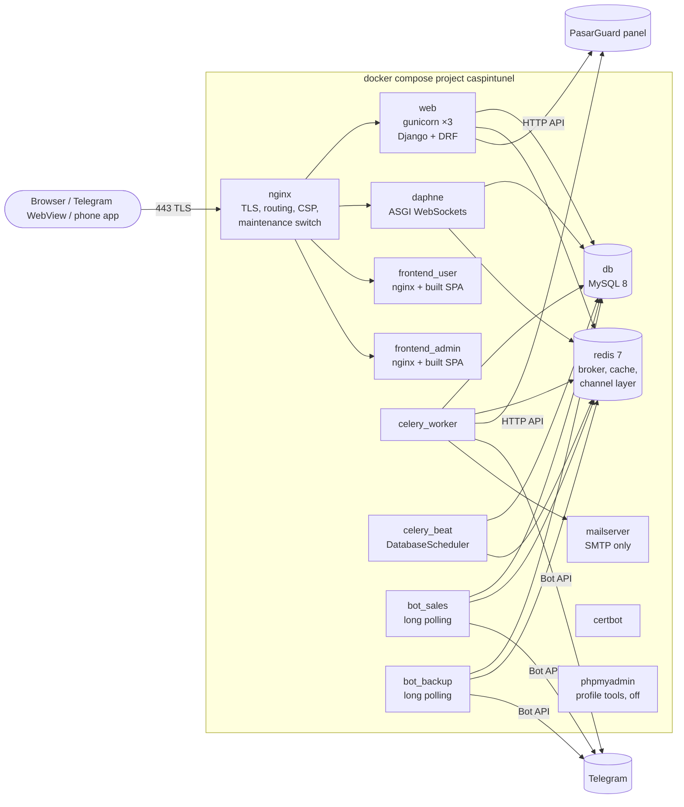
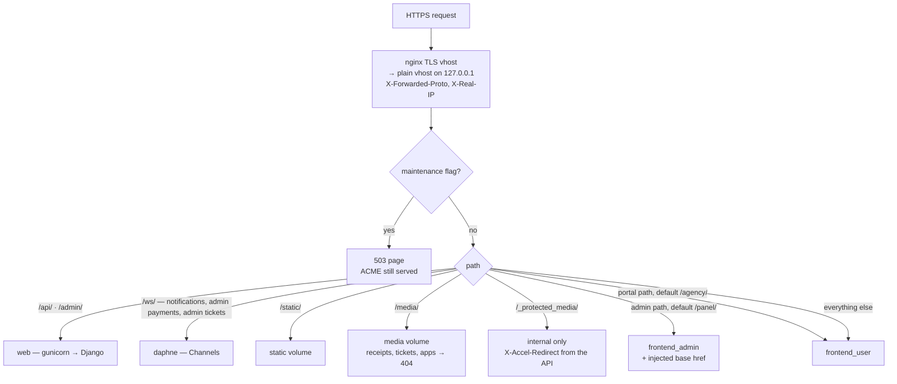

# Architecture

API-first Django. One backend, versioned API (`/api/v1/`, JWT), several
independent frontends (user site, admin panel, reseller portal, Telegram bots,
operator phone tools). Jalali calendar in the presentation layer (UTC stored).
Bilingual fa/en, Latin digits everywhere.

Related: [erd.md](erd.md) (data model) · [flows.md](flows.md) (sequence diagrams) ·
[roadmap.md](roadmap.md) (planned phases) · [deploy.md](deploy.md) · [operations.md](operations.md).

> **Rule:** every phase that changes models, services, tasks, containers or a
> user-visible flow updates `architecture.md`, `erd.md` and `flows.md` in the
> same release (see `CLAUDE.md`).

## Production server

| | |
|---|---|
| Location | Finland (Hetzner, Helsinki), host `ubuntu-4gb-hel1-2` |
| Public IP | server `46.62.192.189`. **`caspintunel.com`** + `www` (redirects to the bare domain) → Iran tunnel IP `185.124.174.13` (Cloudflare DNS-only; 80/443 passthrough to this server), `mail.caspintunel.com` → `46.62.192.189`. `aicaspin.ir` is the old domain (no longer served). Access mode **Iran tunnel** since 2026-11-04 (set without a DNS change): tunnel = backhaul (`tun` + TCP port forwarder 80/443 on the Iran server), source `10.10.10.1`, PROXY protocol off — visitors are rate-limited per client (X-Client-Id / browser hash) plus one total cap, but their real IP is not known (nginx sees `10.10.10.1`) |
| Since | 2026-10-21, migrated from the previous server with the migration toolkit ([migration.md](migration.md)) |
| Compose | `docker-compose.yml` + `docker-compose.prod.yml` (selected by `COMPOSE_FILE` in `.env`) |
| Hardware | 2 vCPU (AMD EPYC-Rome), 3.7 GiB RAM + 2 GiB swap file, 38 GB disk (2026-11-04: ~2.8 GiB RAM and ~1 GiB swap in use, disk 64 %) |
| Also on the host | three PasarGuard **node** containers (`str-hel`, `hel-tun1`, `hel-cdn1`), `x-ui` + xray, the `backhaul-kharej38100` and `caspin` (tunnel manager) systemd services — VPN data plane, **not** part of this project; never restarted by `update.sh` (they use roughly 0.6 GiB of the RAM) |
| Docker daemon | `live-restore: true`, json-file logs capped at 10 MB × 3 per container; journald capped at 200 MB |

Secrets live only in `.env` (git-ignored) and in encrypted DB fields — none
are written in these docs.

## Containers (production)



| Service | Image | Role |
|---|---|---|
| `nginx` | own (`nginx/`) | TLS (Let's Encrypt or manual cert), routing below, security headers / two CSPs, `nginx/flags/maintenance` → 503, admin + portal paths from `nginx/paths/active.conf`, the domain set by the wizard from `nginx/domain/active.conf` |
| `web` | `caspintunel-backend` | gunicorn, 3 workers recycled every ~1000 requests, Django + DRF (`/api/`, `/admin/`), healthcheck `/api/v1/health/` |
| `daphne` | `caspintunel-backend` | ASGI for `/ws/` (Channels; Redis channel layer) |
| `frontend_user` | `caspintunel-frontend-user` | built user SPA (also the Mini App and the reseller portal at `/agency/`; `/agency/manager` only forwards to the panel login since v1.25) |
| `frontend_admin` | `caspintunel-frontend-admin` | built admin SPA, served under the admin path (default `/panel/`) |
| `celery_worker` | `caspintunel-backend` | all async work (provisioning, sync, backups, notifications, Web Push, agency sync, Blu matching, access / domain switches); holds the read-only SSH key for the Blu service check |
| `celery_beat` | `caspintunel-backend` | periodic tasks, stored in the DB (`django_celery_beat`) |
| `bot_sales` | `caspintunel-backend` | `manage.py run_sales_bot` (pyTelegramBotAPI, long polling) |
| `bot_backup` | `caspintunel-backend` | `manage.py run_backup_bot` (backup chat commands, long polling) |
| `db` | `mysql:8.0` | the only database |
| `redis` | `redis:7-alpine` | Celery broker, Django cache (public-config cache, bot state, rate limits), Channels layer |
| `mailserver` | docker-mailserver 14 | `SMTP_ONLY=1`, outbound relay ([email-relay.md](email-relay.md)) |
| `certbot` | `certbot/dns-cloudflare` | certificate renewal by DNS-01 through Cloudflare (works in every access mode — [access-mode.md](access-mode.md)) |
| `phpmyadmin` | phpmyadmin 5 | compose profile `tools` — not running; start it on demand (`docker compose --profile tools up -d phpmyadmin`), bound to `127.0.0.1:8080` (SSH tunnel), stop it afterwards |

## Request flow



- Upstreams are nginx **variables** with `resolver 127.0.0.11 valid=2s`, so
  during a rolling deploy nginx balances over old + new containers and retries
  (`proxy_next_upstream`, 3 tries).
- Django gets exactly **one** trusted client IP (`$client_ip`; `X-Forwarded-For`
  overwritten) and DRF uses `NUM_PROXIES = 1`.
- Two CSPs: `/api`, `/admin`, admin path → locked down (`frame-ancestors 'none'`);
  the user site may be framed by Telegram (Mini App) and loads nothing from a CDN
  (the Telegram SDK is bundled).
- Admin and portal paths are configurable (Settings → Paths, [paths.md](paths.md)).
  The admin SPA is built with relative assets; nginx injects `<base href>` and
  `ct-admin-base`. The user site gets the portal path from an nginx-injected meta.
- Receipts and ticket attachments are never public (`/media/receipts/`,
  `/media/tickets/`, `/media/apps/` → 404): the API checks access, then
  `X-Accel-Redirect` to `/_protected_media/` (no-store).

Token audiences: customer JWT (`Authorization: Bearer`), staff JWT (separate
`Staff` model, `tv` claim = `token_version`), SMS device token
(`X-Device-Token`), reseller session (`Authorization: Agency <token>`, only a
SHA-256 stored).

## Backend apps (`backend/apps/`)

| App | Responsibility |
|-----|----------------|
| `common` | base model, encrypted fields (`FIELD_ENCRYPTION_KEY` / Fernet), Jalali helpers, `AuditLog` + `write_audit`, `DynamicAllowedHostsMiddleware`, health/root views, `mail.DynamicEmailBackend`, `public_cache`, `qrcard` (subscription QR on the active background), `xlsx` (Excel export without a dependency) |
| `accounts` | customer `User` (`AUTH_USER_MODEL`), independent RBAC — `Permission` / `Role` / `Staff`; JWT auth (password-hash claim revokes sessions), registration, phone normalization / Iran-only rule, email verification, 3-path password reset, legacy import, bot↔site account merge, Mini App initData validation, **soft delete + `DeletedUserArchive`**; **permanent delete** (`purge.py`, Super Admin + `users.purge`: removes the person, keeps orders / payments on an anonymous placeholder row) |
| `panel` | multi-panel `Panel` + `PasarGuardClient` (token cache, typed errors), `Service`, payload mappers, idempotent provision / renew / sync, **`account_names.py`** (v1.42.1: PasarGuard's username rule + fixed-name suggestion, used by every name form and `create_order`), scheduled renewals (reset / carry-over, custom-volume bytes in `ScheduledRenewal.data_limit`) always on the same account + link, admin full edit, staff set / change a service's plan (`set_service_plan`, filter «بدون پلن»), manual create, link an existing panel account **v1.55 WireGuard** (`wireguard.py`, [wireguard.md](wireguard.md)): `Service.wireguard` mirrored from the user's peer IPs, per-location `.conf` split on demand from PasarGuard's zip (never stored) for site / Mini App / bot, `WireguardLocation` names + flags, `Plan.vpn_type` checked against WireGuard groups (only WireGuard inbounds), «فقط وایرگارد» hides the subscription link (`customer_sub_url`) |
| `plans` | `Plan` (fixed / custom-volume), `group_ids` per plan with panel-default fallback, renewal mode + carry-over |
| `orders` | `Order` (new / renew / add-on / manual / imported), **`ManualInvoice`** (v1.38 «فاکتور دستی»: `manual.py`, mode paid → `approve_payment(confirmed_at=…)`, mode issued → the customer's checkout; tag = `Order.manual_invoice`), discount code on `create_order` (`crm.retention.check_code`), atomic unique-amount reservation (`amount_unique_lock`), checkout resume, `ScheduledRenewal` (one renewal at a time: `waiting_renewal` / `RenewalWaiting`; never replaced — `RenewalConflict` → order `failed` + staff alert via `common/staff_alert.py`), `fulfill_order` + `retry_unfulfilled_orders`; v1.42.1 «ساخت ناموفق» (`Order.provision_error` / `provision_failed_at`, `tasks._provision_failed`: one staff alert + «در حال آماده‌سازی» to the customer, no auto retry; staff `retry_provision` via `admin/transactions/<id>/retry-provision/`, count `admin/transactions/provision-failed/`); renewal plans incl. custom volume (`plan_renews`, `last_renewal_gb`, `Plan.renewable_when_inactive`) · v1.51.1: a paid renewal that is queued tells the customer at once (`tasks._notify_renewal_queued` → `notify_user` site + bot, once per order: new plan, volume, days, applies at the current expiry or when the volume runs out — "within a few minutes" for an ended service); the admin service serializer carries `pending_renewal` (Services list chip, service page box). |
| `payments_sms` | v1.42.2 Blu linking (`blu_link.py`: any reference — order / TX / MI / INV / AP —, candidates, link-only `linked` status for already approved payments, staff-confirmed shortfall, auto-link on approval via `signals.py`, unlink, backfill `link_blu_deposits`; Persian notes `blu_notes.py`) · `BankCard`, `Payment`, card-to-card receipts, `SmsSource` / `SmsAppDevice` / `SmsMessage`, unit-aware parser, **exact-match auto-confirm + near-miss review** (`matching.py`), `approve_payment` / `reject_payment`; **approval-queue warnings** (`checks.py`: receipt amount, recent SMS payment, duplicate image hash / bank document number, waiting renewal); **transaction numbers** `TX-000123` (`Payment.number`) and the Super Admin **void / restore** (`voiding.py`, 30 days) — voided payments are left out of every total (`Payment.objects.live()`); **unconfirmed-payment alert** (`pending_alert.py`, v1.33); agency deposits are matched after customer orders (`agency.billing.match_deposit`, ambiguous → held); **Blu Bank deposits** (`blu.py`: HMAC-signed webhook `/payments/blu/webhook/`, `BluTransaction` + `BluCollector` health; `matching.match_blu_transaction`: same exact-amount rule inside the order's time window, duplicate after SMS, near-miss → `blu_mismatch` review; staff attach) — [blu-webhook.md](blu-webhook.md); **rounded-amount auto-approve** (`rounded.py`, v1.32: a deposit slightly BELOW exactly one open invoice, inside its window, with a receipt or a known payer card → approved with `auto_rule = rounded`, paid amount + `shortfall`; Super Admin «لغو تأیید» = void; re-checked when a receipt is uploaded) · v1.48 `device_url.py`: `server_base()` = where a device posts (the store's live domain, ours = `SiteConfig.site_domain`) — the Apps page's «آدرس سرور» for the Android app (typed in with the device token) and the iPhone Shortcut endpoint · `manage.py watch_payments` (follows the next N SMS / Blu / receipt payments of our store, `alert_staff(perm="payment.view")` when one does not match; read-only otherwise) |
| `notifications` | `Notification` / `NotificationDelivery`, `dispatch.notify_user` (site / bot / email, each channel isolated), WebSockets: customer notifications + staff live payments queue; **Web Push** (v1.33: `PushSubscription` of a customer, a staff member or — v1.38.2 — an /agency/ reseller; `webpush.py` → `send_push_task`; worker `push-sw.js` is notification-only) |
| `telegram` | `TelegramClient`, `ensure_bot_user`, forced-channel + phone gate, sales bot (pure `bot/screens.py` + fa/en `bot/texts.py`), backup bot + `run_database_backup`, channel member stats ([bots.md](bots.md)) |
| `settings_app` | `Setting` (typed KV; `SUPER_ONLY` keys are Super Admin only), `SiteConfig` (branding singleton), `Theme`, `Page` (CMS), `AppRelease` (operator apps; Android download = uploaded APK > the bundled debug APK in `mobile_sms/release/`), `EmailSettings`, iPhone Shortcut builder, `paths` (admin / portal paths), `domain` (Cloudflare token + domain wizard: `DomainConfig`, `DomainChange`), **access mode** (`access.py`: Direct / Cloudflare proxy / Iran tunnel, `access_switch_task` + `access_tick_task` — [access-mode.md](access-mode.md)), `seed` (permissions, roles, beat rows; idempotent) |
| `ops` | `HealthCheck` / `ResourceStat` / `BackupLog` / `CleanupRun`, **v1.57 `SslCertificate`** (`ssl_certs.py`: «گواهی‌های SSL» on Monitoring — every TLS endpoint we depend on, daily + «بررسی الان», alerts at 14 / 3 days and on failure; API `admin/monitoring/ssl/`), health probes, `psutil` sampling, service alerts, **backup retention** (`retention.py`), beat-interval reconcile, Cloudflare `configure_dns` |
| `agency` | **Agency panel** — 1:1 port of PAMP v1.5.3: `PanelAdmin` (reseller admins), `AdminLimit`, `UserTrafficSnapshot`, `SyncLog`, `AdminGroup`; sync + deleted-user tracking + enforcement; reseller portal (`ResellerSession`; v1.38.2 sections, bell, «پرداخت کل بدهی», reseller push); accounting (`AdminPrice`, `LedgerEntry`, reports); limit history (`AdminLimitChange`); PasarGuard admin CRUD (`admin_crud.py`, header-safe text fields); group managers (`GroupManager` → linked `Staff` with role *Group manager* since v1.25, `GroupManagerAssignment`, `VolumeRequest`, approvals in the panel and on Telegram — `notify.py`, buttons `ag:*`; `agency.gm.*` permissions; full reseller stats `live_stats`; `ManagerSession` is legacy, unused); **invoices and payments** (v1.34+: `AgencyInvoice`, `AgencyPayment` + items, `AgencyInvoiceAllocation` — `allocation.py`, `AgencyNotice`, `AgencyAdminSetting` portal override; `billing.py`: `pay_all`, `debt_breakdown`, deposit matching after customer orders); **v1.52.2**: `release.py` (a limit change through our panel ends an enforcement block at once when it leaves room — PAMP enforcement untouched), set-limit preview warnings (`low_headroom`, `full_charge`), `near_limit.py` + beat «agency: near-limit summary» (10:00 Tehran, admins ≥ 95 %); **v1.53**: invoice kind `store_fee` (source `store_fee`, a store's monthly fee — `tenancy/fees.py`); **v1.54**: `archive.py` — admins are never deleted on our side: gone from PasarGuard (the sync — the one deliberate PAMP deviation, PORTING.md) or deleted in our panel → `archived_at` (`PanelAdmin.objects` hides archived rows from the sync, enforcement and active lists; `all_objects` for pages / accounting / «بایگانی» filters), restored when back on the panel; a deleted group-manager staff account → manager deactivated + archived (its groups pay directly). `history.py` «تاریخچه» (7 days · Jalali month · last month · custom · 12 months; staff `agency/history/` `agency.accounting`, manager `manager/history/`, portal `portal/history/`, CSV / Excel) from the ledger + invoices + `AgencyUserSeen`; **v1.57**: the one sales figure is «فروش» = charges + adjustments («کاهش بدهی» −, «افزایش بدهی» +; an adjustment corrects a mistake) — gross charges are shown nowhere (history, «گزارش‌ها», statements, manager / portal views, every CSV / Excel); «اصلاحیه‌ها» only as an information line (count + debt decreases / increases, API `adjust_count` / `adjust_down` / `adjust_up`); **v1.59**: agency payments `superseded` (+ `superseded_by`) when their invoices are paid elsewhere, expired ones only «تأیید با تأخیر» with a later exact deposit (`late_deposit`), buttons from `payment_row.actions`; **v1.58** «حسابداری» = `accounting.py`: period + summary strip, tabs (debtors · all · reseller payments · 12-month history), ONE sortable / filtered / paged table (sales, paid, debt, last payment, open invoices) and a side drawer (last 5 entries) — the same layout for group managers; the same filters on the group statement, the manager's accounting and the history table; one colour system for every agency page (`lib/agencyTone.js` + `agency-tones.css`, identical in both SPAs) ([agency.md](agency.md)) |
| `tickets` | **support tickets** — `TicketTopic` (+ staff topic scopes), `Ticket`, `TicketMessage`, `TicketAttachment`, `TicketEvent`; rules in `services.py` (active-service gate, open limit, reopen window, auto-close), notifications in `notify.py`, staff Telegram linking (`staff_link.py`), user API `/api/v1/tickets/`, staff API `/api/v1/admin/tickets/`, WebSocket `/ws/admin/tickets/` |
| `crm` | **CRM** (v1.59: also per store — `store_ok`, opt-in codes incl. new `crm.analytics`, our panel's `?store=` filter, `crm/stores/`) — `CustomerProfile` (lifecycle stage + manual override, owner, tags), notes, `FollowUpCase` (inactivity / lead / manual, reason, outcome, linked ticket), `CaseReason`, `MessageTemplate`, `CrmEvent` (timeline); stage rules + detection in `services.py`, hourly beat, links connection-problem tickets to open cases (`signals.py`); **retention** (`retention.py`: `WarningRule`, pre-expiry warnings with quiet hours, win-back; settings are `Setting` rows `retention_*`), **discount codes** (`DiscountCode` — kinds `campaign` / `winback` / `credit` (v1.56 store import), `discounts.py`, `credits_for`), **analytics** (`analytics.py`, read-only); staff API `/api/v1/admin/crm/` + `/api/v1/admin/discounts/` |
| `tenancy` | **multi-tenant storefronts ([multi-tenant.md](multi-tenant.md) — Phases 0–8, 10, 12 built; 11 started; the pilot is next)** — `Tenant` (one store; the default tenant = our own store, caspintunel.com), `TenantDomain` (verified hosts); `fields.tenant_fk` = the `tenant` column (NOT NULL since v1.42; `null=True` only on the NULLABLE models); `registry.py` classifies every model (TENANT / NULLABLE = platform when NULL / PLATFORM, enforced by a test); `backfill.py` (default tenant + fill rows without one, idempotent). **Release B (v1.41)**: `TenantMiddleware` (host → active `TenantDomain`, our own hosts → default tenant, any other host 404), `context.py` (contextvar; processes without a request use the default tenant; `unscoped()` only in an allow-listed file), `scoping.py` (every TENANT model's managers filter through the `tenant__tenant_scope` lookup, which reads the tenant when the SQL is compiled — safe for DRF's import-time `queryset = …`; new rows get the current tenant), customer JWT `tid` claim (`tokens.py`, checked in `accounts/authentication.py`), per-tenant unique constraints. **Release C (v1.42)**: tenant NOT NULL, old global uniques dropped (admin serializers check "already exists" per store; `auth.TenantModelBackend` = ModelBackend on the scoped User manager, `auth.W004` silenced), strict mode — a tenant-table query without a tenant in the web process raises `NoTenant` (`TENANCY_STRICT=false` = emergency switch back to warning + default); Celery, bots, daphne and manage.py use the default tenant **Phase 2 Release A (v1.43)**: `stores.py` (our staff open a store for an agency admin: draft, own `TenantBranding`, a copy of our pages; name / status / export; audit `store.enabled` / `store.updated`; API `admin/agency/panel-admins/<u>/store/`), only an ACTIVE store answers on its domains, `settings_app/branding.py` (`branding()` = SiteConfig for our store, TenantBranding for a store — used by /config/, QR card, bot texts, CRM templates; `TENANT_KEYS` + `TenantSetting` read first by `get_setting`), themes per store (built-in + own; «فعال» sets the store's theme), public cache keyed by tenant. **Store mode**: on a store's domain `StaffPermission` refuses every admin view without `store_ok = True` (Super Admin too) — open: users, pages, themes, branding, settings (TENANT_KEYS only), dashboard (no server health); `TenantMiddleware` 404s platform paths there (`/admin/`, `/api/v1/agency/`, Blu, SMS devices, staff approve / reject, API schema); `auth/me` returns `store`. **Release B (v1.44)**: the admin SPA runs in store mode when `auth/me.store` is set — `adminNav.STORE_GROUPS` / `STORE_BOTNAV` (dashboard, users, branding, settings, pages, themes), store-only routes (anything else → dashboard), a «فروشگاه · name» badge, no payments / tickets / approvals polling, dashboard without revenue / health, settings = alerts / requirements / display only, store domain read-only on Branding, themes report the store's active one; the user SPA never shows our name as a fallback (`/config/` names only, empty `<title>` until it answers, a letter favicon for a store without one). **Phase 3 (v1.45) store domains + TLS**: `domains.py` — our staff add a domain on «فروشگاه» (`…/store/domains/`, `agency.manage`, audit `store.domain_*`) with mode *direct* (A → `SERVER_IP`) or *tunnel* (A → the Iran IP of the access mode) and get the exact records (A, www, TXT `_caspin-verify.<host>`); Celery `store_domains_tick_task` (every minute): DNS every 5 min via DoH (TXT token + A on our IP; Cloudflare edges → the `/.well-known/caspin/<token>` probe must come back from THIS server — answered by `TenantMiddleware` before any host check), then the host watcher `scripts/tenants.sh` (+ `tenants_host.py`, host cron every minute) reads `backups/.tenant-domains.json`: a free pre-check through the public path, HTTP-01 certificate (lineage `store-<host>`, webroot — works direct, through the Iran tunnel without PROXY protocol and through the reseller's Cloudflare), `nginx/tenants/<host>.conf` (mounted read-only, included after our vhosts so caspintunel.com stays the default name) → `nginx -t` → reload → TLS verify → rollback; results in `backups/.tenant-status.json`; TLS health over the public path → `active`; health every 5 min (alert after 30 min), DNS daily, expiry alert at 14 days, 3 failed Let's Encrypt attempts → `failed` until «تلاش دوباره». The store dashboard lists its domains read-only. Test: `scripts/test-tenants.sh`. **Phase 4 (v1.46) catalog + PasarGuard per store**: `celery_ctx.py` — `before_task_publish` stamps the sender's explicit tenant into the message headers (`caspin_tenant`), `task_prerun` restores it in the worker (no header = default tenant, as before); `context.for_each_tenant` runs `sync_all_services`, `apply_due_scheduled_renewals`, `retry_unfulfilled_orders` and the customer part of `expire_stale_reservations_task` once per store. `panel.services.provision_service`: a store's account is created with our token, then `set_owner` to the reseller's PasarGuard admin (`PUT /api/user/{u}/set_owner?admin_username=`) and read back (`admin.username` must be the reseller, else `PanelError` → «ساخت ناموفق»). `quota.py` (D6): available = the agency `admin_remaining` (limit − the reseller users' traffic, synced every 2 min; recomputed live when a sale would leave < 10 %) − the store's open orders (reserved / paid, not delivered) − unapplied paid renewals; `create_order` (→ `SaleUnavailable`, code `quota`), `fulfill_order` (paid order waits, retried every minute) and manual invoices with a service action check it; unlimited resellers never blocked, unlimited plans refused for limited ones; `store_quota_warnings_task` (5 min) → portal notice + staff alert at 20 % / 10 % left, once per level (`Tenant.quota_alert_level`); store dashboard banner. `catalog.py`: store plans (`PlanAdminViewSet` `store_ok`, `plans/store-options/`) = the agency panel only, the reseller role's `allowed_group_ids`, no unlimited volume for a limited reseller. **Phase 5 (v1.47) payments + SMS per store**: unique-amount pool per store (`order` constraint `order_tenant_amount_lock` = unique (tenant, amount_unique_lock); agency payments share only OUR pool — `agency.billing.open_at` / `paid_duplicate` are empty in a store context, `_assign_unique_amount` skips agency amounts only for our store); `/api/v1/payments/sms/*` answer on a store's domain (no longer in `STORE_BLOCKED_PREFIXES`; Blu still blocked) — the device token resolves inside that store, so an SMS matches only its orders, cards, sender numbers; `sms/ping/` returns the store name. Store panel: payments queue, approve / reject, receipt info, SMS log, cards, SMS devices + sources, Android APK download (`store_ok`); queue rows never carry Blu data. `TENANT_KEYS` += checkout timer, unique-amount range, pending-payment alert delay. `common.staff_alert.alert_staff` in a store context reaches only that store's staff (`Staff.tenant`; Web Push only until its bot, Phase 6) — never our staff or backup chat; `platform=True` for alerts meant for us (quota, store domains); `webpush.push_to_staff` and the live socket (`live.payments_group`: `staff_payments` ours, `staff_payments_t<id>` per store, chosen from the socket's Host) follow the same rule. **Phase 6 (v1.49) store bots + Mini App**: `TenantBot` (one per store, token + webhook secret encrypted, `bot_id` unique) set / replaced / removed only by our staff on «فروشگاه» (`agency/panel-admins/<u>/store/bot/` + `check/`, `agency.manage`, audit `store.bot_set` / `store.bot_removed` without the token) — `bots.set_token`: format, never our own bots, `getMe`, one store per bot, then `apply` = `setWebhook` (OUR host `/api/v1/telegram/hook/<tenant id>/`, `secret_token`, message + callback_query) · menu button → the store's site (`branding.public_base`) · description from its branding (re-applied when the store saves branding). `telegram/webhook.py`: secret header (constant time, else 403), suspended / closed store → 200 dropped, `update_id` once (24 h), blocked on store domains; `store_bot_update_task` (Celery, in the store's context) runs the sales bot's own handlers on a per-store TeleBot (`telegram/bot/store_bots.py`) — customers, plans, orders, texts all the store's, step state keyed per store, staff flows (staff link, `st:*`, `ag:*`, staff tickets button) off. `telegram/config.sales_client()` = the current store's bot (None for a store without one — never ours), `our_sales_client()` for staff alerts / our bot's settings / domain wizard / ticket staff DMs; a store's own staff (Phase 8) are DMed through the store bot. Mini App: `telegram_auth.sales_bot_token()` = the store's token on its domain (ours refused there, 503 without a bot). `store_bots_check_task` every 10 min: `getWebhookInfo`, a wrong webhook set again, one alert to us (`platform=True`) when broken, a silent one when fixed. Store dashboard shows its bot read-only (username + state). **Phase 7 Release A (v1.50) store-owned features stay in the store**: periodic jobs on customer data run once per store (`for_each_tenant`): `crm_detect_task`, `service_alerts_task` (retention / expiry warnings), `auto_close_tickets_task`, `sync_required_channels_task` (through each store's bot), `pending_payment_alert_task` (a store's queue was never checked before — its alert reaches its own staff). `notifications.dispatch.notify_user` always delivers inside the CUSTOMER's store (its bot, sender name, links), whatever context calls it. Mail sent in a store context goes out from our address under the store's name (`common.mail._store_sender`); verify / reset emails link to the store's own site (`accounts/emails.py` → `branding.public_base`). `Staff` is NULLABLE (not scoped): every staff loop for a store event filters `tenant_id=store_id()` — ticket staff (`tickets.rules.ticket_staff`), the ticket scope picker, the CRM staff list; `tickets.bot.staff_for` / disk alerts = our staff only. `common.links.admin_link` = the current store's panel. No platform name on a store (test push, API root). **Phase 7 Release B (v1.51) store tickets, discounts, settings, caps**: the store panel gets its own tickets (inbox, reply, assign, topics, canned replies, ticket rules — `tickets/admin_views._StaffView.store_ok`, staff lookups `_store_staff()` = that store's staff only; the Telegram link to OUR bot stays ours) and discount codes (`DiscountCodeViewSet.store_ok`); `adminNav.STORE_GROUPS` + store routes. `settings_app.utils.set_setting` inside a store writes that store's value for a `TENANT_KEYS` key and raises `StoreSettingRefused` for anything else (a store can never change our settings); `TENANT_KEYS` += the four ticket rules. Throttles: every bucket of a store is prefixed `t<id>:` (`common/throttling._store_prefix`, ours unchanged) + `StoreTotalThrottle` = `Tenant.limits["requests_per_minute"]` (set by our staff on «فروشگاه», 60–100000, empty = none) → 429 for that store only + one alert to us an hour. `TenantBranding.support_email` (Branding page, stores only) = Reply-To of the store's mail. Release gate `tenancy/tests/test_phase7b.py`: the reverse sweep — on a store's domain no admin endpoint shows our data or our staff. **Phase 8 (v1.52) reseller staff**: `tenancy/staff.py` — `STORE_CODES` (every code a store_ok view asks for + `roles.manage`; a test keeps it equal and free of platform codes), `Tenant.permission_ceiling` (default template for new / existing stores, set by our staff on «فروشگاه» → `store/ceiling/`; lowering it strips the store's roles, audit `store.ceiling`), the store owner = one store staff on the per-store `store-owner` role (= the ceiling), created / password reset by our staff (`store/owner/`, password returned once, never audited; reset ends its sessions). `Staff.has_perm`: a store's staff (tenant set) only within the ceiling, never Super Admin; `/auth/me` gives them their capped codes + `store_staff`. Sign-in and every token of a store's staff only on that store's domains (`tokens.staff_for_payload` / `store_staff_here`, also on the payments + tickets sockets via the socket's Host); our staff keep working on store panels. Roles / Staff / Permissions APIs are `store_ok` and always filtered to the current store (ours = NULL): our panel no longer lists a store's roles / staff, a store's panel never ours; store roles ⊆ ceiling ∩ the actor's own codes, names unique per store (`role_tenant_name`); the owner role / account are ours to manage; group-manager options 404 on stores. Store staff link Telegram with THEIR store's bot (`staff_link.redeem` checks the store; `tickets.bot.staff_for` = the current store's staff) and get ticket DMs through it; agency `ag:*` stays ours. `plans/store-options/` answers 503 (not 500) without a reachable agency panel. **v1.52.1 (pilot fixes)**: `stores.enable` copies our active ticket topics into a new store (no staff scopes; the starter list of `tickets/defaults.py` when we have none) and the store dashboard warns without an active topic (`ticket_topics_active`). `tenancy/failed_orders.py` = a store's «ساخت ناموفق» (paid orders PasarGuard refused): listed with the panel's error on the store's Payments page (`orders/provision-failed/`, `payment.view`) and retried there (`…/<order>/retry/`, `payment.approve`, optional new account name) and on our «فروشگاه» card (`store/failed-orders/` + `…/<order>/retry/`, `agency.manage`, inside the store's context); the retry is `orders.services.retry_provision` (same paid order, no new payment, queued in the order's store); the failure alerts the store's staff and us (`platform=True`, «فروشگاه» → «سفارش‌های ناموفق»); store dashboard banner `failed_orders`. **v1.53 (Phases 10 + 12)**: `export.py` — `TenantExport` (TENANT table): a zip of the store's own data (JSON + CSV: customers, services, orders, payments, queued renewals, tickets + messages + topics + attachment names, discount codes, plans, branding + images, store settings, pages, cards) built by Celery `build_export_task` inside the store (progress per dataset) from EXPLICIT field lists — no password hashes, tokens, our panel names, Blu / SMS links; cards masked to the last 4; our staff appear as «support». Asked for in the store panel («پشتیبان‌گیری», `/backup`, `store-export/`, `store.export` + `Tenant.export_allowed`, one per 6 h) or by our staff on «فروشگاه» (`store/exports/`, `agency.manage`, no gap); one export at a time. The file lives under `media/exports/` (nginx 404) and is served once per one-time link (`/api/v1/exports/download/<tenant>/<token>/`, token-only, sha256 stored, bound to the host it was made for, X-Accel-Redirect) until 24 h after it was ready; `store_exports_cleanup_task` (hourly) deletes expired files / fails stuck jobs. The «فروشگاه» export switch also puts `store.export` into / out of the ceiling. Audit `store.export_requested / _ready / _failed / _link / _downloaded`. `fees.py` — `TenantFee` + `TenantFeeInvoice` (PLATFORM): the monthly store fee, OFF by default (`store/fee/`, `agency.accounting`): `store_fees_task` (hourly) issues one ledger charge + agency invoice of kind `store_fee` to the reseller per Jalali month on the due day (paid like every agency invoice), a portal notice + store-staff reminder after N days, and — only with `suspend_enabled` (off by default) — suspends the store N days after the due date while unpaid (not under review) and makes it active again once paid (a store our staff moved meanwhile is left alone); store dashboard banner `fee_due`. Audit `store.fee_updated / _invoiced / _reminded / _suspended / _resumed`. **v1.53.1**: `common/middleware.DynamicAllowedHostsMiddleware` refreshes `ALLOWED_HOSTS` per gunicorn worker (a shared token + the worker's own copy, ≤ 60 s) — a new store domain no longer gets 400 from some workers. **v1.53.2**: a store that is not active (draft / suspended / closed) is PARKED — `domains.desired()` marks its hosts `parked`, the host watcher renders a vhost that keeps the certificate, the ACME challenge and our probe and sends every other path to `/api/v1/store-unavailable/` (`unavailable.py`, answered by `TenantMiddleware` before its host check): HTTP 503 + Retry-After (not logged as an error, v1.53.3), the store's name and inlined logo, no data, never our brand, 404 for our / unknown hosts; a status change rewrites the watcher's file at once (live within about a minute); the domain health check only probes a parked store (no false «unreachable» alert). nginx (`prod.conf`): plain http → https (301, 308 for non-GET) for every real name (our domain, www, store domains) — never for the TLS hops (`$fwd_proto`), IPs / dot-less internal names, the ACME challenge or `/.well-known/caspin/`; works through the Iran tunnel (plain TCP forward of 80 + 443) — tested with the real `prod.conf` in `scripts/test-tenants.sh`. **v1.56 store import (Phase 11, [store-import.md](store-import.md))**: `importers/` — `dump.py` (MySQL dump read as text, never executed; zip / gz / sql ≤ 15 MB), one adapter per source bot (`mirza.py`) → `source.py` shapes, `engine.py`: `StoreImport` + `ImportRecord` (TENANT): upload (our staff on «فروشگاه», `store/imports/`, `agency.manage`; file under `media/imports/`, nginx 404, 0600, deleted after the import or 24 h) → `scan_import_task` (one read-only PasarGuard listing, preview + report) → «ربات قبلی فروش را متوقف کرده است» + plan map + confirmed big balances → `run_import_task` (DB backup first; customers by Telegram id inside the store, services linked only when PasarGuard's owner is the store's reseller via `link_existing_service(owner_must_be=…)`, 1-day tests / unpaid skipped, referrals, balances → `DiscountCode` kind `credit`, paid payments → read-only `history` records on Customer 360, never `Payment` / revenue; no customer messages, one alert to us) → CSV report → «بازگردانی» (only rows unused since; PasarGuard never touched); `store_imports_cleanup_task` hourly. |
| `adminpanel` | operator API under `/api/v1/admin/` — staff JWT + `StaffPermission` (`perms_map` / `action_perms`; a staff linked to a group manager is default-denied everywhere unless a view sets `group_manager_ok`), every management endpoint, SMS log, system/update, read-only `docs/*.md` for the Documentation page |

## Permissions (RBAC)

Staff (`accounts.Staff`) get permissions through a `Role`; a Super Admin has all of them. Each admin view names the codes it needs
(`perms_map` per method, `action_perms` per viewset action). Codes are created by `manage.py seed` (idempotent, never overwrites
names edited in the panel) or by a data migration; a group manager's role holds only `agency.gm.*` codes and every other admin
API answers 403 for a staff member linked to a group manager. Settings keys in `SUPER_ONLY` are Super Admin only regardless of
role. 47 codes (2026-11-04):

| Code | Name | نام فارسی |
|---|---|---|
| `accounting.view` | View accounting reports | مشاهدهٔ گزارش‌های حسابداری |
| `agency.accounting` | Agency panel: prices, charges, payments, statements | پنل نمایندگی: قیمت‌ها، شارژها، پرداخت‌ها، صورت‌حساب‌ها |
| `agency.gm.accounting` | Group manager: view accounting / group statement | مدیر گروه: دیدن حسابداری و صورت‌حساب گروه |
| `agency.gm.activity` | Group manager: view activity | مدیر گروه: دیدن فعالیت |
| `agency.gm.add_volume` | Group manager: add volume | مدیر گروه: افزودن حجم |
| `agency.gm.admin_password` | Group manager: change admin password | مدیر گروه: تغییر رمز ادمین |
| `agency.gm.admin_role` | Group manager: change admin role | مدیر گروه: تغییر نقش ادمین |
| `agency.gm.create_admin` | Group manager: create admin (incl. profile title, support link) | مدیر گروه: ساخت ادمین (با عنوان پروفایل و لینک پشتیبانی) |
| `agency.gm.full_stats` | Group manager: view full reseller stats | مدیر گروه: مشاهده آمار کامل نمایندگان |
| `agency.gm.invoices` | Group manager: view and pay the group's invoices | مدیر گروه: دیدن و پرداخت فاکتورهای گروه |
| `agency.gm.request_volume` | Group manager: request volume for group admins | مدیر گروه: درخواست شارژ برای ادمین‌های گروه |
| `agency.gm.toggle_admin` | Group manager: enable / disable admin | مدیر گروه: فعال / غیرفعال‌کردن ادمین |
| `agency.gm.view_admins` | Group manager: view group admins | مدیر گروه: دیدن ادمین‌های گروه |
| `agency.gm.view_users` | Group manager: view admins' users | مدیر گروه: دیدن کاربران ادمین‌ها |
| `agency.group_manager` | Group manager: own groups only (agency admins, volume, accounting) | مدیر گروه: فقط گروه‌های خودش (ادمین‌های نماینده، حجم، حسابداری) |
| `agency.manage` | Agency panel: limits, enable/disable, sync | پنل نمایندگی: سقف حجم، فعال/غیرفعال، همگام‌سازی |
| `agency.payments` | Agency panel: review / approve agency payments | نمایندگی: بررسی و تأیید واریزهای نمایندگان |
| `agency.view` | Agency panel: view reseller admins | پنل نمایندگی: مشاهدهٔ ادمین‌های نماینده |
| `audit.view` | View audit log | مشاهدهٔ لاگ رویدادها |
| `bots.manage` | Manage bots & channels | مدیریت ربات‌ها و کانال‌ها |
| `broadcast.send` | Send broadcasts | ارسال پیام همگانی |
| `crm.manage` | CRM: cases, messages, notes, owners, stages, settings | CRM: پرونده‌ها، پیام‌ها، یادداشت‌ها، مسئول‌ها، مراحل، تنظیمات |
| `crm.view` | CRM: customer 360, follow-up queue, leads, reports | CRM: نمای کامل مشتری، صف پیگیری، سرنخ‌ها، گزارش‌ها |
| `discounts.manage` | Discount codes: create, edit, disable | کدهای تخفیف: ساخت، ویرایش، غیرفعال‌کردن |
| `discounts.view` | Discount codes: see codes and their reports | کدهای تخفیف: دیدن کدها و گزارش آن‌ها |
| `monitoring.view` | View monitoring & resources | مشاهدهٔ مانیتورینگ و منابع سرور |
| `pages.manage` | Manage content pages | مدیریت صفحه‌های محتوا |
| `payment.approve` | Approve / reject payments | تأیید / رد پرداخت‌ها |
| `payment.view` | View payments | مشاهدهٔ پرداخت‌ها |
| `payments.manual_invoice` | Create manual customer invoices (already paid / issued for payment) | ثبت فاکتور دستی برای مشتری (پرداخت‌شده / صدور برای پرداخت) |
| `plans.manage` | Manage plans | مدیریت پلن‌ها |
| `roles.manage` | Manage roles & permissions | مدیریت نقش‌ها و دسترسی‌ها |
| `store.export` | Store: download a backup of the store's own data (only while we allow it) | فروشگاه: دریافت پشتیبان از داده‌های خود فروشگاه (فقط وقتی ما اجازه داده‌ایم) |
| `services.delete` | Delete sold services | حذف سرویس‌های فروخته‌شده |
| `services.manage` | Manage sold services (status, reset, revoke, create) | مدیریت سرویس‌های فروخته‌شده (وضعیت، ریست، لغو، ساخت) |
| `settings.email` | Manage outgoing email (SMTP relay) | مدیریت ایمیل خروجی (SMTP) |
| `settings.manage` | Manage settings & branding | مدیریت تنظیمات و برندینگ |
| `sms.manage` | Manage SMS numbers & devices | مدیریت شماره‌ها و دستگاه‌های پیامک |
| `themes.manage` | Manage themes | مدیریت پوسته‌ها |
| `tickets.assign` | Tickets: assign to staff | تیکت‌ها: ارجاع به کارمند |
| `tickets.close` | Tickets: close / reopen | تیکت‌ها: بستن / بازکردن دوباره |
| `tickets.manage_topics` | Tickets: topics, settings, staff topic scopes | تیکت‌ها: موضوعات، تنظیمات، محدودهٔ موضوع کارکنان |
| `tickets.reply` | Tickets: reply, internal notes, status, priority | تیکت‌ها: پاسخ، یادداشت داخلی، وضعیت، اولویت |
| `tickets.view` | Tickets: see the inbox (within the topic scope) | تیکت‌ها: مشاهدهٔ صندوق (در محدودهٔ موضوعات) |
| `users.delete` | Delete / restore users | حذف / بازگردانی کاربران |
| `users.manage` | Create / edit / disable users | ایجاد / ویرایش / غیرفعال‌کردن کاربران |
| `users.purge` | Permanently delete users (Super Admin only) | حذف دائمی کاربران (فقط سوپرادمین) |
| `users.view` | View users | مشاهدهٔ کاربران |

## Memory limits and tuning (v1.39.0, multi-tenant Phase 0)

The server stays at 2 vCPU / 3.7 GiB (owner's decision, swap enlarged by the owner), so every container has a `mem_limit`
(`docker-compose.prod.yml`; swap up to the same amount again): web 640 MB · daphne 192 · celery_worker 640 · celery_beat 192 ·
db 640 · redis 160 · nginx 128 · bot_sales / bot_backup 192 each · frontend_user / frontend_admin 48 each · mailserver 256 ·
certbot 96 (≈ 3.4 GB of caps; ≈ 0.8–1 GB in use). Tuning: gunicorn `--max-requests 1000 --max-requests-jitter 100`; Celery
`--concurrency 2 --max-tasks-per-child 200 --max-memory-per-child 262144` (KB); MySQL `--performance-schema=OFF`; Redis
`maxmemory 100mb` + `volatile-lru` (only keys with a TTL — cache, throttles, Celery results — can be evicted; queues and Channels
groups never). The PasarGuard nodes on the host are not limited by us.

**Watch** (`apps/ops/containers.py`, checked by `resource_sample_task` every 5 min, Telegram like the disk alerts; each kind at
most every 6 h, one "back to normal" line): a container of this project ≥ 85 % of its limit, an OOM kill or a restart, swap
≥ 1.5 GB for 30 min, memory pressure (some avg60) ≥ 10 %, load (15 min) above the CPU count, and the host report missing / stale
(> 20 min). Upgrade triggers: [multi-tenant.md §19](multi-tenant.md#19-server-capacity). Building an SPA needs ~1 GB — never build
while the test stack runs (the kernel OOM-killed a build that did, 2026-11-04).

## Async — Celery beat schedule

Defined by `manage.py seed` (idempotent, runs on every update) and stored in
the DB scheduler. Two intervals follow settings and are reconciled when the
setting is saved (`apps/ops/schedule.py`).

| Periodic task | Task | Every |
|---|---|---|
| panel: sync all services | `panel.tasks.sync_all_services` → every linked service, every status, in one run (lock) — see flows.md §4 | `service_sync_interval_minutes` |
| orders: expire stale reservations | `orders.tasks.expire_stale_reservations_task` (customer orders + unfinished agency checkouts — `agency.billing.expire_stale`) | 5 min |
| panel: apply due scheduled renewals | `panel.tasks.apply_due_scheduled_renewals` | 5 min |
| orders: retry unfulfilled | `orders.tasks.retry_unfulfilled_orders` (paid > 2 min, not provisioned) | 10 min |
| ops: database backup | `telegram.tasks.run_backup_task` | `backup_interval_minutes` (default 1440) |
| agency: sync panel admins | `agency.tasks.sync_panel_admins` (no-op while `agency_sync_enabled` is off; enforcement inside, gated by `agency_enforcement_enabled`) | `agency_sync_interval_minutes` (seed default 15; production 2 since 2026-11) |
| telegram: required-channel member counts | `telegram.tasks.sync_required_channels_task` | 60 min |
| ops: health checks | `ops.tasks.health_check_task` | 2 min |
| ops: resource sample | `ops.tasks.resource_sample_task` | 5 min |
| ops: service alerts | `ops.tasks.service_alerts_task` → `crm.retention.run_warnings` (pre-expiry warnings; the old fixed alert only when `retention_warnings_enabled` is off) | 30 min |
| payments: unconfirmed payment alert | `payments_sms.tasks.pending_payment_alert_task` → `pending_alert.run`: a payment pending longer than `pending_payment_alert_minutes` (Settings → Alerts, default 5, 0 = off; only rows of the last 24 h) → ONE Telegram to `payment.approve` staff with a link + live `payment_pending_alert` + browser push (`pending_alerted_at`); a silent "resolved" follow-up once it is approved / rejected / deleted | 1 min |
| ops: prune old backups | `ops.tasks.prune_backups_task` → `retention.run_cleanup` | 60 min |
| crm: inactivity detection + stages | `crm.tasks.crm_detect_task` (inactivity cases, auto-close on reconnect, optional friendly message, win-back queue + auto won-back, stage refresh) | 60 min |
| tickets: auto-close stale | `tickets.tasks.auto_close_tickets_task` (awaiting the customer for `tickets_auto_close_days`) | 60 min |
| domain: host results + retire old domain | `settings_app.tasks.domain_tick_task` (folds in the host's result; asks the host to remove the old domain when the transition is over) | 5 min |
| payments: Blu collector service check (SSH) | `payments_sms.tasks.blu_service_check_task` → `blu_service.check_service`: one read-only SSH command to `BLU_SSH_HOST` (`systemctl is-active` + last 10 min of `journalctl` for the collector unit). v1.33.1 liveness = last "poll ok" line (`last_poll_ok_at`); alert once per incident when the service is inactive, a session / login / OTP error shows, no successful poll for `blu_poll_stale_minutes` (default 10; without "poll ok" lines: ≥ 80 % of the window's polls failed) or SSH fails 3× in a row; one silent "healthy again". "No deposit for a while" never alerts (the old offline check is retired) | `blu_ssh_check_minutes` (Blu tab, Super Admin; default 5, min 1 — `ops.schedule.reconcile_blu_service_schedule` on save and in `seed`) |
| ops: daily disk report | `ops.tasks.disk_report_task` → `disk.daily_report` (reads the host's `backups/.disk-report.json`) | 1440 min |
| access mode: host nginx result + Cloudflare ranges | `settings_app.tasks.access_tick_task` (folds in the host's nginx result of a switch; refreshes Cloudflare's IP ranges once a day) | 5 min |
| ops: SSL certificates | `ops.tasks.ssl_check_task` → `ops/ssl_certs.run` (v1.57): one TLS handshake per target (v1.57.1: retried once), states + alerts at 14 / 3 days, expired, and «unreachable» only after 2 failed checks in a row (a first failure queues one extra check in 30 min) — each once | daily 07:30 Tehran |
| celery.backend_cleanup | Celery's own result cleanup | daily 04:00 UTC |
| accounts: auto-purge deleted users (daily) | `accounts.tasks.auto_purge_deleted_users_task` → `accounts.autopurge.run`: no-op while `deleted_purge_enabled` is off (default); else `purge_user(delete_on_panel=True)` for users deleted more than `deleted_purge_days` (default 30) ago, max 200 per run; a PasarGuard problem keeps that user (retried next day, one staff alert per day); audit `user.purged` per user + `users.auto_purged` per run | 1440 min |
| agency: near-limit summary | `agency.tasks.near_limit_summary_task` → `agency/near_limit.py`: one Telegram summary of agency admins at ≥ 95 % of their limit (v1.52.2) | daily 10:00 Tehran |
| stores: domains, certificates and health | `tenancy.tasks.store_domains_tick_task` → `tenancy/domains.tick` (DNS every 5 min, the host watcher's certificate / nginx results, TLS health, parked stores) | 1 min |
| stores: reseller quota warnings | `tenancy.tasks.store_quota_warnings_task` → `quota.warn_all` (20 % / 10 % left, once per level) | 5 min |
| stores: bot webhooks | `telegram.tasks.store_bots_check_task` (`getWebhookInfo`, a wrong webhook set again, one alert to us when broken) | 10 min |
| store: export cleanup | `tenancy.tasks.store_exports_cleanup_task` (delete exports 24 h after ready, fail stuck jobs — every store) | 60 min |
| store: monthly fees | `tenancy.tasks.store_fees_task` → `fees.run` (does nothing while no store has its fee on — the default) | 60 min |
| store: import cleanup | `tenancy.tasks.store_imports_cleanup_task` (delete uploaded dumps 24 h after upload, fail imports stuck 2 h — every store, v1.56) | 60 min |

On-demand tasks: `fulfill_order`, `provision_service_task`, `renew_service_task`,
`sync_service_task`, `sync_services_task` (Sync now for a list of services), `apply_scheduled_renewal_task`, `access_switch_task` (one access-mode switch),
`deliver_notification_task`, `reconcile_backup_schedule_task`,
`notify_ticket_task` (ticket notifications, queued on commit),
`match_blu_transaction_task` (one new Blu deposit, queued on commit by the webhook),
`rounded_retry_task` (a receipt was uploaded: re-check a slightly-lower deposit linked to that order),
`send_push_task` (Web Push to a list of subscriptions); stores: `store_domain_check_task` («بررسی الان» for one domain), `store_bot_apply_task` (webhook + menu + description again after branding is saved), `telegram.store_bot_update_task` (one Telegram update of a store's bot, run inside the store), `build_export_task` (a store backup), `scan_import_task` / `run_import_task` (a store import: preview, then the import — v1.56). Tasks queued inside a store carry the `caspin_tenant` header and run there (`tenancy/celery_ctx.py`). `payments_sms.tasks.blu_stale_check_task` is still registered but no longer scheduled (the "no deposit for a while" check was retired in v1.33.1). Panel tasks
retry on `PanelUnavailable`; a permanent `PanelError` is audited and flagged.

## Bots

- **Sales bot** (`bot_sales`): site parity — buy / renew / custom volume /
  receipt upload / services (each as a QR photo + tap-to-copy link) / purchase
  history / account / rules / guide / support message. Gate: forced channels +
  shared phone (asked again on any message). With `force_share_phone` on, `/start`
  creates **no** account: the account is made or found when the user shares their
  own contact (`telegram/accounts.py::handle_contact`, `contact.user_id` must equal the
  sender). Phone owned by an account without Telegram → Telegram is linked to it
  (or a leftover bot account is merged into it); username, password and sessions are
  never changed (`user.linked_telegram` / `user.merged_telegram` audit). Phone owned by
  an account linked to another Telegram id → refused, `user.telegram_link_conflict`
  audit + DM to linked staff with `users.manage` (else the backup chat). No match →
  new account with a random username + password (`ensure_bot_user`). Screens are
  pure functions; the router edits the current message; typed steps live in
  Redis (`tgbot:state:<tg_id>`).
- **Mini App**: the user SPA inside Telegram; `POST /auth/telegram/miniapp/`
  validates initData with the sales-bot token ([telegram-miniapp.md](telegram-miniapp.md)).
- **Backup bot** (separate token and chat): the beat task sends each DB dump to
  the backup chat (`sendDocument`, > 50 MB split into `.partNN`) plus retention
  alerts; the `bot_backup` process only answers `/id` (chat id) and `/backup`
  (backup now).
- **Tickets:** customer `tk:*` and staff `st:*` flows — see [Ticketing](#ticketing).
- **Staff linking:** a staff member asks the panel for a one-time code and opens
  `t.me/<bot>?start=staff-<CODE>`; the sales bot links that Telegram account to
  the `Staff` row (`telegram_id`) for ticket DMs — handled before any customer
  account logic, so no customer is created.
- Tokens are stored encrypted in `TelegramConfig`; an optional proxy URL per bot.

## PasarGuard integration

- **HTTP API only** (`apps/panel/client.py`, PasarGuard **5.6.0** live (2026-11-04; built against 5.3 → 5.4.1) — its schema is public at
  `<panel>/openapi.json`); none of its AGPL
  source is in this repo. Admin token cached encrypted on the `Panel` row,
  refreshed on 401.
- Rule: **panel first, then read the account back and mirror it**
  (`apply_user_to_service`); send only changed fields. Never delete a panel
  account where "disable" is meant.
- Timed plans start **On-Hold** (`on_hold_expire_duration`), so the clock
  starts at first connection. Renewal keeps the same username + subscription URL.
- The agency app has its own client (`apps/agency/panel_api.py`, PAMP's) for
  `/api/admins`, `/api/users` and admin enable/disable.

## Agency sync

Every interval (when `agency_sync_enabled`): fetch all panel admins and their
users → update `PanelAdmin` counters → deleted-user tracking from
`UserTrafficSnapshot` (skipped on a truncated or failed user list — the v1.5.3
fix) → preserve sold volume → remove admins gone from the panel (never on an
empty list) → **enforcement** (disable an admin at ≥ 100 % of their limit,
re-enable below it) → `SyncLog`. The formulas are verbatim PAMP and proven
equal by `tests/test_golden.py`. Raising a limit through the panel UI writes a
**quota charge** to the ledger at the admin's price per GB on that date.

**Admin create / edit / delete** (`apps/agency/admin_crud.py`, caspintunel
addition — the PAMP port stays verbatim): every field of the panel's
`AdminCreate` / `AdminModify` schema — username, password, **role** (5.4
replaced `is_sudo` with roles; owner roles = the old sudo; the groups /
templates an admin may use come from the role's `access` and are read live),
status, Telegram id, Discord webhook, subscription domain / title / template,
support URL, custom variables, panel notifications, per-admin limit overrides,
note. Panel picker when several panels are active (only the agency panel is
tracked locally). On create, optionally: initial limit → quota charge at a
price per GB (`agency.accounting`), membership of an account group; the reply
carries the password once for the "send to reseller" card. Delete needs the
typed username, removes the local row and group membership, keeps the ledger.
Endpoints `agency/panel-admins/` (+ `options/`, `<username>/` GET / PATCH /
DELETE), permission `agency.manage`, cut-over gate, audited without passwords.

Cut-over from the Finland PAMP happened on 2026-10-16; the old PAMP has its
workers stopped (rollback steps in [agency.md](agency.md)). Never run two syncs
against one panel.

## Ticketing

Customers open tickets from the **site** (`/tickets`) or the **sales bot**
(🎫 menu) — both go through `tickets/services.py`, so a reply written in one
place shows in the other. Topic gate (enforced in the API): topics with
`requires_active_service = false` ("pre-purchase") are open to everyone; the
rest to anyone who **ever had a service** (expired / used-up included — only
never-purchased users are limited to pre-purchase). When all of a user's
services are expired / used up, the new-ticket form and the bot show a
"service expired — renew" hint (`GET /tickets/topics/` → `renew_hint`), and
the ticket can still be sent. "سایر / Other" + a free subject covers anything
else. Limits (settings, `tickets.manage_topics`): `tickets_max_open_per_user`
(3), `tickets_auto_close_days` (7, for tickets awaiting the customer),
`tickets_reopen_days` (7), `tickets_show_staff_name` (off → customers see
"پشتیبانی"; on → the staff member's `display_name`).

Statuses: `open` → `awaiting_admin` (customer wrote) ⇄ `awaiting_user` (staff
answered) · `on_hold` · `closed` (by the user, staff or the auto-close).
Answering a closed ticket as staff reopens it; the first staff reply sets
`first_response_at` and assigns an unassigned ticket to the replier. Internal
notes are staff-only. Every change is a `TicketEvent` (actor, old → new) and
staff changes also go to `AuditLog`.

RBAC: `tickets.view`, `tickets.reply` (incl. status / priority / internal
notes), `tickets.assign`, `tickets.close` (close / reopen),
`tickets.manage_topics` (topics, settings, scopes); seeded role **Ticketing**
(view, reply, assign, close). **Topic scopes**: a staff member linked to some
topics sees and answers only those (everything else is 404); no topic = all;
superadmins always see all.

Notifications (`notify.py`, Celery, after commit): staff reply → customer
site bell (real-time, `Notification.link` = `/tickets/<id>`) + email, and a
sales-bot message with **Reply / Open** buttons; closed / auto-closed → site.
New ticket / customer reply / assignment → the assignee, or — if unassigned —
every staff member whose permission + scope cover the topic: bot DM with
**Reply / Open / Assign to me / Close** buttons (Telegram linked) and email
(`Staff.email`). Every change also pushes a live event: to the customer's
notification socket (`ticket.event` → the open chat refetches; never for
internal notes) and to each scoped staff socket `/ws/admin/tickets/` with
their badge count (open / awaiting admin, unassigned or theirs).

Saved replies (`CannedReply`, per topic or general) are offered in the staff
composer; the inbox side panel shows the customer (services, last payments —
only with `payment.view` — and other tickets), a placeholder for the Phase 3
CRM.

**Bot** (`apps/tickets/bot.py`, routed from `sales_bot`): customers —
`tk:home` → new ticket (allowed topics as buttons → subject → message, text or
photo / PDF), my tickets (paginated), a ticket (last 8 messages, Reply / Close
/ Reopen). Linked staff — `/tickets` or "📥 Tickets (staff)": inbox
(open / mine, paginated, scope-limited), a ticket, reply (force-reply, text or
photo), assign to me, close / reopen; staff updates never create a customer
account and skip the customer gate. Staff screens are Persian. Attachments: ≤ 3 per message, ≤ 5 MB, JPEG / PNG / GIF /
WebP (decoded with Pillow) or PDF, type sniffed from the bytes, stored under a
random name in `media/tickets/`.

## CRM

**Customer 360** (`/panel/crm/customers/<id>`, from Users and from the ticket
side panel): profile (contact, source, Telegram, signup, referrer), services
(status, usage, expiry, last connection), orders / payments and LTV (sum of
approved payments; payments only with `payment.view`), tickets, notifications
sent, notes, tags, owner, follow-up cases, and one merged activity timeline
(orders, payments, tickets, notifications, stage changes and staff actions).

**Lifecycle stage** (computed hourly and on view; a manual override wins):
lead (never bought) · new (first purchase ≤ `crm_new_days`) · active ·
at_risk (open inactivity case, expiry ≤ `crm_at_risk_days`, or
≥ `crm_at_risk_usage_pct` used) · expired · churned (no live service for
`crm_churn_days`) · won_back (live again after expired / churned, for
`crm_won_back_days`). Every change is a `CrmEvent`.

**Inactivity detection** (hourly; only services synced in the last 24 h —
`online_at` comes from PasarGuard on every service sync): active service
without a connection for `crm_inactive_days` (3) → `no_connection` case; on
hold / never connected `crm_never_connected_hours` (48) after purchase →
`never_connected` case; one open case per service; the case closes itself
(outcome resolved, by the system) when the service connects again. Optional
friendly message after `crm_auto_message_days` (setting `crm_auto_message`,
off by default; template, `{guide}` link). A ticket opened in the
"Connection problem" topic joins the customer's open case.

**Follow-up queue** (`/panel/crm`, "نیاز به پیگیری"): reason from a
configurable list, notes, assignee, outcome (resolved / still inactive / lost);
actions: send a message via site / bot / email from editable templates, open a
ticket on the customer's behalf (`tickets.services.open_for_user`, linked to
the case), close. **Leads**: registered users who never bought, with
pre-purchase ticket count, last activity, follow-up. **Reports**: open cases,
opened per period, reasons, outcomes, time to resolve, customers per stage.
Permissions `crm.view` (also given to the Ticketing role) and `crm.manage`.

## Retention

**Pre-expiry warnings** (`apps/crm/retention.py`, every 30 min): `WarningRule`
rows (defaults: data 80 % and 95 % used, 3 days and 1 day left), each with its
own fa / en title + message (`{name} {service} {remaining_gb}
{remaining_days} {renew}`). A `ServiceWarning` is stored per (service, kind,
threshold, period) — the period key is the service's expiry + volume, so it
changes on renewal — which makes a duplicate impossible; if several thresholds
are passed at once only the most urgent is sent (the others are recorded as
skipped). Channels are recorded one by one: site bell at once (links to
`/renew/<service>`), bot (with a 🔄 renew button → the bot's renew screen) and
email wait until the quiet hours end (`retention_quiet_start/end`, Tehran,
default 00:00–08:00); a retry only sends a channel still missing. A renewal /
new purchase within `retention_conversion_days` marks the warning converted.
Warnings appear on the Customer 360 timeline. The old fixed volume / expiry
alert (`ops.alerts`) only runs when `retention_warnings_enabled` is off.

**Win-back queue** ("بازگشت مشتری", `/panel/crm/winback`, `crm.view` — incl.
the Ticketing role): a service first seen expired / used up gets a
`ServiceEndMark`; after `retention_grace_hours` (24) without becoming live, and
when the customer has no other live service, a `winback` case opens (plan,
LTV, last connection, open tickets / cases). Actions: win-back message from
templates (site / bot / email; `{renew} {code} {percent} {code_expires}`),
single-use discount code (`DiscountCode` kind `winback` — see *Discount codes (v1.26)*: percent, expiry, one active per
customer, reserved by the order at checkout, used when that order is paid —
`Order.discount_amount`), ticket on their behalf, reason for not renewing
(own reason list), owner. Live again within `retention_winback_days` (14) →
closed automatically as **won_back** with the recovered revenue (approved
payments since the case opened); otherwise staff close it as lost with a
reason. Optional automatic first win-back message (off by default).

**Reports**: warnings sent per threshold and renewals after them, ended
services, win-back rate, revenue recovered, top reasons, discount codes issued
/ used (`crm/retention/report/`).

## Analytics (CRM accounting)

`/panel/analytics` (`apps/crm/analytics.py`, read-only — no payment, agency or
ledger calculation changes; `accounting.view` + `crm.view`, the support tab
`crm.view` + `tickets.view`):

- **Business overview**: revenue this Jalali month vs the same part of last
  month, active customers, at-risk / expired / churned, win-back rate, open
  tickets and follow-ups, average first response, 12-month / 12-week trend
  charts (revenue, new customers, active customers, tickets).
- **Customer finance** (period presets or a Jalali range; CSV / Excel export):
  revenue (= approved payments, as the Accounting page), AOV, ARPU (revenue ÷
  paying customers), new vs returning revenue, revenue per month, by plan, by
  channel (site / bot / panel), by bank card, discount cost (codes used),
  average LTV.
- **Retention**: churn and renewal rate per month, first-purchase cohorts
  (% active in the following months), average customer lifetime, top
  customers by LTV. "Active in a month" = a paid new / renew order whose plan
  period covers it (orders are the only history of service periods).
- **Support**: per staff — tickets handled, replies, average first response
  (credited to the first replier), resolved + average resolution, reopened;
  per topic — opened, closed, first response.

## Domain & Cloudflare

Settings → Domain & Cloudflare (super admins; [domain.md](domain.md)). The Cloudflare token is stored encrypted
and never returned (`.env` fallback); **Test** shows its zones and whether it may edit DNS. The wizard
(`settings_app/domain.py`, `DomainChange.steps`): new domain → A records via the Cloudflare API (or manual) →
public DoH check → certificate → apply → transition (old domain 301 for `transition_days`) → checklist; rollback
to the previous domain. The web container never touches docker: it writes `backups/.domain-request.json`; the
host's `scripts/domain.sh` (cron) runs certbot, renders `nginx/domain/active.conf`, edits `.env`, recreates the
app containers (web/daphne rolling), verifies through nginx over TLS and restores everything on failure; its
`.domain-status.json` is folded back into the wizard, which then updates `site_config.site_domain`, the
email sender and the bot's Mini App menu button. **Mail moves with the domain**: the certificate covers
`mail.<new>`, the mail server makes the new domain's DKIM key, the panel publishes MX / SPF / DMARC / DKIM
(Cloudflare) and waits until public DNS answers, the switch sets `MAIL_DOMAIN` and recreates the mail server.
Only the PTR (reverse DNS at the hosting provider) stays manual. **Access mode**
([access-mode.md](access-mode.md)): the same domain served Direct, through the Cloudflare proxy (real IP
only from Cloudflare's ranges) or through an Iran tunnel (tunnel sources limited per client, not per
IP); a switch = DNS through the API + a verified path, reverted on failure; certificates via DNS-01. Every failure (Cloudflare codes, DNS, certbot,
nginx, switch, mail DNS) is explained by `settings_app/domain_errors.py` as fa/en text with the fix + the raw code;
the token test and step b really check DNS edit per zone (temporary TXT record, deleted again).

## Frontends

React 18 + Vite + Tailwind. Themes from `/api/v1/theme/` (Caspian light/dark —
production, Midnight Aurora, Royal Frost). **Offline-safe:** fonts (Vazirmatn,
Inter, JetBrains Mono) and every asset bundled, no CDN.

- `frontend/user` — customer site, Telegram Mini App, reseller portal (`/agency/`).
- `frontend/admin` — admin panel. Desktop: grouped collapsible sidebar
  (≥ 1280 px docked, 768–1279 px overlay drawer). Phones (≤ 767 px, Caspian):
  **no ☰ / drawer** (removed v1.30.4) — bottom nav = dashboard · users · payment queue
  (centre, live badge) · services · settings; **Settings is the index of every page**
  (bottom-tab pages included), built from the same list as the sidebar
  (`components/adminNav.js` — same groups, icons, permissions), plus Deleted users and the
  settings sections, each with its own route (`/panel/settings/<section>`), and an
  **Account** block (user · role, language, theme, logout). The header avatar opens it.
  Sub-pages (agency, CRM and analytics tabs, details) are reached from their page. Group
  managers: bottom tabs = their whole menu, last tab = their Settings (profile, password,
  language, theme, logout). A menu permission may be a list = all of them (Analytics needs
  `accounting.view` + `crm.view`, Ticket topics `tickets.view` + `tickets.manage_topics`);
  `adminpanel/tests/test_mobile_nav.py` checks every menu page opens with exactly its
  permission and every route is reachable. Classic themes (Aurora / Frost) keep their own
  phone header menu (they have no bottom nav).
- One `ConfirmDialog`, one **toast** for every write (`components/Toast.jsx`,
  identical in both SPAs, fed by `FeedbackBridge` in the admin): top centre, a
  self-drawing check / X, a countdown ring (success 4 s, error 6 s; hover /
  focus pauses, click / Esc closes), reduced-motion aware — no inline result
  bars. Jalali dates, Latin digits.
- Agency admin detail = tabs in the URL (`/agency/admins/<u>/<tab>`: overview ·
  limits · settings · accounting · send); `/agency/admins/new` is a full-page,
  sectioned create form.
- SPA caching: `index.html` is served `Cache-Control: no-cache`, hashed
  `/assets/` `immutable` for a year (each SPA's `nginx.conf`) — a deploy reaches
  every browser on the next load.
- Documentation page (`/panel/docs`) renders ```` ```mermaid ```` blocks with
  the bundled `mermaid` library (lazy chunk, `securityLevel: strict`, no CDN).
- **Tickets — customer site** (`pages/Tickets.jsx`): list (status chip, topic,
  last message, unread badge, Jalali time), new ticket (topic cards, locked
  ones with the reason, renew hint, optional related service, attachments),
  full-height chat (bubbles, date separators, read ticks, image lightbox, PDF
  chips, sticky composer, closed banner with reopen); live via the bell's
  socket (`ct:ticket` window event) + 30 s poll.
- **Tickets — admin** (`pages/Tickets.jsx`, `pages/TicketTopics.jsx`): split
  view on desktop (list · chat · customer panel), one pane at a time on phones;
  filters (status, topic, priority, assignee, search), reply / internal note
  (visually distinct), saved replies, attachments, assign / status / priority /
  close / reopen, timeline of events; Topics & saved replies & settings page;
  staff topic scopes, display name and email in Roles → staff; "My Telegram"
  link code from the inbox. Live badge (`lib/liveTickets.jsx`) on the sidebar
  item, the Settings-index item and the mobile Settings tab.

## Host jobs (outside Docker)

| Schedule | Job |
|---|---|
| every minute | `scripts/paths.sh apply-request` — applies an admin/portal path change requested from the panel (nginx -t, reload, verify, rollback) |
| every minute | `scripts/domain.sh apply-request` — domain wizard: certificate, switch (nginx, .env, rolling restart, verify over TLS, rollback), retire, rollback ([domain.md](domain.md)) |
| every 2 min | `scripts/watch-update.sh --prod` — runs `update.sh` when the panel's **Update** button left a sentinel |
| every 5 min | `scripts/container-stats.sh` (v1.39.0) — read-only `docker stats` / `inspect`, swap, `/proc/pressure/memory`, load → `backups/.container-stats.json`; read by `apps/ops/containers.py` (Monitoring card «حافظهٔ کانتینرها» + alerts); installed by `update.sh` |
| daily 03:17 | `scripts/disk-report.sh` — biggest folders, Docker volumes, MySQL binlogs → `backups/.disk-report.json` (+ `.prev`), trims build cache > 24 h; installed by `update.sh` |
| certbot container | TLS renewal (DNS-01 through Cloudflare); the host `acme.sh` cron holds no certificates |

## Backups

- `run_database_backup` (beat, `backup_interval_minutes`): single-transaction
  `mysqldump` → `backups/<project>-<ts>.sql.gz` → `BackupLog` → sent to the
  backup chat.
- **Retention** (`apps/ops/retention.py`, hourly; `manage.py cleanup_backups
  [--dry-run]`): a local dump older than `backup_retention_days` (default 2) is
  deleted **only if `sent_to_telegram`**; unsent ones are re-sent (≤ 6 per run)
  or kept and alerted; the newest 2 always stay. `pre-update-*` keep 3,
  `backups/migration/*` 7 days. Each run → `CleanupRun` (shown on Monitoring).
- `update.sh` dumps the DB to `backups/pre-update-<ver>-<ts>.sql.gz` before
  every deploy.

## Disk protection (v1.25.2)

On 2026-10-28 the 38 GB root disk filled up (MySQL binary logs: 12.9 GB, 30-day retention) and MySQL /
Redis stopped accepting writes twice (07:14–07:38 and 09:36–12:10 UTC). Since then:

- **Binlogs**: `binlog_expire_logs_seconds = 86400` (persisted in the server, `SET PERSIST`); there is no
  replica — the binlog only serves point-in-time recovery for one day; backups are the SQL dumps.
- **Fewer writes**: the agency sync (every 2 min) rewrote all ~8.4k `agency_user_traffic_snapshot` rows
  each run (`last_seen` was auto_now) as single-row transactions — ~2M binlog events per 8 h. It now
  writes only rows whose usage changed, in one transaction per admin (`last_seen` = usage last changed).
- **Alerts** (`apps/ops/disk.py`, checked by `resource_sample_task` every 5 min, before any DB write):
  Telegram at `disk_alert_warn_percent` (80) and `disk_alert_crit_percent` (90) — backup chat + linked
  staff with `monitoring.view`; repeated every 6 h (warn) / 1 h (critical), "back to normal" below
  warn − 3. State lives in Redis with an in-process fallback (works while Redis is read-only).
- **Daily check**: the host cron writes `backups/.disk-report.json`; `ops: daily disk report` (beat,
  1440 min) adds day-over-day growth and sends a summary when the disk is above warn, something grew
  ≥ 1 GB/day, or the report is missing / older than 36 h. Monitoring → *Disk & cleanup* shows the
  thresholds, the level and the biggest folders with growth.
- **Clean-up**: `scripts/test.sh` drops the test stack's volumes (`down -v`); `test-paths.sh` /
  `test-domain.sh` remove their throw-away images; `docker-cleanup.sh` (every deploy) removes those
  leftovers too and keeps build cache only 24 h.

## Discount codes (v1.26)

One model (`crm.DiscountCode`) and one rule engine (`apps/crm/discounts.py`) for the panel's
**Discount codes** page (`/panel/discounts`, permissions `discounts.view` / `discounts.manage`,
Super Admin always) and the CRM win-back codes (kind `winback`: one customer, one use; on the page
they can only be switched on/off or get another end date). **v1.56**: kind `credit` = a balance carried over from a reseller's previous bot (store import): one
customer, one use, fixed Toman, treated like a win-back code (personal, `used_at` when paid); the bot's discount step offers it
as a «💳 استفاده از اعتبار» button and checkout as a chip (`GET /orders/credits/`, `discounts.credits_for`), so the customer never types it.

- **A code**: text (typed or random), on/off, start / end (Jalali picker, Tehran time +03:30),
  percent (optional max Toman) or fixed Toman, all or selected customers (+ first purchase only),
  all or selected plans, new purchase / renewal (renewal = renew + top-up) / both, total uses, uses
  per customer, minimum order. Codes are never deleted (orders keep pointing at them); disable instead.
  Create / edit / disable / enable are audited (`discount.*`, with the changed fields).
- **Where**: site checkout = Mini App (`POST /orders/quote/` shows original / discount / final
  before the order, `POST /orders/` applies it), and the Telegram bot (asks for a code after the
  plan + name only if some code could apply to that customer, `apps/crm/discounts.any_usable_for`).
  Refusals come back with a reason code (`discount_error`) and the text in Persian or English:
  invalid, disabled, not started, expired, not for you, first purchase only, not for this plan,
  renewals / new purchases only, used up, already used, minimum amount.
- **Money**: the code is applied in `orders.services.create_order` **before** the unique amount:
  `original_amount − discount_amount = amount`, `amount_unique = amount + surcharge`. The SMS
  matcher, card-to-card review, accounting and analytics all work on `amount_unique` / the
  approved payment, i.e. the discounted price; the undiscounted price never matches an SMS.
- **Uses** are held by paid / completed / failed orders and by pending orders whose reservation is
  alive or whose receipt waits for review; rejected / expired / cancelled orders give the use back.
  A customer's own unpaid invoice with the same code never blocks them (buying again replaces it).
- **Reports**: per code (list + report: uses, customers, total discount, revenue, its orders),
  Accounting (`discounts` block for the range) and Analytics (discount cost, codes used, per code).

## Deploy and rollback

Production runs the code baked into images. `./update.sh`:

1. safety net: DB dump + tag the running app images `:rollback`;
2. `git pull`, build the images;
3. one-off container of the **new** image: `migrate` + `seed` +
   `collectstatic` while the old release keeps serving (migrations must stay
   backward compatible: add now, drop next release);
4. **rolling** swap of `web`, `daphne`, `frontend_user`, `frontend_admin`:
   the new container starts next to the old one, waits for its healthcheck,
   then the old one is removed;
5. plain recreate of the rest (celery, bots, mail, nginx) only where the image
   or config changed — bots and beat never run twice;
6. nginx reload, Docker cleanup (keeps `:latest` + `:rollback`).

`./update.sh --rollback` puts the `:rollback` images back (restore the
pre-update dump if a migration must be undone). The panel **Update** button
goes through the same script via `watch-update.sh`. Details: [deploy.md](deploy.md).

## Sign-in state — cookies and browser storage (v1.30.2)

Both SPAs keep their tokens in `localStorage` and send them as `Authorization: Bearer …`;
**no app cookie is set**. The customer site, the Mini App, the reseller portal and
`/panel/` share one origin, so every key is prefixed per app.

| Where | Key | App | Lifetime / notes |
|---|---|---|---|
| localStorage | `ct_access` · `ct_refresh` | customer site + Mini App | customer JWT 30 min · refresh 7 d (rotated, blacklisted) |
| localStorage | `cta_access` · `cta_refresh` | panel (staff + group managers) | staff JWT 30 min · refresh 7 d (rotated, `StaffRevokedToken`) |
| localStorage | `agency_token` | reseller portal | `Agency <token>`, 10 d |
| localStorage | `ct_checkout_active` | customer | open checkout; cleared on logout / login |
| localStorage | `ct_lang` · `cta_lang` · `ct_mode` · `cta_nav_open` · `ct_cid` | both | preferences, client id (not auth) |
| sessionStorage | `ct_session_expired` · `cta_session_expired` · `ct_tg_relaunch` | both | one-shot flags |
| sessionStorage | `ti_filters` · `an_period` | panel | page filters; cleared on panel logout / login |
| cookie | `ct_admin_sid` | Django `/admin/` only | HttpOnly, Secure, SameSite=Lax, Path=`/admin/`, host-only, 14 d |
| cookie | `ct_admin_csrf` | Django `/admin/` only | Secure, SameSite=Lax, Path=`/admin/`, host-only, 1 y |
| cookie (old) | `sessionid` · `csrftoken` (Path=`/`) | before v1.30.2 | expired by every login / logout response |

Rules (`lib/api.js` in each SPA, `apps/common/auth_reset.py`):
- **Sign-in endpoints run no authenticator** (`FreshAuthMixin`: customer login / register /
  refresh / logout / password reset / email confirm / Mini App, staff login / refresh /
  logout). A stored token is never attached to them and a sign-in clears the app's old state
  first. Responses are `Cache-Control: no-store` and expire the old root cookies.
- The API authenticates **JWT only** (`SessionAuthentication` removed): a Django-admin
  session can never cause a CSRF 403 on the API; its cookies live under `/admin/`.
- Tokens that can never work (wrong kind — e.g. a customer token in the panel slot — or an
  expired refresh token) are dropped before the first request (`pruneStoredTokens`).
- A refused refresh (401/400/403) or a CSRF 403 → clean sign-out and the login form (with
  the "session expired" notice); a network error / 5xx is not a logout. On a sign-in page the
  error goes back to the form — no request is left hanging.
- `/me/` at boot retries a 5xx / network error (3×, backoff) — a deploy blip no longer lands
  operators on the login page with their old tokens still stored.
- Logout clears the app's tokens + per-account state and revokes the refresh token
  (customer: blacklist; staff: `POST /admin/auth/logout/`). The other app's keys are untouched.
- Telegram: the Mini App always signs in from `initData` (stored token dropped first); no
  cookie is involved, so SameSite / ITP third-party rules don't apply.
- **One host** (v1.30.3): `www.<domain>` answers only with a redirect to `https://<domain>` (301, path + query
  kept; 308 for POST etc.), so all of this lives in one browser origin — a sign-in on `www` can no longer be a separate,
  stale session. Rendered by `scripts/domain.sh` (domain wizard + every access mode); cookies stay host-only.

## Security posture

Secrets only in `.env`; panel password, bot tokens, panel API token and SMTP
password encrypted at rest. Throttles: anon 180/min, user 600/min, public reads
600/min (+ 60 s Redis cache), `auth` 10/min, receipts 20/hour. Every staff write
that matters → `AuditLog`. Payments become approved only through
`approve_payment`; SMS amounts match **exactly** (no tolerance). See
`LICENSE` (proprietary) and [operations.md](operations.md).


## Transactions — numbers and Super Admin delete (v1.25)

* **Number.** `Payment.number` = the row id, written right after the insert (`Payment.save`) and
  backfilled by migration `payments_sms.0009`; shown as `TX-000123` (`Payment.tx_number`) — first column
  of `/panel/transactions`, the detail page, the CSV export (`GET admin/transactions/?export=csv`), the
  customer's order history / checkout / receipt (`OrderSerializer.tx_number`), the bot order screen,
  history and receipt reply, and the approve / reject notifications. Search: `?search=` matches the
  number (`TX-000123`, `TX123`, `123`), user, name, phone, account name, gateway reference.
* **Delete = void** (`apps/payments_sms/voiding.py`, Super Admin only — every other role gets 403 and
  never sees the buttons): reason required; fields `voided_at / voided_by / void_reason /
  void_service_action / void_prev_order_status`. The dialog (`GET transactions/<id>/delete-preview/`)
  shows the linked order and service and asks: **keep** (default), **disable** (order → `cancelled`,
  service disabled on PasarGuard) or **delete** (order → `cancelled`, service deleted on PasarGuard).
  The choice is **required** by the API (missing / unknown → 400, never a silent "keep" — v1.25.1).
  PasarGuard runs inside the void's DB transaction and is **verified by reading the account back**
  (delete → GET must 404; disable → status must be `disabled`); any refusal, transport error or
  unverified result rolls everything back (502 "PasarGuard: … — nothing was deleted") and is audited as
  `payment.void_failed` with every PasarGuard call. The response says what happened
  (`service_result`: kept | no_service | disabled | deleted | missing_on_panel), shown in the toast. A still-pending payment always closes its
  order so an SMS can never approve it; an unapplied scheduled renewal of a cancelled order is dropped;
  `fulfill_order` skips cancelled orders; `approve_payment` / `reject_payment` refuse voided payments.
  Bulk: `POST transactions/bulk-delete/ {ids, reason, service_action}` / `bulk-restore/ {ids}`.
* **Left out of every figure**: `Payment.objects.live()` in the Transactions list (unless *Show deleted*,
  `?deleted=1|only`, Super Admin), the review queue + live pending count, Accounting, card deposit
  report, CRM Analytics (revenue, LTV, cohorts — orders whose payment is voided are not purchases),
  CRM customer figures / retention win-back revenue, ticket customer context.
* **Restore** within 30 days (`POST transactions/<id>/restore/`): payment counts again, the order status
  comes back (a lapsed pending reservation becomes `expired`). PasarGuard changes are not undone and a
  dropped scheduled renewal is not re-created (see the audit entry).
* **Audit**: `payment.voided` / `payment.restored` (staff, time, reason, amount, TX, order, choice,
  panel result); live event `payment_voided` / `payment_restored` on the staff payments socket.


## Super Admin runtime settings (v1.32)

`/admin/settings/` (`adminpanel/views/system.py`) refuses these keys with 403 for anyone but a
Super Admin (`SUPER_ONLY`); each change is audited with old → new values. They are read at call
time, so they apply without a restart (`.env` values are only the fallback):

| Key | Default | Where | Used by |
|---|---|---|---|
| `deleted_purge_enabled` / `deleted_purge_days` | off / 30 | Settings → «حذف دائمی خودکار» | `accounts/autopurge.py`; the Deleted users page shows the next run and each row's purge date |
| `blu_ssh_check_minutes` | 5 (min 1) | Payments → «واریزهای بلو» | beat interval of the SSH service check |
| `blu_poll_stale_minutes` | 10 (min 2) | same | `blu_service.poll_stale_minutes` (no successful poll → alert; v1.33.1, replaced `blu_stale_minutes`) |
| `blu_late_grace_minutes` | `.env` `BLU_LATE_GRACE_MINUTES` (30) | same | `matching._blu_grace` (exact + rounded matching) |
| `rounded_auto_enabled` / `rounded_max_toman` | on / 2000 | Settings → «مبلغ گرد شده» | `payments_sms/rounded.py` (± tolerance, below and above; v1.44.1 dropped the percent) |

The Blu tab also shows the collector's own poll interval (`BLU_COLLECTOR_POLL_SECONDS`, 45 s;
information only — it is configured on the Iran server).


## Notifications: Telegram, sound, browser push (v1.33)

- **Staff alerts** all go through `apps/common/staff_alert.py::alert_staff(text, perm, …)`: a DM from the
  sales bot to every active staff member with the permission and a linked Telegram, else the backup chat.
  Messages ring (`disable_notification=false`, explicit in `telegram/client.py`); `silent=True` only for
  low-priority follow-ups ("back online", "healthy again", "resolved"); backup files are sent silently.
  Optional inline `buttons` (DMs only — the backup chat belongs to the other bot) and `push` (browser push
  to the same staff).
- **Agency events** (`apps/agency/notify.py`; before v1.33 `managers._notify_staff` only cleared the badge
  cache, so nothing reached Telegram): approval requests (manager created an admin / added volume) with
  **Approve / Reject** buttons (`ag:a|r|rc|x:<id>`, handled in `sales_bot` before the customer flow; same
  permission checks and the same `managers.approve / reject` as the panel; reject asks to confirm), cap
  reached, admin enabled / disabled / role / password changed by a manager (role + password silent). All to
  `agency.manage`. The PAMP enforcement (blocking at 100 %) is ported verbatim and sends nothing.
- **Panel sound** (`frontend/admin/src/components/NotifySound.jsx`, `lib/notifySound.js`): a WebAudio chime
  (no audio file) on new payments-queue items, mismatches, unconfirmed-payment alerts, rounded approvals,
  approvals, ticket events and Blu outages. Per staff member: `Staff.notify_prefs` {sound, volume}
  (`GET/PATCH /admin/auth/me/prefs/`), header speaker button / Settings → Account. Browsers allow audio only
  after a gesture: the first tap unlocks it, until then an «فعال‌سازی صدا» chip is shown. Customer site:
  the bell chimes on a new notification; on/off = `User.notify_sound` (Profile → preferences).
- **Web Push** (`apps/notifications/webpush.py`, `pywebpush`): VAPID keys in `.env` (empty = hidden). Staff:
  `/admin/push/` (+ `subscribe|unsubscribe|test`), customers: `/notifications/push/…`. Sent for staff
  alerts with `push`, payment events that need a person (`notifications/live.py`), ticket alerts, and
  every site notification of a customer (`notify_user`). The worker `push-sw.js` (both SPAs' `public/`)
  only shows notifications: registered with scope `<base>push-sw/` where no page lives, no fetch handler,
  no caches — the v1.28 cleanup still removes every other worker and all caches. iPhone / iPad: only for a
  site added to the Home Screen (iOS 16.4+); the UI explains it.
- **Counts, not dots** (`frontend/admin/src/lib/actionCounts.js`): pending payments (Payments + Transactions),
  tickets waiting, agency approvals — on the desktop sidebar, the phone bottom tabs, every row of the
  Settings index and the in-page tabs (Payments → queue, Agency → Approvals).
- **Monitoring** shows a «کالکتور بلو» card (`/admin/monitoring/` → `blu`, same data as the Blu tab).


## Agency invoices and payments (v1.34, docs/agency.md#invoices-and-payments-v134)

- `apps/agency/billing.py`: every agency charge issues an `AgencyInvoice` (GB × the admin's price per GB of
  that day — `ledger.price_at`); **no price → no charge** (`NoPrice`, «قیمت هر گیگ برای این ادمین تعریف نشده»,
  checked before PasarGuard is touched, Telegram to `agency.accounting`). One «تسویه مانده قبلی» invoice per
  admin for balances from before invoices.
- Admin volume requests from the `/agency/` portal are `VolumeRequest(kind="request")` in the same Approvals queue
  and Telegram buttons; approval (agency.manage + agency.accounting, never a group manager) raises the limit on
  PasarGuard from the last finite limit, then charge + invoice.
- `AgencyPayment`: the admin pays one invoice, a group manager (`agency.gm.invoices`) several of its groups'
  invoices — full totals, checkout like a customer (card, unique amount, timer, receipt). Unique amounts share the
  customer pool (each picker skips the other's locks; a deposit equal to both is never auto-approved).
  `payments_sms.matching` / `rounded` match SMS / Blu deposits against agency payments after customer orders: exact
  → approved (`approve_payment`: invoices paid, ledger payment entries, portal notice), ±20 % / ×10 → review,
  rounded rule (± 2,000 T; below needs a receipt or a payer card that paid this payer before; above needs none — the
  extra is not credited, like the unique surcharge), duplicates. Staff review in Agency →
  Accounting → «واریزهای نمایندگان» (`agency.payments`). Never counted in customer revenue, Transactions,
  Analytics or the customer queue; its own badge (`/admin/agency/payments/badge/`, live `agency_review`).
- v1.35.1 `apps/agency/allocation.py`: invoices are settled by `AgencyInvoiceAllocation` rows (payment = agency checkout,
  manual = staff «ثبت پرداخت», adjustment = «کاهش بدهی», outside = «تسویه خارج از سیستم» without a ledger entry, balance =
  covered by credit); `paid_amount` / `settled_via` on the invoice, partial = unpaid with a remainder. `ledger.add_entry(settle=
  auto|selected|none, invoice_ids)`; `enforce` keeps open invoices ≤ ledger debt after every entry, void and new invoice;
  voiding a source releases its rows. `manage.py reconcile_agency_invoices [--apply]` (preview by default).
- v1.37 group-manager panel: paged admins list (`ManagerAdminCreateView.get`), `managers.manager_activity` (typed, filtered,
  paged; incl. own `agency.payment.*` / `agency.request.created`), notices paged + bell (`components/GmBell.jsx`), manager
  sound prefs / Web Push endpoints (`ManagerPrefsView`, `ManagerPushView`), push on every manager notice.
- v1.36 group managers' full reseller stats: `manager_views._admin_row(full=)` (same `api.admin_row` numbers, stripped without
  `agency.gm.full_stats`), `live_stats` (PasarGuard `/api/system/users` + newest `online_at`, 8 threads, Redis 60 s).
- v1.35.3 `admin_crud.clean_field` / `clean_url` / `clean_text`: profile title and support link are cleaned before they reach
  PasarGuard (they become subscription HTTP headers); `manage.py check_admin_profiles [--apply]`.
- v1.35.2 group debt: `billing.debt_breakdown` (open invoice remainders + old balances, live from the ledger) feeds the
  group-manager page and Agency → Groups; `billing.pay_all` = settlement invoices + one `AgencyPayment` for exactly the
  current total (409 `total_changed` when it moved). No new tables.
- Alerts (Telegram + panel + sound / push): new admin request, receipt uploaded, auto-approved, mismatch, waiting
  > `pending_payment_alert_minutes` (`pending_alert._agency`). Unfinished checkouts expire with the order
  reservations (`expire_stale_reservations_task`).

- v1.35 access rules: invoices are paid from one place (`billing.payer_for`: group manager if the group has one, else the
  admin); `/agency/` sign-in blocked for owners of managed groups, read-only for their sub-admins, per-admin override
  (`AgencyAdminSetting`); group managers request volume for their admins (`manager/requests/`, `agency.gm.request_volume`)
  and pay old balances (`manager/invoices/settlement/`).

## Manual customer invoices (v1.38)

- `apps/orders/manual.py` (`ManualInvoice`, permission `payments.manual_invoice`, Super Admin has it), from Users → user
  (purchase history) and CRM 360: «+ فاکتور دستی».
- Mode «قبلاً پرداخت شده» (`create_paid`): Order + Payment, approved through `approve_payment(confirmed_at=<entered date>,
  notify=False)` → revenue / Accounting / Analytics count it on that date; confirmed_by = the staff member; method card
  (`card_manual`, optional bank card) / `cash` / `other`; receipt image + tracking number → the usual duplicate warnings.
- Mode «صدور فاکتور برای پرداخت» (`issue` → `pay`): notification (site + bot); the customer presses «پرداخت» on the site,
  Mini App (`/history`) or bot (`mi:<id>`) → a normal order with the invoice amount (unique amount, card, timer, receipt,
  SMS / Blu auto-confirm). `mark_paid_and_fulfill` marks the invoice paid, never holds a unique-amount lock for it, and
  completes a no-action (type `manual`) order without provisioning.
- Service action (default off): new service / renew / add volume — the same fulfilment as a paid order.
- Tag «دستی» (`Order.manual_invoice`): customer history, admin purchase history, Transactions (+ `?manual=1`), payment
  detail, CSV, Accounting (`manual` tile), bot history. Void / restore (Super Admin) re-opens / re-pays the invoice.

## Receipt picker and group-manager UI (v1.38.1)

- **One receipt picker** — `components/ReceiptDrop.jsx` (identical in both SPAs, like ConfirmDialog): tap / click or drag,
  checks type (JPG / PNG / WEBP / GIF) and size (≤ 10 MB, under Django's 12 MB / nginx 15 MB) with fa/en errors, preview
  with name, size, «تغییر» / «حذف», and an upload bar from axios `onUploadProgress`. Used by the customer checkout (pick →
  «ارسال رسید»), the agency portal and group-manager payment dialog (`AgencyBilling.jsx` Checkout) and the staff manual
  invoice form. The server still validates the image (DRF `ImageField` / Pillow); no API changed.
- **Group-manager admins page** — compact cards (name · status · role, usage bar, cap / used / remaining row, debt, user
  chips) with «افزودن حجم» · «کاربران» · «جزئیات» + a «⋯» menu (password, role, settings, enable / disable). The full
  numbers (sold, sell limit left, hidden, deleted users' usage, last activity, online now, with the (i) tips) are only in
  «جزئیات». The card grid sizes columns by its own width (container query) and a short last row spans the free width;
  every GM list uses the same compact centred pager (‹ 1 … 4 5 6 … 12 ›).
- **Group-manager account** — the header avatar links to Settings; «خروج» is red at the bottom of the sidebar
  (desktop) / Settings tab (phones), behind a ConfirmDialog (`components/LogoutButton.jsx`).
- `/agency/` portal sign-in = a compact card (≤ 400 px, 42 px controls; 44 px + 16 px text on phones).

## Reseller portal layout (v1.38.2)

- `/agency/` (user SPA, `pages/AgencyPortal.jsx`) = a shell with sections at `<portal>/<section>` (dashboard, request,
  requests, invoices, statement, notifications, settings); desktop sidebar, phone ☰ drawer; «خروج» (red, ConfirmDialog) at
  the bottom of the menu. Read-only sub-admins: dashboard / notifications / settings only (billing routes redirect).
- Shared with the group-manager panel, identical files in both SPAs: `components/AgencyBell.jsx` (bell + notifications
  page; `GmBell.jsx` wraps it), `components/AgencyStats.jsx` (tile labels + (i) tooltips), `components/ReceiptDrop.jsx`.
- Portal billing (`billing_views.py`): `portal/debt/`, `portal/payments/all/` (`billing.pay_all` with `admin=`), several
  `invoice_ids` per payment, `portal/invoices/settlement/`, paged `portal/notices/`, `portal/push/…`. Invoices carry
  `source` (`billing.invoice_source`).
- Web Push for resellers: `push_subscription.reseller` (additive column), `webpush.push_to_reseller`, called from
  `billing.notice(admin=…)` on commit; the click opens `<portal>/notifications` (`portal.PORTAL_NOTICES_URL`).
- Stale tabs: index.html is never cached and assets are content-hashed; additionally the portal compares its bundle with a
  fresh index.html (every 5 min / on focus) and shows «نسخهٔ تازه … بارگذاری دوباره».

## Days, months and the Transactions cards (v1.38.3)

- A "day" in filters and reports is a **Tehran calendar day** (`apps/common/jalali.py`: `tehran_day_start/end`,
  `today_bounds`, `jalali_month_bounds`, `parse_day`); the server itself runs in UTC. `finance._parse_any_date` (Transactions,
  Accounting, deleted users) returns Tehran day boundaries; Accounting's daily breakdown truncates in Tehran time;
  `to_jalali_str` formats in Tehran time (it used UTC); the panel's `lib/format.js` pins `timeZone: 'Asia/Tehran'`.
- v1.42.1: a date / time **typed by staff** without an offset is Tehran time (`orders/manual._parse_dt`; the manual invoice form
  sends `+03:30` and defaults to Tehran now — 12:22 today had been read as UTC and refused as "future"); the future check allows
  5 min skew («تاریخ پرداخت نمی‌تواند در آینده باشد»). Ledger / agency "today" defaults, the approvals day grouping, the agency
  report range and the CSV file name use `tehran_today()`; discount code start / end already sent `+03:30`.
- Transactions: the list filters and shows ONE date, `pay_date = Coalesce(confirmed_at, created_at)` (a manual invoice counts
  on its entered payment date). The cards «واریزی‌های امروز / این ماه» come from `GET admin/transactions/summary/` — the list's
  own queryset and filters (search, manual, source, method…), approved and not deleted, for today in Tehran and the current
  Jalali month; a click applies that range to the list. (Before: Accounting's rolling last 24 h / last 30 days by
  confirmation time.) Agency payments are `AgencyPayment` and never in either.
