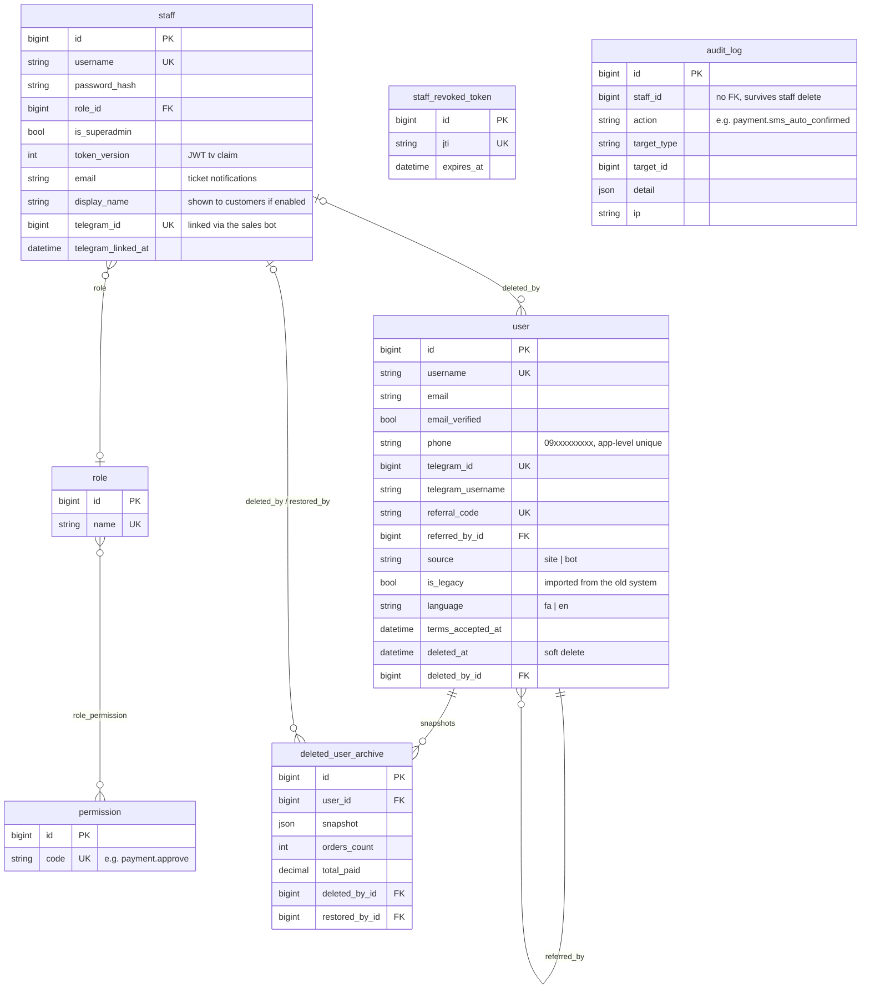
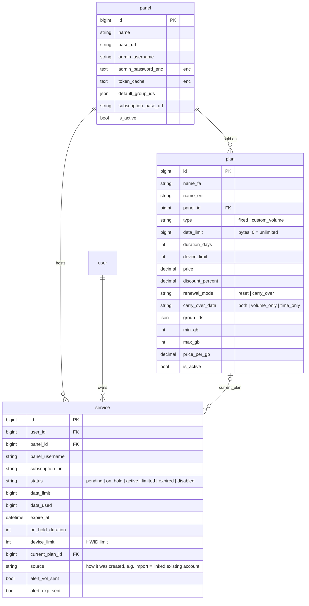
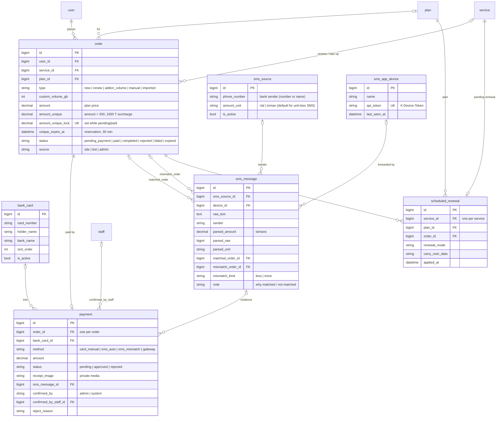
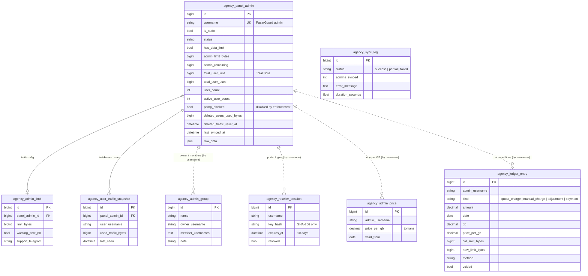
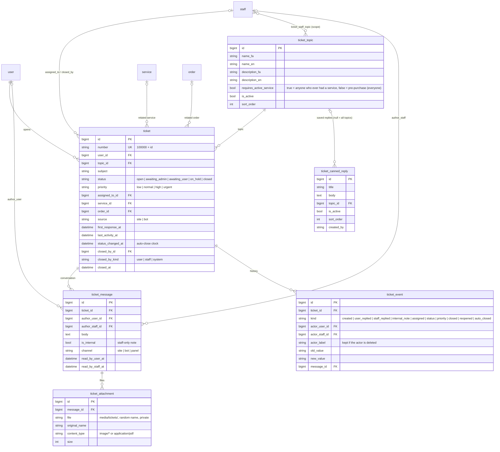
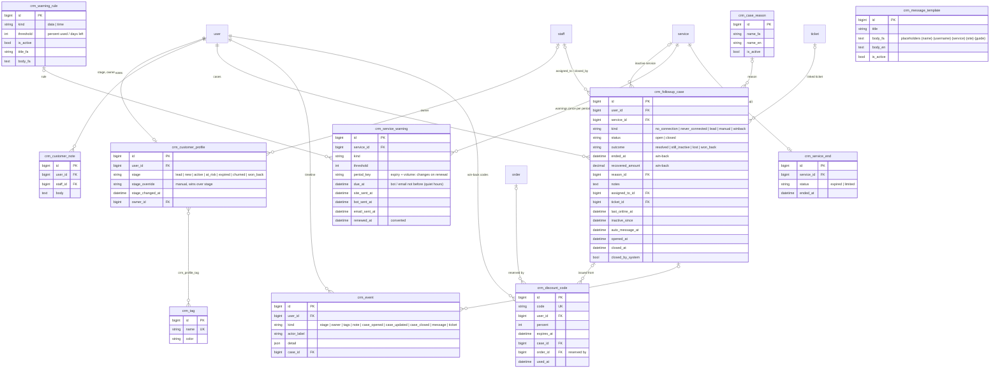
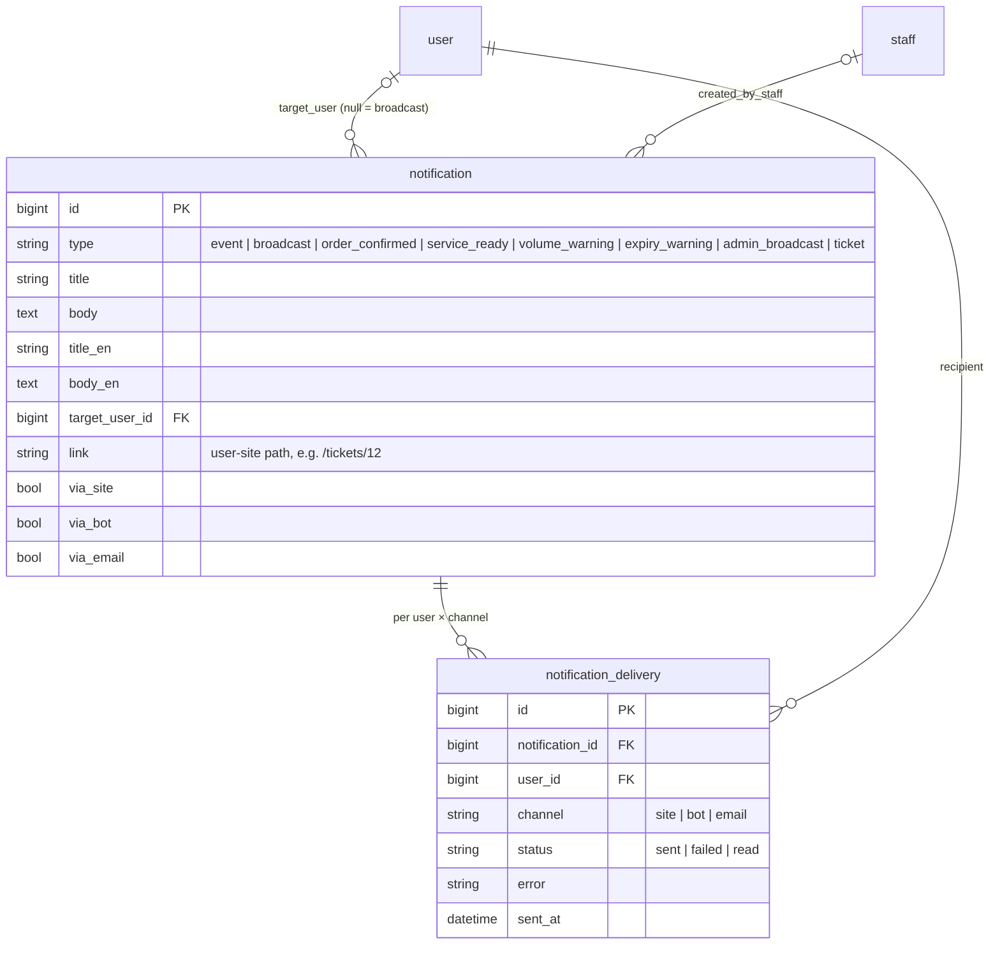

# Data model (ERD)

Every table of the application, grouped by area, as Mermaid ER diagrams (rendered
on GitHub and in the admin Documentation page). Diagrams
list the key columns only; the models in `backend/apps/*/models.py` are the
source of truth. Table names are the real MySQL names.

Conventions: every domain table has `id` (bigint PK); `created_at` / `updated_at`
where noted (`TimeStampedModel`). Money is `DECIMAL` in **tomans**; volumes are
**bytes** (`BIGINT`; 1 GB = 1024³). Times are stored in UTC and shown in Jalali.
Fields marked *enc* are Fernet-encrypted (`FIELD_ENCRYPTION_KEY`).

Related: [architecture.md](architecture.md) · [flows.md](flows.md).

## 1. Users, auth and RBAC (`accounts`, `common`)

| Table | Description |
|---|---|
| `user` | Customer account (site, bot or legacy import). Soft-deleted only; excluded from lists, stats and renewals once `deleted_at` is set. |
| `staff` | Admin-panel operator — a separate model from `user`, with its own JWT; `token_version` ends all sessions when bumped. Optional `email` and linked `telegram_id` receive ticket notifications. |
| `role` / `permission` / `role_permission` | RBAC: roles bundle permission codes (`users.view`, `payment.approve`, `agency.view`, `agency.accounting`, `settings.email`, …). Super-admins bypass checks. |
| `staff_revoked_token` | Spent / revoked staff refresh tokens (by `jti`) until they expire. |
| `deleted_user_archive` | Full snapshot of a user taken right before a soft delete; restore writes `restored_at/_by`. |
| `audit_log` | Immutable record of staff and system actions (`write_audit`). `staff_id` is a plain column, not an FK. |

## 2. Plans and services (`plans`, `panel`)

| Table | Description |
|---|---|
| `panel` | A PasarGuard panel we provision on (multi-panel); credentials and the cached API token encrypted. |
| `plan` | A sales plan: fixed (volume + days) or custom-volume (GB range × price per GB); panel groups; renewal behaviour copied into each scheduled renewal. |
| `service` | One VPN account = one username on a panel; mirrors the panel after every operation; synced periodically (usage, expiry, online). Alert flags stop repeated warnings. |

## 3. Orders, payments and SMS (`orders`, `payments_sms`)

| Table | Description |
|---|---|
| `order` | Purchase intent. `amount_unique` = price + a random surcharge, reserved via the unique `amount_unique_lock` while pending/paid (never a value the same user had in the last 24 h). Expires after `unique_amount_reservation_minutes`. |
| `payment` | One per order: receipt (card-to-card), SMS auto-confirm, or SMS near-miss under review. Approved / rejected only through `approve_payment` / `reject_payment`. |
| `bank_card` | Receiving cards shown at checkout; per-card deposit report in Accounting. |
| `sms_source` | Allow-list of bank senders and the default amount unit for unit-less SMS. |
| `sms_app_device` | Operator phones (Android app / iPhone Shortcut) allowed to forward bank SMS. |
| `sms_message` | Every forwarded SMS with the parsed amount, the matched order or the near-miss order (`less` / `more`), and a human-readable note (admin SMS log). |
| `scheduled_renewal` | A paid renewal waiting for the service to reach the end of its cycle; applied once (`applied_at`). |

## 4. Agency panel (`agency`)

PAMP v1.5.3 tables (verbatim columns, renamed to `agency_*`) plus the
caspintunel additions: reseller sessions, prices and the ledger. Resellers are
**not** `user` rows — they are linked by the panel `username`.

| Table | Description |
|---|---|
| `agency_panel_admin` | One PasarGuard admin (reseller) with the PAMP counters refreshed by every sync: limit, used, sold, remaining, user counts, deleted-users traffic, blocked flag. |
| `agency_admin_limit` | Per-admin limit settings and the 80 % warning flag (PAMP). |
| `agency_user_traffic_snapshot` | Last-known `used_traffic` per user of each admin — a user missing on the next sync counts as deleted and their traffic is kept in `deleted_users_used_bytes`. |
| `agency_sync_log` | One row per sync run (Sync logs page). |
| `agency_admin_group` | Several admin accounts under one owner (combined numbers, portal group view). |
| `agency_reseller_session` | Reseller-portal logins (password checked against the panel); hashed token, revocable. |
| `agency_admin_price` | Price per GB for an admin from a date on. |
| `agency_ledger_entry` | The reseller's account: automatic quota charges on limit increases, manual charges, signed adjustments, payments; voidable, never deleted. Balance = charges − payments. |

## 5. Tickets (`tickets`)

| Table | Description |
|---|---|
| `ticket_topic` | Ticket categories, editable in the panel. Seeded once (migration): Pre-purchase questions (open to everyone), Payment problem, Connection problem, Renewal & upgrade, Other (customers = anyone who ever had a service). |
| `ticket_canned_reply` | Saved replies for the staff composer, per topic or for all topics. |
| `ticket_staff_topic` | Staff topic scopes: a staff member with rows here sees only those topics; none = all. |
| `ticket` | One support conversation of a customer, with status, priority, owner (assignee), optional related service / order, first-response and activity times, and who closed it. |
| `ticket_message` | A message from the customer or staff (or a staff-only internal note), with per-side read times. |
| `ticket_attachment` | Validated image / PDF files of a message; served only through the API. |
| `ticket_event` | Full history: every reply, assignment, status / priority change, close and reopen with the actor and old → new value. |

## 6. CRM (`crm`)

| Table | Description |
|---|---|
| `crm_customer_profile` | CRM data per customer: computed lifecycle stage (+ manual override), owner, tags. |
| `crm_tag` / `crm_profile_tag` | Free tags (name + colour) on customers. |
| `crm_customer_note` | Internal staff notes about a customer. |
| `crm_followup_case` | A "needs follow-up" case: detected inactivity (no connection / never connected), lead or manual; reason, notes, assignee, outcome, linked ticket. |
| `crm_case_reason` | Configurable inactivity reasons (seeded: app not installed, config / setup, filtering / ISP, device, no need now, price, other). |
| `crm_message_template` | Editable follow-up messages (seeded: help connecting). |
| `crm_event` | Timeline of stage changes and staff actions (merged with orders, payments, tickets and notifications on the 360 page). |
| `crm_warning_rule` | Pre-expiry warning thresholds (data % / days left) with their fa / en messages. |
| `crm_service_warning` | One warning per service, threshold and period, with per-channel send times (quiet hours) and conversion. |
| `crm_service_end` | When a service was first seen expired / used up (drives the win-back grace period). |
| `crm_discount_code` | Single-use win-back discount codes: percent, expiry, the reserving order and when it was used. |

Analytics (Phase 5, `crm/analytics.py`) adds no tables — it reads payments, orders, services, CRM and ticket tables.

`crm_case_reason` and `crm_message_template` have a `category` (inactivity / winback); `order.discount_amount` holds the discount taken off `amount`.

## 7. Notifications (`notifications`)

| Table | Description |
|---|---|
| `notification` | A message to one user (event) or everyone (broadcast), with the channels to use and an optional `link` the bell opens (ticket replies → the chat). |
| `notification_delivery` | One delivery attempt per recipient and channel; a failing channel never blocks the others. |

## 8. Settings, CMS, Telegram and ops (`settings_app`, `telegram`, `ops`)

```mermaid
erDiagram
    panel |o--o{ health_check : "panel target"

    setting {
        bigint id PK
        string key UK
        text value
        string value_type "str | int | bool | json"
    }
    site_config {
        bigint id PK "single row"
        string site_name_fa
        string site_name_en
        string site_domain
        string logo
        string support_telegram
        string qr_background
    }
    theme {
        bigint id PK
        string name
        json palette
        bool is_active
    }
    page {
        bigint id PK
        string slug UK "rules | tutorial | faq"
        string title_fa
        text body_fa
        bool is_active
    }
    app_release {
        bigint id PK
        string platform "android | ios"
        string file
        string version
    }
    email_settings {
        bigint id PK "single row"
        bool enabled
        string host
        int port
        text password "enc"
        datetime last_success_at
        text last_error
    }
    telegram_config {
        bigint id PK
        string bot_type "sales | backup"
        text token "enc"
        string proxy_url
        bigint backup_chat_id
    }
    required_channel {
        bigint id PK
        string channel_id
        string invite_link
        int member_count
        bool bot_is_admin
    }
    telegram_stats {
        bigint id PK
        int bot_member_count
        int overlap_bot_channels
    }
    health_check {
        bigint id PK
        string target "site | mysql | redis | celery_worker | celery_beat | bot_sales | bot_backup | panel | mail"
        bigint panel_id FK
        bool is_up
        int latency_ms
    }
    resource_stat {
        bigint id PK
        float cpu_percent
        float ram_percent
        float disk_percent
        bigint net_in
        bigint net_out
    }
    backup_log {
        bigint id PK
        string filename
        bigint size
        string status "ok | failed"
        bool sent_to_telegram
        datetime local_deleted_at
    }
    cleanup_run {
        bigint id PK
        bigint freed_bytes
        json deleted
        json warnings
        bool alerted
    }
```

| Table | Description |
|---|---|
| `setting` | Typed key/value runtime settings (intervals, unique-amount range, alert thresholds, agency switches, retention, ticket limits, CRM thresholds, …) edited in the panel. |
| `site_config` | Branding singleton: names, domain, logo / favicon, bot texts, support contacts, QR background. |
| `theme` | Colour themes; exactly one active. |
| `page` | CMS pages (rules, tutorial, FAQ) in fa/en. |
| `app_release` | Operator tools served from this server (Android SMS app, iPhone Shortcut). |
| `email_settings` | Outgoing-mail relay (single row), with the last success / error. |
| `telegram_config` | The two bots (sales, backup): encrypted token, proxy, backup chat. |
| `required_channel` | Forced-join channels of the sales bot with member counts. |
| `telegram_stats` | Periodic bot / channel member snapshot. |
| `health_check` / `resource_stat` | Monitoring samples (targets incl. each panel; CPU / RAM / disk / network). |
| `backup_log` / `cleanup_run` | Every DB backup (and whether Telegram got it) and every retention run. |

Framework tables (`django_celery_beat_*` periodic tasks, `django_session`,
`django_migrations`, `auth_*`, `django_content_type`, `django_admin_log`) are
not listed.
