# Flows

Sequence diagrams of the main business and operations flows, as implemented.
Mermaid (rendered on GitHub and in the admin Documentation page). Function names point at the code.

Related: [architecture.md](architecture.md) · [erd.md](erd.md).

## 1. Purchase + card-to-card payment

A customer buys on the site, in the Mini App or in the sales bot — all three
call the same order API. The invoice amount is unique, so the bank SMS can
identify the order.

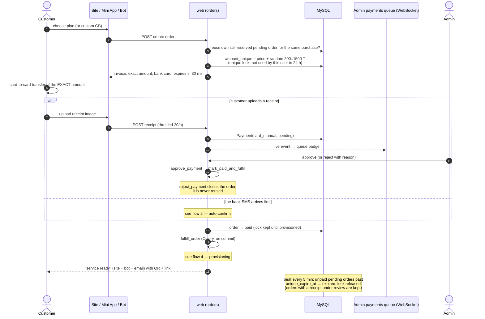

## 2. SMS auto-confirm (exact match / near-miss review)

An operator phone (Android SMS Bridge or iPhone Shortcut) forwards each bank
SMS. Rules: one explicit unit, converted to tomans once, **exact** match only —
never a tolerance, never a ×10 / ÷10 retry (incident 2026-10-15).

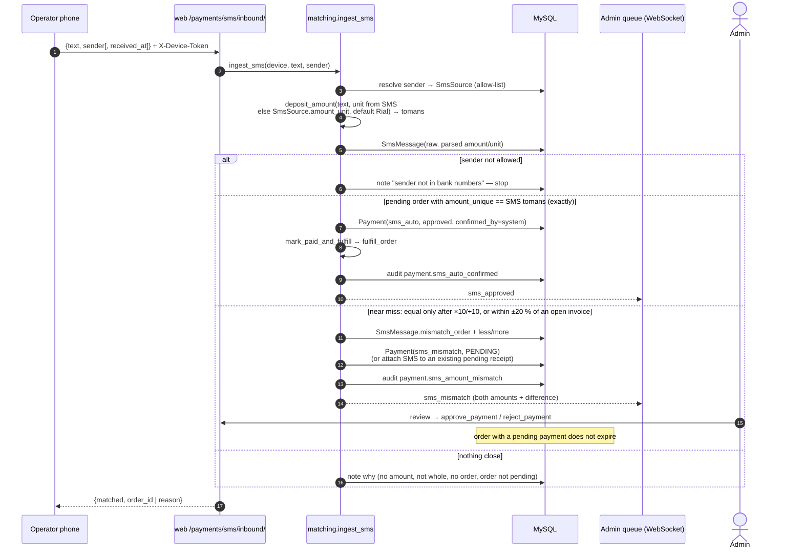

Matching happens at `received_at` — when the phone got the SMS. An order counts
as open for an SMS if it is still pending, or it expired since but was still open
when the SMS arrived (deadline and close time after it); an order created after
the SMS arrived never matches (5 min clock skew allowed). The iPhone Shortcut
(v1.1+) saves every SMS to a queue file on the phone **before** any network call
and uploads the whole queue to `/payments/sms/inbound-batch/`, which is
idempotent — see [sms-batch.md](sms-batch.md).

## 3. Renewal

A renewal is paid like a purchase (flows 1–2) with `type=renew` on an existing
service, but it is **not applied immediately**: it waits for the end of the
current cycle so the customer loses nothing. It always runs on the **same PasarGuard
username and subscription link** — never an account-name step, never a new account.

Which plan (`orders.services.renewal_plans` = active, fixed-volume, same panel;
`renewable_plan` = the service's own plan if it is one of them):
- own plan → one tap (site: summary dialog → checkout; bot `s:<id>:rn` → «✅ تمدید با همین پلن»);
- «تغییر پلن / ارتقا» (site `checkout?renew=<id>&pick=1`, bot `s:<id>:rnp`) → any renewal plan;
- no usable plan (e.g. linked manually by staff) → the plan list straight away with a short note.
`GET /services/<id>/renew-info/` returns `plan`, `plans`, `needs_plan`. Custom-volume plans are
refused for renewals (the renewal applies the plan's fixed volume). Discount codes apply as usual.
After payment `schedule_renewal` makes the paid plan the service's plan (audit
`service.plan_changed`, via `renewal`). Staff can set / change / clear a service's plan on
Admin → Services → edit (or when linking an account); filter «بدون پلن» lists services without one.

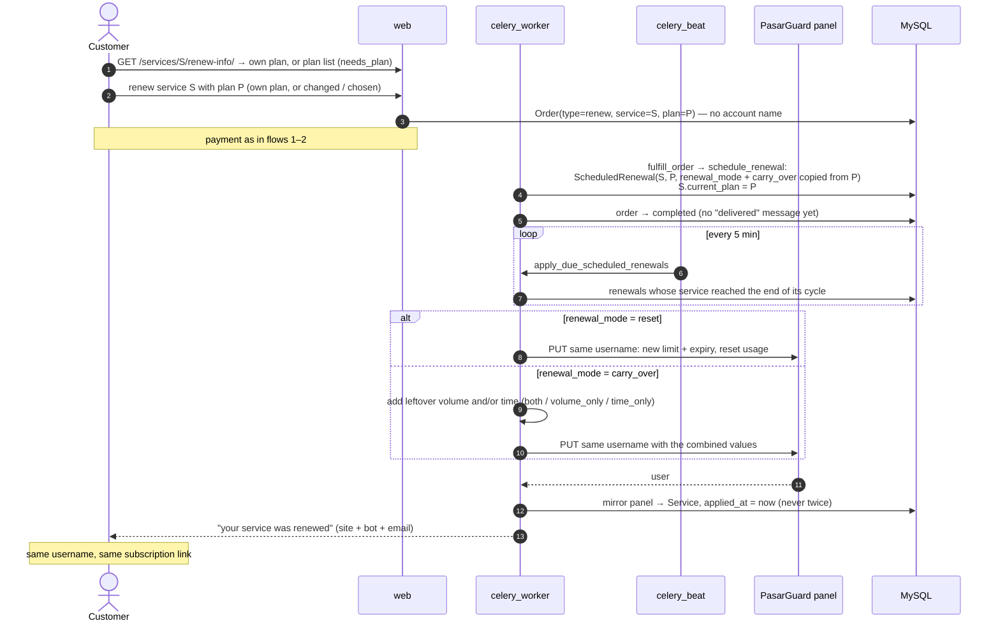

## 4. Service provisioning

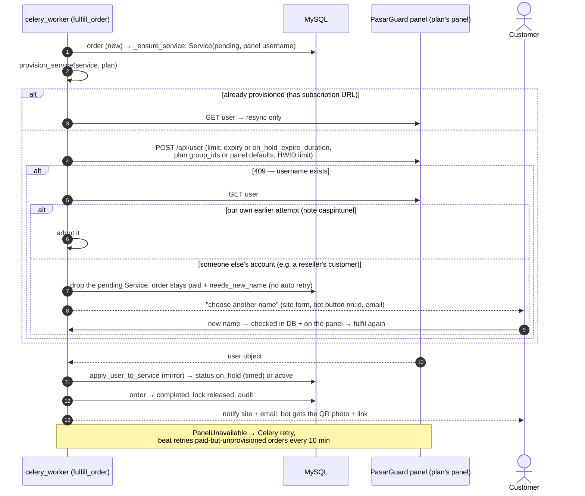

Account names are checked **in our DB and on the panel** when the order is placed
(`orders.services.check_account_name`, site + bot ask for another name; an unreachable
panel does not block the sale — the 409 guard above still never attaches). Staff manual
creation refuses a name that exists on the panel and offers **Link existing account**; linking
an account owned by another panel admin needs `confirm_other_admin` (a checkbox in the modal).

Add-on volume orders call `add_service_data_limit` instead (panel first, then
mirror).

**Service sync (v1.28).** Every `service_sync_interval_minutes` (Settings; currently every minute) the beat runs
`sync_all_services`: **every** service with a panel account — whatever its status, expired /
limited / disabled included — is read from PasarGuard (status, expiry, volume, usage, on-hold,
online / last seen) and mirrored. A renewal, usage reset, top-up or re-enable done directly on
PasarGuard is detected (`service.changed_on_panel` audit) and re-arms the volume / expiry
reminders. One run at a time (cache lock). Staff **Sync** (`services/sync-now/`) runs it in the
request and answers `{checked, updated, errors, skipped, rows}` (40 s budget, the rest continues
in the background); each row has its own sync (`services/{id}/sync/`). The customer's services
page re-reads ended services (≤ once a minute) and on-hold ones (15 s). Changing the subscription
link signature / `online_at` alone is not counted as an update.

Before 1.28 the beat skipped expired services, so a service renewed directly on PasarGuard after
it expired stayed "expired" here forever (incident 2026-10-28, `hadis_sadeghi`).

**Reminders never use stale numbers.** A warning (80 % / 95 %, 3 / 1 days) is only created after
the service was re-read from PasarGuard (or synced < 2 min ago); if the panel can't be asked no
warning goes out. A queued bot / email warning is dropped when the service was renewed / reset
before delivery. Win-back only marks services synced in the last 30 minutes.

## 5. Agency sync + enforcement + ledger charge

```mermaid
sequenceDiagram
    autonumber
    participant B as celery_beat
    participant W as celery_worker
    participant PG as PasarGuard panel
    participant DB as MySQL
    actor A as Admin (agency.manage)
    actor R as Reseller (portal)

    B->>W: sync_panel_admins (every agency_sync_interval_minutes)
    alt agency_sync_enabled is off
        W-->>B: "disabled" — nothing done
    else
        W->>PG: GET admins + each admin's users
        alt panel call failed
            W->>DB: SyncLog(failed) — stop, nothing changed
        else
            W->>DB: update PanelAdmin counters
            W->>DB: deleted-user tracking via UserTrafficSnapshot<br/>(skipped on a truncated list)
            W->>DB: remove admins gone from the panel (never on an empty list)
            opt agency_enforcement_enabled
                W->>PG: used ≥ limit → disable admin (pamp_blocked)<br/>used < limit and blocked → enable admin
            end
            W->>DB: SyncLog(success | partial)
        end
    end

    A->>W: Limits & actions → preview (set / add / reduce, GB)
    W-->>A: old → new limit, remaining, charge = ΔGB × price per GB on that date
    A->>W: confirm set-limit
    W->>PG: set admin data_limit
    W->>DB: PanelAdmin limit + remaining
    W->>DB: increase only → LedgerEntry(quota_charge, gb, price_per_gb, old/new)
    W-->>A: "Limit set to 5,200 GB (5.08 TB)"
    A->>DB: record payment / manual charge / adjustment / void
    R->>W: portal: usage, limit, statement + balance
```

## 5b. Create a PasarGuard admin from the Agency panel

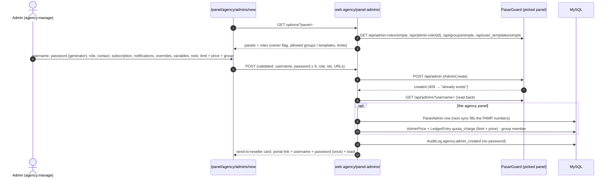

Edit (`PATCH`, only changed fields, password reset shown once) and delete
(`DELETE`, typed username; local row + group membership removed, ledger kept)
follow the same panel-first rule.

## 5c. Group manager gives volume → staff approve / reject

```mermaid
sequenceDiagram
    autonumber
    actor M as Group manager
    participant MP as /panel/ (group-manager menu)
    participant API as web agency/manager/
    participant PG as PasarGuard
    participant DB as MySQL
    actor S as Staff (agency.manage + agency.accounting)
    participant AP as /panel/agency/approvals

    M->>MP: sign in at /panel/login (staff JWT, role "Group manager")
    Note over MP,API: every other /api/v1/admin/ endpoint → 403 for this staff (StaffPermission default-deny)
    M->>MP: + volume (GB) on an admin of their group
    MP->>API: POST admins/{u}/add-volume/ {gb}
    API->>API: own group? not sudo? GB > 0? cap (pending + GB ≤ max)?
    alt forbidden / cap reached
        API-->>MP: 403 / 409 cap_reached — nothing changed
    end
    API->>PG: GET /api/admins?username= (live limit; unlimited → 403)
    API->>PG: PUT /api/admin/{u} data_limit = live + GB
    API->>DB: PanelAdmin limit · VolumeRequest(pending) · AdminLimitChange(add, source manager)
    API->>DB: AuditLog agency.manager.volume_added (manager, group)
    API-->>MP: live at once — "pending approval"
    AP->>API: GET approvals/badge/ (every 30 s → menu badge + toast)
    S->>AP: Approve (price × GB shown; price asked if the admin has none)
    AP->>API: POST approvals/{id}/approve/
    API->>DB: LedgerEntry quota_charge (old → new, price of that day) · link to the limit-history row
    API->>DB: AuditLog agency.approval.approved
    S->>AP: or Reject (confirm)
    AP->>API: POST approvals/{id}/reject/ {confirm: true}
    API->>PG: PUT data_limit = live − GB (never 0 = unlimited)
    API->>DB: AdminLimitChange(reduce) · request rejected · no charge
```

A new admin made by a manager (`POST admins/`) follows the same path: created on
PasarGuard with an allowed role and the initial GB, added to the group, request `create`.

## 6. Bot and Mini App login

```mermaid
sequenceDiagram
    autonumber
    actor U as Telegram user
    participant T as Telegram
    participant Bot as bot_sales
    participant API as web
    participant DB as MySQL

    U->>T: /start (or any message)
    T->>Bot: update (long polling)
    alt force_share_phone on and no account with this telegram_id
        Bot-->>U: welcome + "share phone" button (no account created)
        U->>Bot: shares contact
        Bot->>Bot: contact.user_id == sender? else refuse
        Bot->>DB: handle_contact — normalize phone, find account by phone
        alt account with that phone, no Telegram
            DB-->>Bot: link telegram_id to it (username + password kept), audit user.linked_telegram
        else account linked to another Telegram id
            Bot-->>U: refused, contact support
            Bot->>T: DM staff (users.manage) / backup chat, audit user.telegram_link_conflict
        else no account
            DB-->>Bot: new User(source=bot) — random username + password sent once
        end
    else gate off / account exists
        Bot->>DB: ensure_bot_user(telegram_id)
    end
    Bot->>T: getChatMember for each required channel
    alt missing channel
        Bot-->>U: join channels (asked again on any message)
    end
    Bot-->>U: main menu (screen edited in place)

    U->>T: opens the Mini App
    T->>API: SPA loads, POST /auth/telegram/miniapp/ {initData}
    API->>API: HMAC check with the sales-bot token, auth_date ≤ max age
    API->>DB: phone gate on and no account → 403 phone_required (nothing created);<br/>the SPA asks Telegram for the contact → bot handle_contact → retry
    API->>DB: ensure_bot_user(telegram_id) — existing account
    API-->>T: JWT pair — the SPA never shows a login form inside Telegram
```

## 7. Ticket lifecycle and notifications

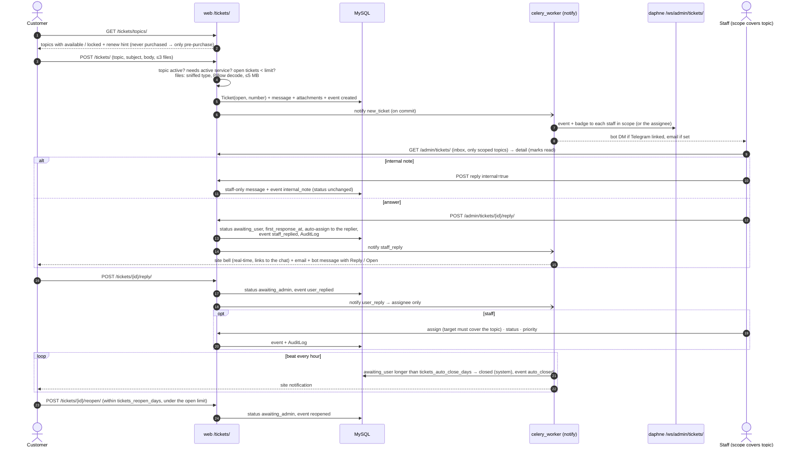

## 8. Tickets in the bot

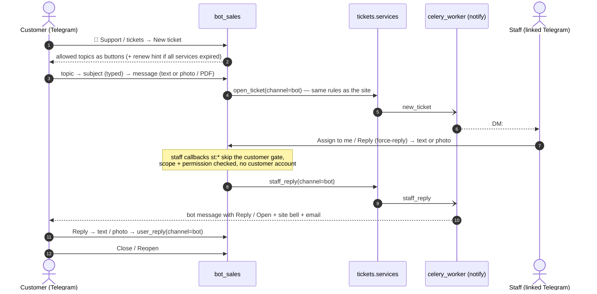

## 9. Staff Telegram linking

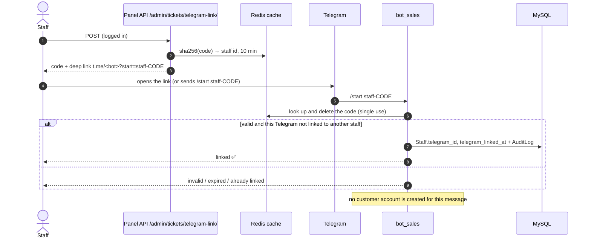

## 10. CRM inactivity follow-up

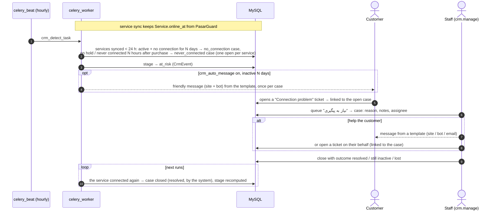

## 11. Pre-expiry warning and win-back

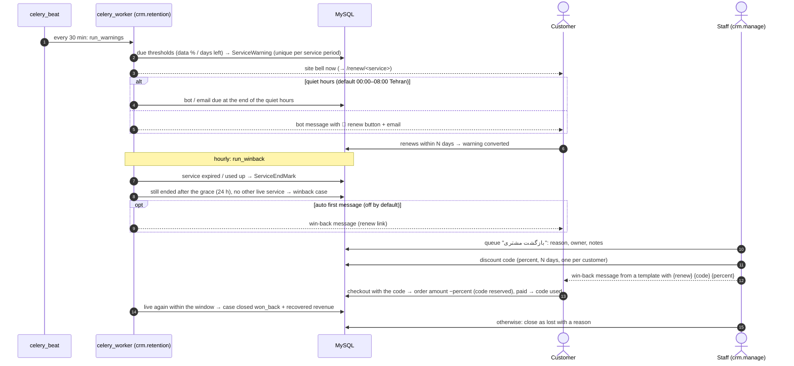

## 12. Analytics (read-only)

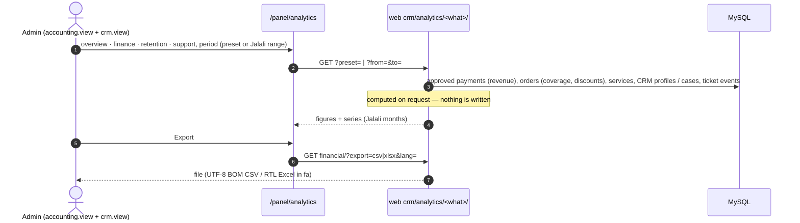

## 13. Domain change (Settings → Domain & Cloudflare)

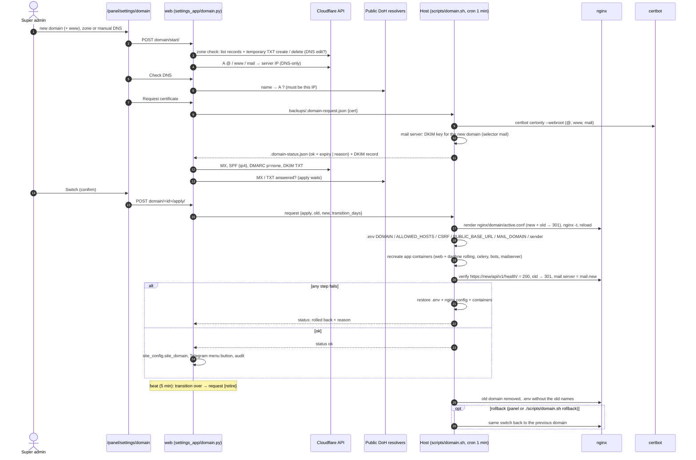

## 13b. Access mode switch (Direct / Cloudflare proxy / Iran tunnel)

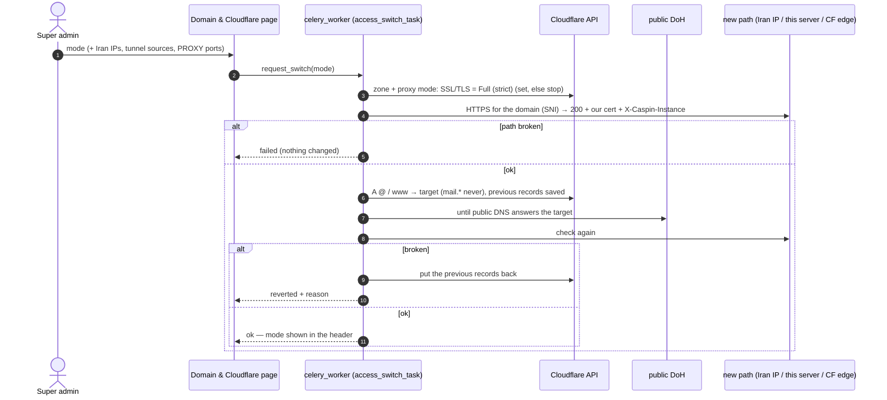

## 14. Deploy (`./update.sh`)

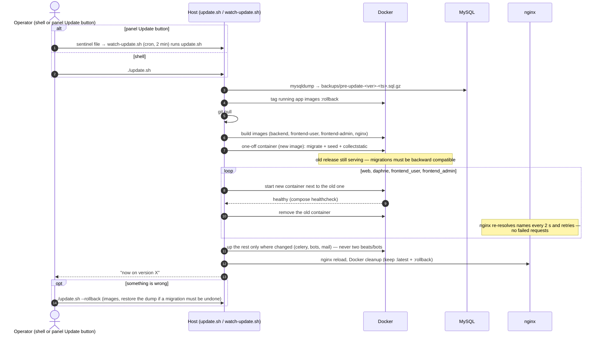

Release routine (development side): tests on the isolated stack
(`./scripts/test.sh`), bump `VERSION`, PROGRESS entry, commit, tag `vX.Y.Z`,
push, `./update.sh`, GitHub release ([development.md](development.md)).


## 5d. Super Admin deletes (voids) a transaction → restore

```mermaid
sequenceDiagram
    autonumber
    actor SA as Super Admin
    participant TX as /panel/transactions
    participant API as web admin/transactions/
    participant PG as PasarGuard
    participant DB as MySQL

    SA->>TX: Delete (row or bulk)
    TX->>API: GET {id}/delete-preview/
    API-->>TX: TX number, amount, linked order + service, choices keep | disable | delete
    SA->>TX: reason (required) + choice (default keep)
    TX->>API: POST {id}/delete/ {reason, service_action}
    API->>API: Super Admin? (else 403) · reason? · not already deleted?
    API->>API: service_action required (missing / unknown → 400)
    API->>DB: BEGIN · lock payment + order
    opt disable / delete
        API->>PG: PUT user status=disabled  /  DELETE user
        API->>PG: GET user (disabled? / 404?) — verify
        alt refused / error / not verified
            API->>DB: ROLLBACK · AuditLog payment.void_failed (+ PasarGuard calls)
            API-->>TX: 502 "PasarGuard: … — nothing was deleted"
        end
        API->>DB: service row disabled / deleted
    end
    API->>DB: order → cancelled (choice, or the payment was still pending) · drop unapplied renewal
    API->>DB: payment.voided_at / voided_by / void_reason / void_service_action
    API->>DB: AuditLog payment.voided (who, reason, amount, TX, order, choice)
    API-->>TX: row hidden; cards, Accounting, Analytics, reports no longer count it
    SA->>TX: Show deleted → Restore (≤ 30 days)
    TX->>API: POST {id}/restore/
    API->>DB: clear voided_*; order status back (lapsed pending → expired)
    API->>DB: AuditLog payment.restored
```

## 5e. Staff page → Group manager role (v1.25.2)

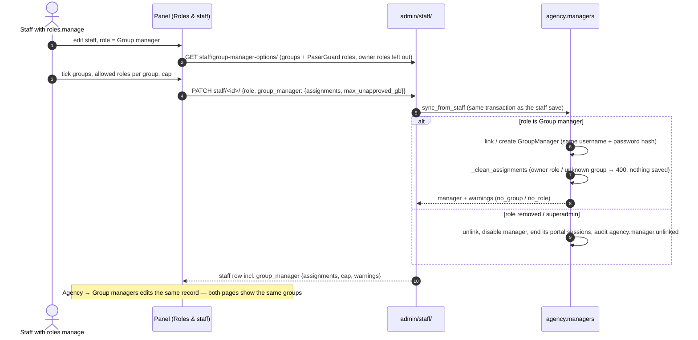

## 15. Disk full protection (v1.25.2)

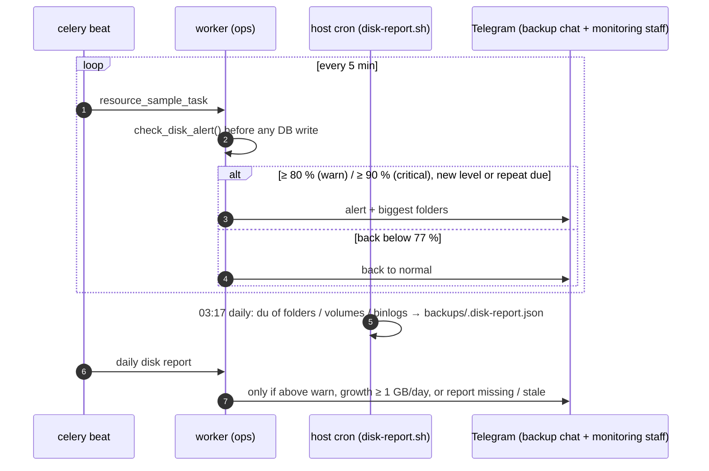

## 16. Discount code at checkout (v1.26)

```mermaid
sequenceDiagram
    autonumber
    actor C as Customer (site / Mini App / bot)
    participant API as orders API / bot
    participant E as crm.discounts.evaluate
    participant O as orders.create_order
    participant M as SMS matcher / card review
    C->>API: plan (+ volume / service) + code
    API->>E: quote (POST /orders/quote/ or the bot's code step)
    alt refused
        E-->>C: reason in Persian / English (expired, not for this plan, not for you, used up, …)
    else ok
        E-->>C: original · discount · final
        C->>API: confirm
        API->>O: create_order(discount_code)
        O->>E: evaluate again (limits are checked at this moment)
        O->>O: amount = original − discount; amount_unique = amount + surcharge (unique)
        O-->>C: invoice: pay amount_unique (shows original, code, discount)
        C->>M: card-to-card / SMS for amount_unique
        M->>O: matches amount_unique → paid (the code's use is now counted as used)
    end
```

