# Flows

Sequence diagrams of the main business and operations flows, as implemented.
Mermaid (rendered on GitHub and in the admin Documentation page). Function names point at the code.

Related: [architecture.md](architecture.md) · [erd.md](erd.md).

## 1. Purchase + card-to-card payment

A customer buys on the site, in the Mini App or in the sales bot — all three
call the same order API. The invoice amount is unique, so the bank SMS can
identify the order.

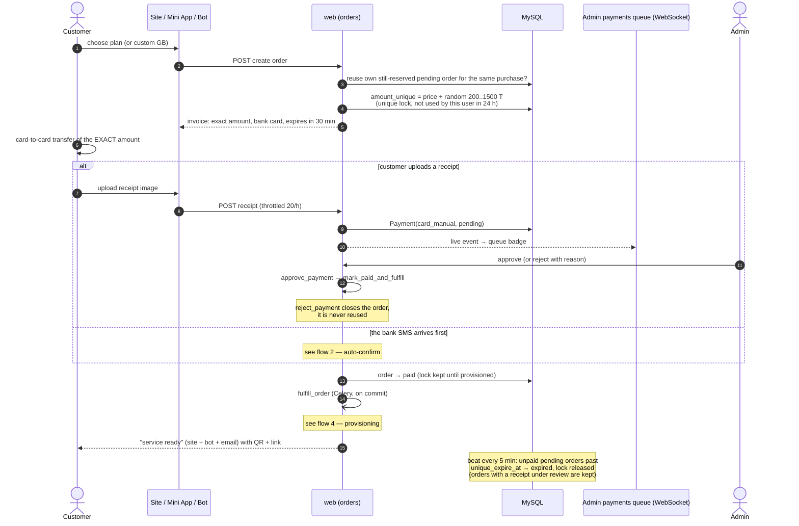

## 2. SMS auto-confirm (exact match / near-miss review)

An operator phone (Android SMS Bridge or iPhone Shortcut) forwards each bank
SMS. Rules: one explicit unit, converted to tomans once, **exact** match only —
never a tolerance, never a ×10 / ÷10 retry (incident 2026-10-15).

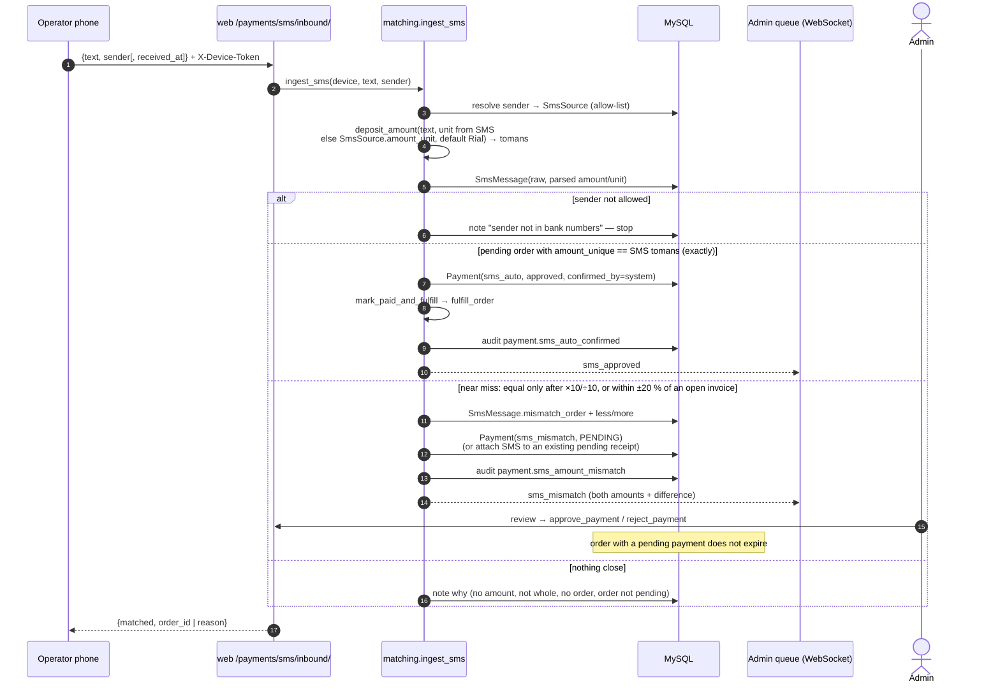

## 3. Renewal

A renewal is paid like a purchase (flows 1–2) with `type=renew` on an existing
service, but it is **not applied immediately**: it waits for the end of the
current cycle so the customer loses nothing.

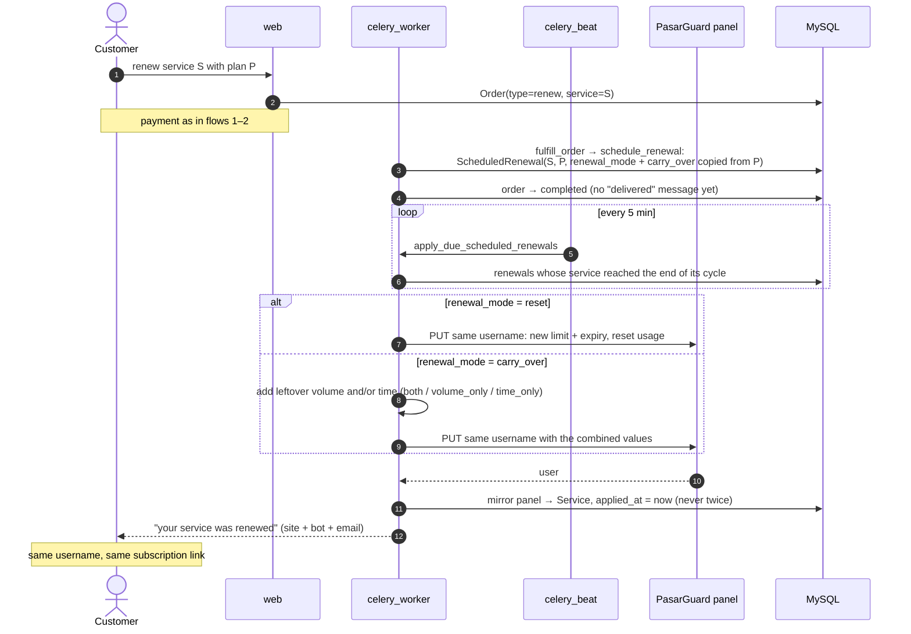

## 4. Service provisioning

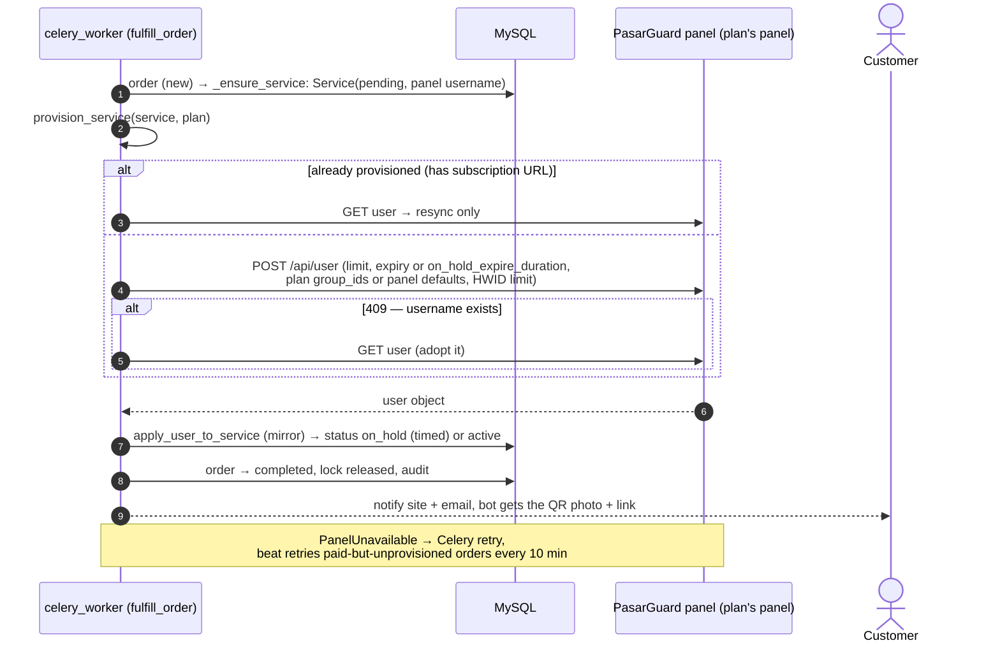

Add-on volume orders call `add_service_data_limit` instead (panel first, then
mirror). Every `service_sync_interval_minutes` beat dispatches
`sync_service_task` per live service to refresh usage, expiry and online state.

## 5. Agency sync + enforcement + ledger charge

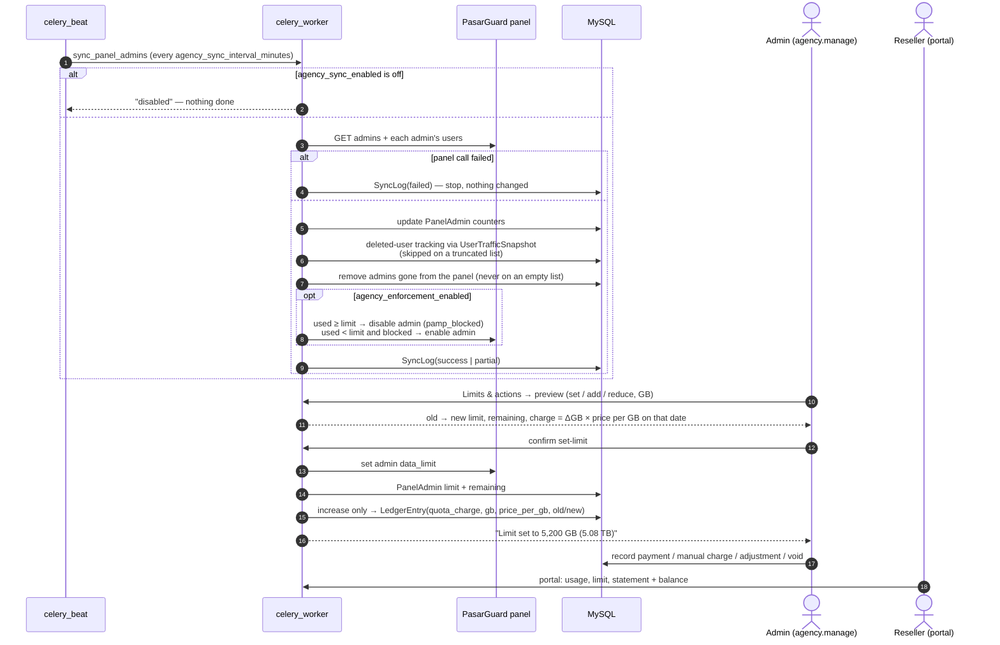

## 5b. Create a PasarGuard admin from the Agency panel

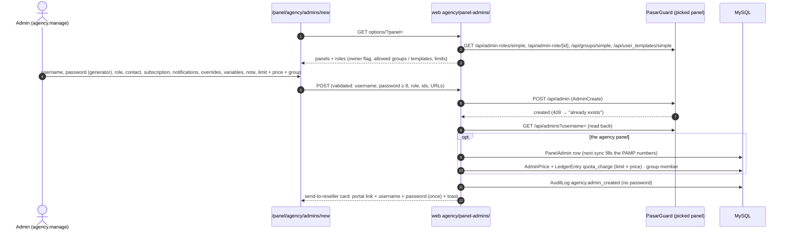

Edit (`PATCH`, only changed fields, password reset shown once) and delete
(`DELETE`, typed username; local row + group membership removed, ledger kept)
follow the same panel-first rule.

## 6. Bot and Mini App login

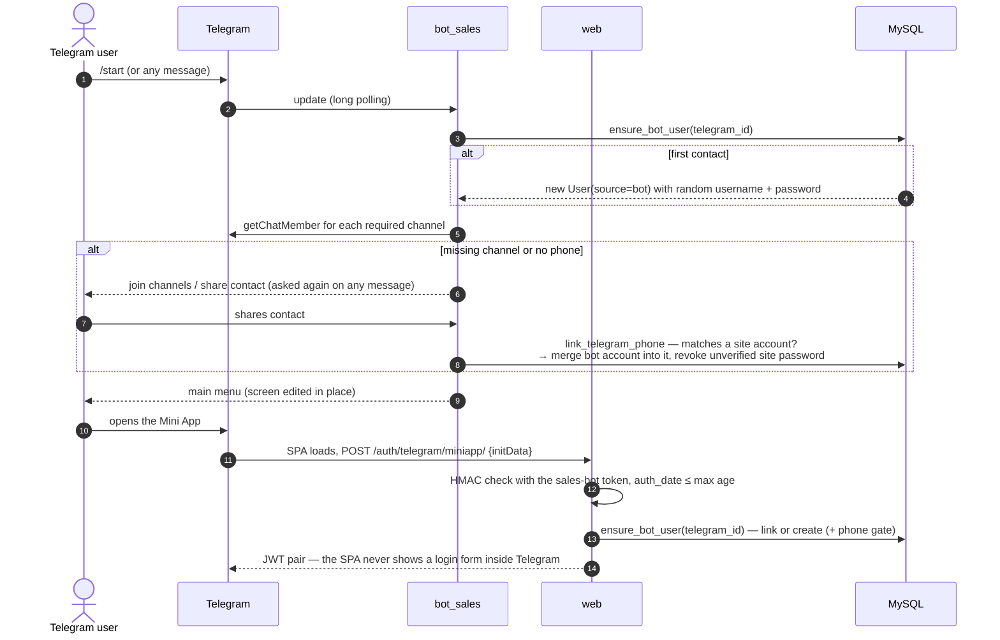

## 7. Ticket lifecycle and notifications

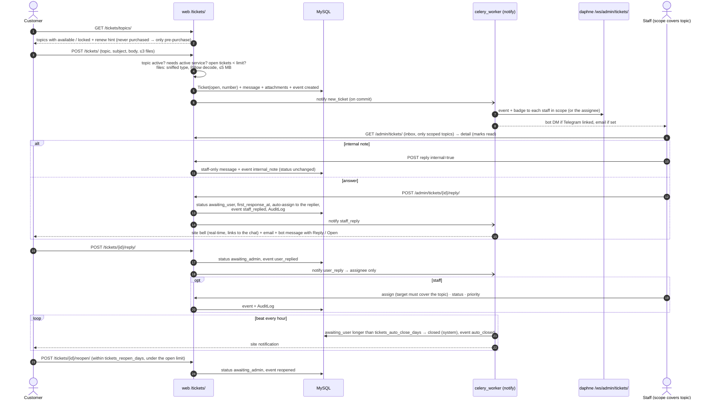

## 8. Tickets in the bot

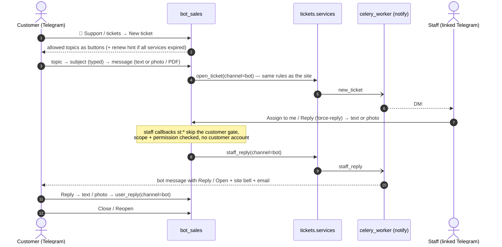

## 9. Staff Telegram linking

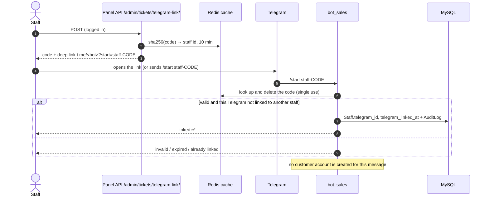

## 10. CRM inactivity follow-up

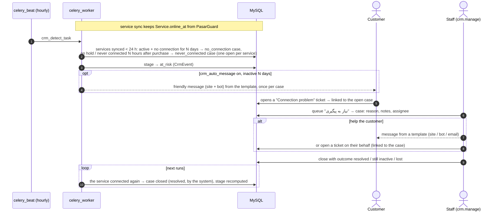

## 11. Deploy (`./update.sh`)

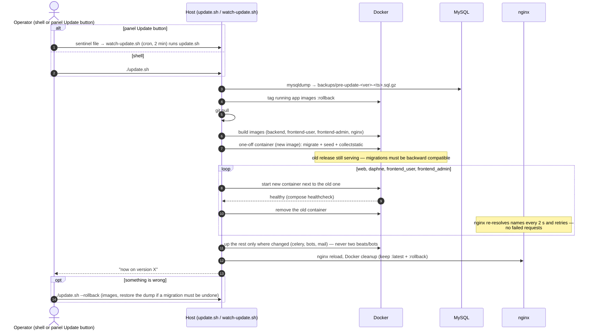

Release routine (development side): tests on the isolated stack
(`./scripts/test.sh`), bump `VERSION`, PROGRESS entry, commit, tag `vX.Y.Z`,
push, `./update.sh`, GitHub release ([development.md](development.md)).
