# Flows

Sequence diagrams of the main business and operations flows, as implemented.
Mermaid (rendered on GitHub and in the admin Documentation page). Function names point at the code.

Related: [architecture.md](architecture.md) · [erd.md](erd.md).

## 1. Purchase + card-to-card payment

A customer buys on the site, in the Mini App or in the sales bot — all three
call the same order API. The invoice amount is unique, so the bank SMS can
identify the order.

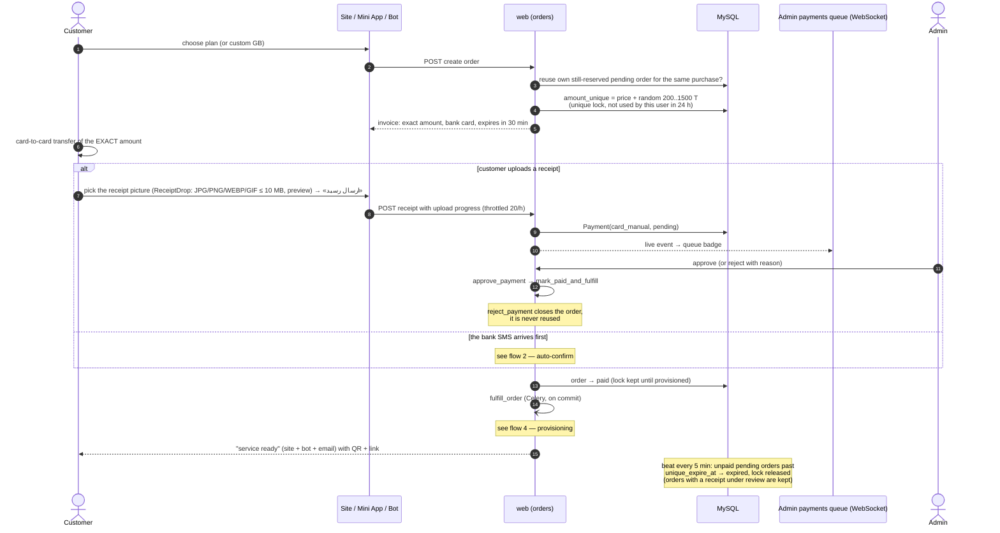

## 2. SMS auto-confirm (exact match / near-miss review)

An operator phone (Android SMS Bridge or iPhone Shortcut) forwards each bank
SMS. Rules: one explicit unit, converted to tomans once, **exact** match only —
never a tolerance, never a ×10 / ÷10 retry (incident 2026-10-15).

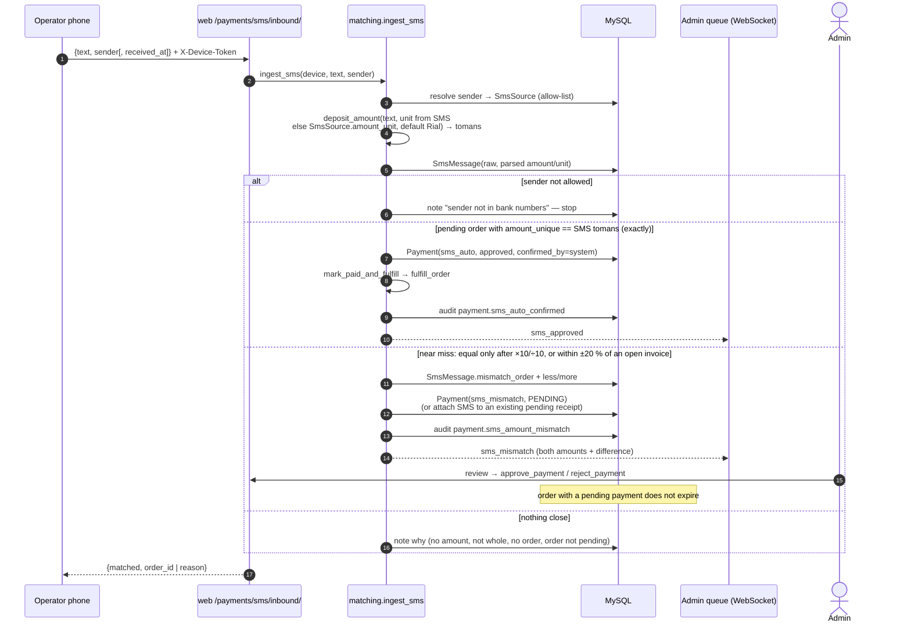

Matching happens at `received_at` — when the phone got the SMS. An order counts
as open for an SMS if it is still pending, or it expired since but was still open
when the SMS arrived (deadline and close time after it); an order created after
the SMS arrived never matches (5 min clock skew allowed). The iPhone Shortcut
(v1.1+) saves every SMS to a queue file on the phone **before** any network call
and uploads the whole queue to `/payments/sms/inbound-batch/`, which is
idempotent — see [sms-batch.md](sms-batch.md).

## 2b. Blu Bank deposit auto-confirm (v1.31)

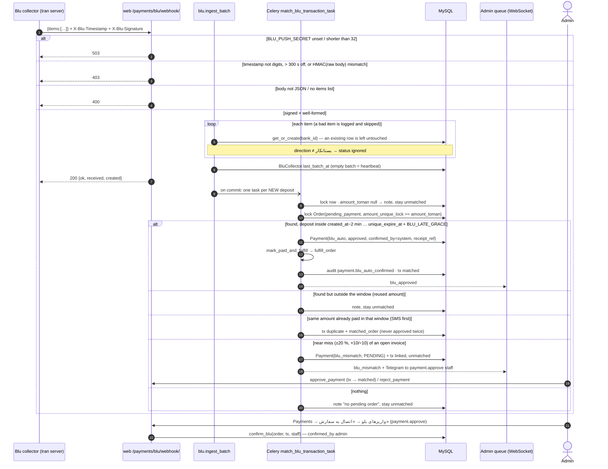

The iPhone SMS stays as the fallback: when Blu confirmed an order first, the later
SMS finds no pending order (no double confirm); when the SMS was first, the Blu
deposit becomes `duplicate`. A deposit is matched only once, when it arrives —
never later against a newer order. Contract: [blu-webhook.md](blu-webhook.md).

The collector only pushes when there are new deposits, so "no batch" is never an outage signal
(v1.33.1: that alert is retired; the tab and Monitoring show «X ساعت بدون واریزی» as info). The
health check is `blu_service_check_task` (every `blu_ssh_check_minutes`, default 5): the worker runs
one fixed, read-only command over SSH (`systemctl is-active blu-collector.service; journalctl -u …
--since -10min`) with the key, known_hosts and ssh config mounted read-only at `/run/blu-ssh`.

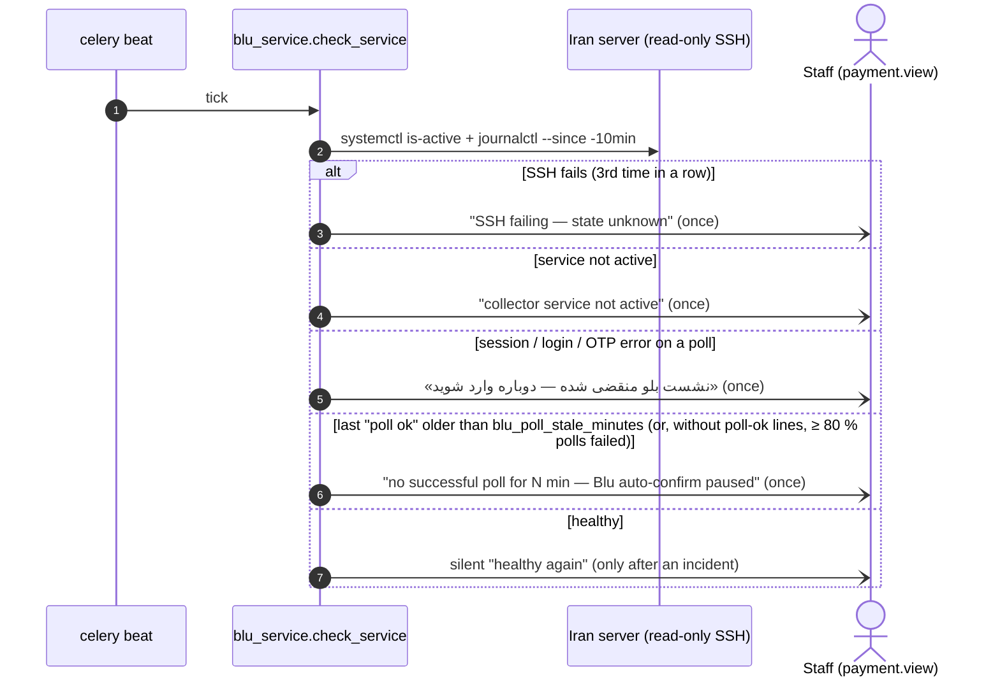

**Linking a deposit (v1.42.2).** Payments → «واریزهای بلو» → «اتصال»: staff type an order id, `TX-`, `MI-`, `INV-` or `AP-`, or
pick a suggestion; the dialog says what happens before anything is written. Approvals by other routes auto-link a deposit
with the same tracking / reference number (or the one same-amount deposit in 24 h with the same payer name).

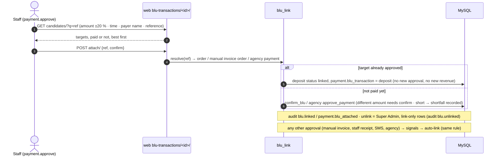

## 2c. Rounded-amount auto-approve (v1.32, widened v1.44.1, Blu + SMS)

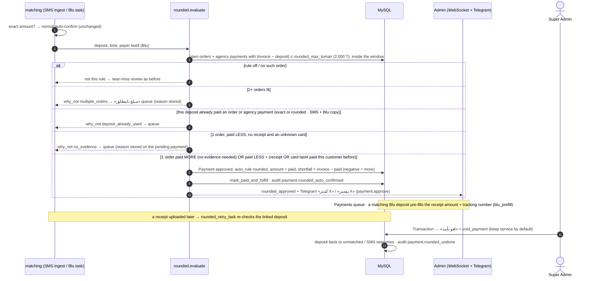

## 2d. Unconfirmed payment alert (v1.33)

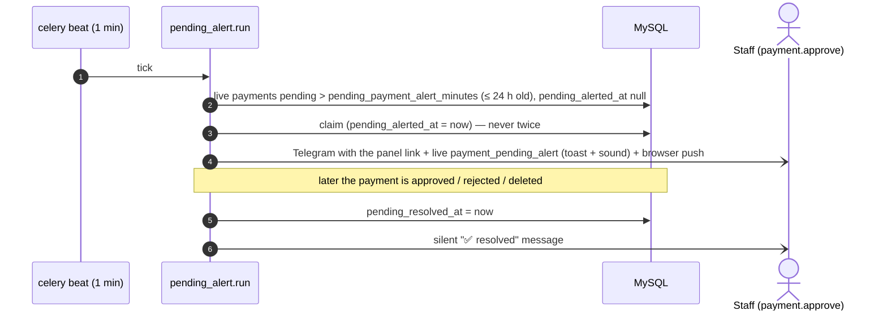

## 2e. Manual customer invoice (v1.38)

Dates / times staff enter are Tehran time (v1.42.1: sent with `+03:30`, naive input read as Tehran; "in the future" only beyond
5 minutes — «تاریخ پرداخت نمی‌تواند در آینده باشد»). A new-service item's account name follows PasarGuard's rule (flow 4).

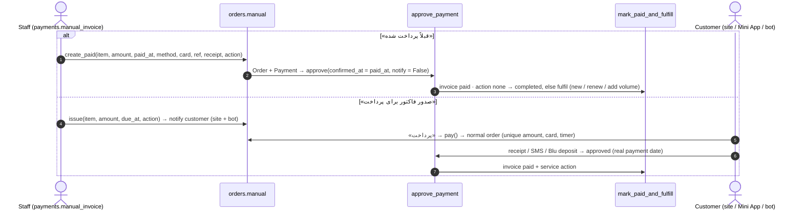

## 2f. Super Admin deletes (voids) a transaction → restore

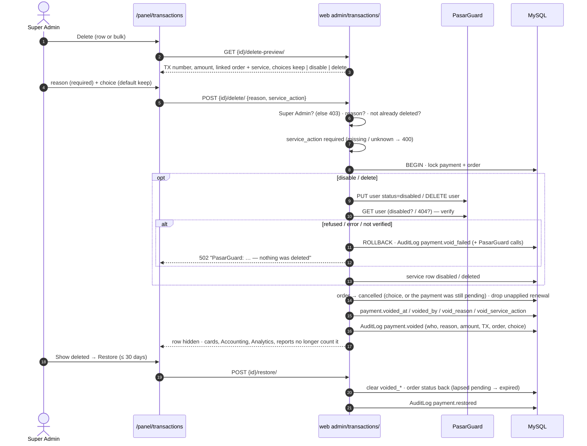

## 2g. Discount code at checkout (v1.26)

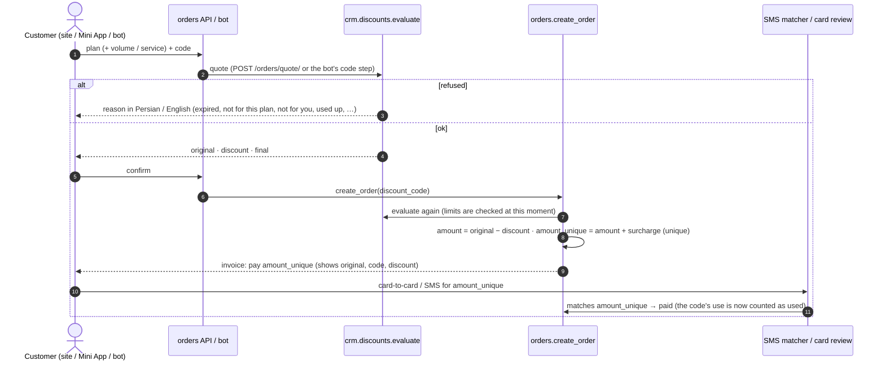

## 2h. Transactions cards = the list (v1.38.3)

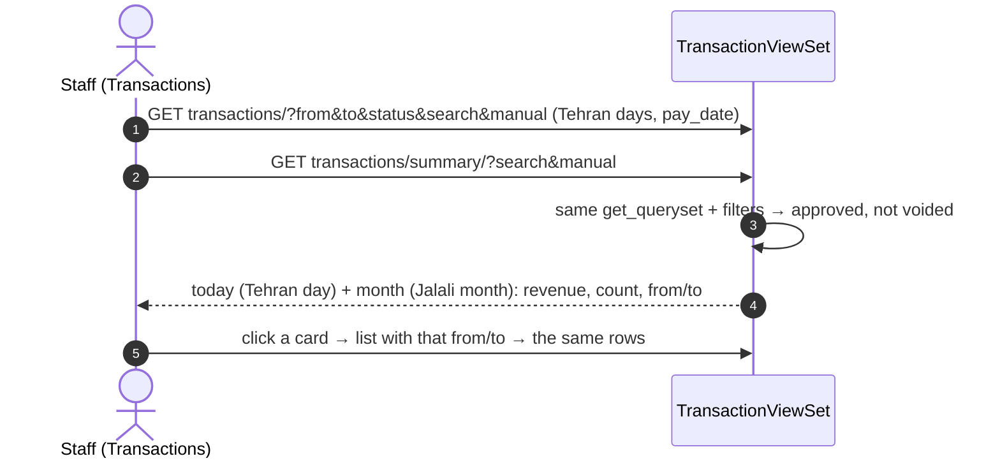

## 3. Renewal

A renewal is paid like a purchase (flows 1–2) with `type=renew` on an existing
service, but it is **not applied immediately**: it waits for the end of the
current cycle so the customer loses nothing. It always runs on the **same PasarGuard
username and subscription link** — never an account-name step, never a new account.

Which plan (`orders.services.renewal_plans` = every active plan of the service's panel, fixed **or custom volume**
(v1.42.1); `renewable_plan` = the service's own plan when `plan_renews` — active, or retired but marked
«قابل تمدید با وجود غیرفعال بودن» by staff):
- own plan → one tap (site: summary dialog → checkout; bot `s:<id>:rn` → «✅ تمدید با همین پلن»);
- «تغییر پلن / ارتقا» (site `checkout?renew=<id>&pick=1`, bot `s:<id>:rnp`) → any renewal plan;
- no usable plan (e.g. linked manually by staff) → the plan list straight away with a short note.
`GET /services/<id>/renew-info/` returns `plan`, `plans`, `needs_plan`, `last_gb`. v1.42.1: «تغییر پلن / ارتقا» shows the
purchase page's plan cards (site + Mini App), «حجم دلخواه» included; a custom-volume renewal asks the GB with live price
(the last volume bought for the service — else its current volume — pre-filled; bot: «مثل دفعهٔ قبل» button `rg:<s>:<p>:<gb>`,
or type the GB) and `ScheduledRenewal.data_limit` carries the bytes to PasarGuard. Discount codes apply as usual.
Services without a plan got the plan of their last paid order (migration `panel.0007`).
After payment `schedule_renewal` makes the paid plan the service's plan (audit
`service.plan_changed`, via `renewal`). Staff can set / change / clear a service's plan on
Admin → Services → edit (or when linking an account); filter «بدون پلن» lists services without one.

**One renewal at a time** (v1.30.1, incident 2026-10-29: one transfer paid two renewal orders).
`orders.services.waiting_renewal(service)` = an unapplied `ScheduledRenewal`, a `paid` renew order,
or a renew order whose receipt / SMS-mismatch payment is still pending (`review`). While it exists:
`create_order` / `quote_order` raise `RenewalWaiting` (site + Mini App `409 code=renewal_waiting`,
bot shows the waiting screen), renew-info answers `can_renew: false` + `pending_renewal`, and the
service (site card, checkout, bot) shows «تمدید پرداخت شد — با پایان حجم/زمان فعلی اعمال می‌شود»
with the queued plan and when it applies (current volume runs out or the current expiry). A paid
renewal never replaces a waiting one: `schedule_renewal` raises `RenewalConflict`, the order becomes
`failed` (audit `renewal.conflict`), staff with `payment.approve` get a Telegram alert
(`common/staff_alert.py`, else the backup chat) and the customer a "being reviewed" notice.

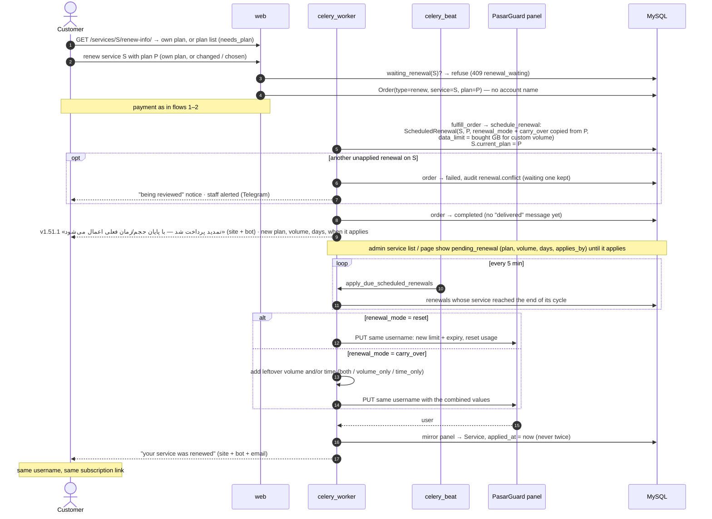

**Approval-queue warnings** (v1.30.1, `payments_sms/checks.py::payment_warnings`, read-only): each
pending payment in Admin → Payments lists hints with links to the related transactions —
`amount_mismatch` (receipt amount ≠ the order's unique amount), `recent_sms` (the same customer had a
payment approved by bank SMS within 24 h; `same_service` marked), `duplicate_image` (same receipt
`receipt_sha256`, voided ones included), `duplicate_ref` (same bank document / tracking number) and
`renewal_waiting`. The image hash is set on upload (site + bot); the customer may type the tracking
number on the site; staff record the receipt amount (explicit Rial / Toman) and number with
`POST /admin/payments/<id>/receipt-info/` (audit `payment.receipt_info`). The approve dialog repeats
the warning count. Nothing is approved or blocked automatically.

## 4. Service provisioning

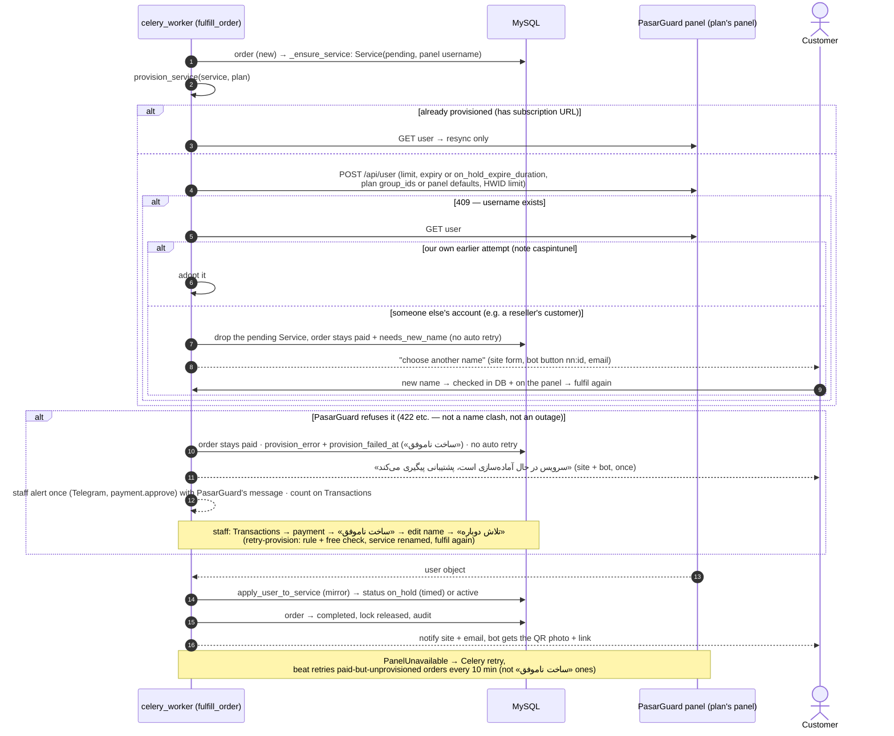

**Account names = PasarGuard's username rule** (v1.42.1, `apps/panel/account_names.py`, same rule in both SPAs'
`lib/accountName.js`): 3–64 characters of `a-z A-Z 0-9 - _ @ .`, no two of `- _ @ .` in a row (PasarGuard v5.6 allows up to
128; our columns hold 64). Checked while typing on every form (site / Mini App checkout and rename, staff new service,
manual invoice, provisioning retry, agency create admin = 32) with a Persian / English reason and a one-tap fixed name
(spaces → `_`, Persian digits → Latin, other characters dropped), and again in `create_order` before payment — the bot
explains it and offers the fix as a button (`an:<name>`, paid-order rename `nr:<order>:<name>`). Incident 2026-11-06: the
bot took «sahar 1364», PasarGuard answered 422 after payment and the service was never created (order #125, fixed by hand).
The service sync no longer marks a never-created service of a paid order «disabled» (it stays «در حال ساخت»).

Account names are checked **in our DB and on the panel** when the order is placed
(`orders.services.check_account_name`, site + bot ask for another name; an unreachable
panel does not block the sale — the 409 guard above still never attaches). Staff manual
creation refuses a name that exists on the panel and offers **Link existing account**; linking
an account owned by another panel admin needs `confirm_other_admin` (a checkbox in the modal).

Add-on volume orders call `add_service_data_limit` instead (panel first, then
mirror).

**Service sync (v1.28).** Every `service_sync_interval_minutes` (Settings; currently every minute) the beat runs
`sync_all_services`: **every** service with a panel account — whatever its status, expired /
limited / disabled included — is read from PasarGuard (status, expiry, volume, usage, on-hold,
online / last seen) and mirrored. A renewal, usage reset, top-up or re-enable done directly on
PasarGuard is detected (`service.changed_on_panel` audit) and re-arms the volume / expiry
reminders. One run at a time (cache lock). Staff **Sync** (`services/sync-now/`) runs it in the
request and answers `{checked, updated, errors, skipped, rows}` (40 s budget, the rest continues
in the background); each row has its own sync (`services/{id}/sync/`). The customer's services
page re-reads ended services (≤ once a minute) and on-hold ones (15 s). Changing the subscription
link signature / `online_at` alone is not counted as an update.

Before 1.28 the beat skipped expired services, so a service renewed directly on PasarGuard after
it expired stayed "expired" here forever (incident 2026-10-28, `hadis_sadeghi`).

**Reminders never use stale numbers.** A warning (80 % / 95 %, 3 / 1 days) is only created after
the service was re-read from PasarGuard (or synced < 2 min ago); if the panel can't be asked no
warning goes out. A queued bot / email warning is dropped when the service was renewed / reset
before delivery. Win-back only marks services synced in the last 30 minutes.

## 5. Agency sync + enforcement + ledger charge

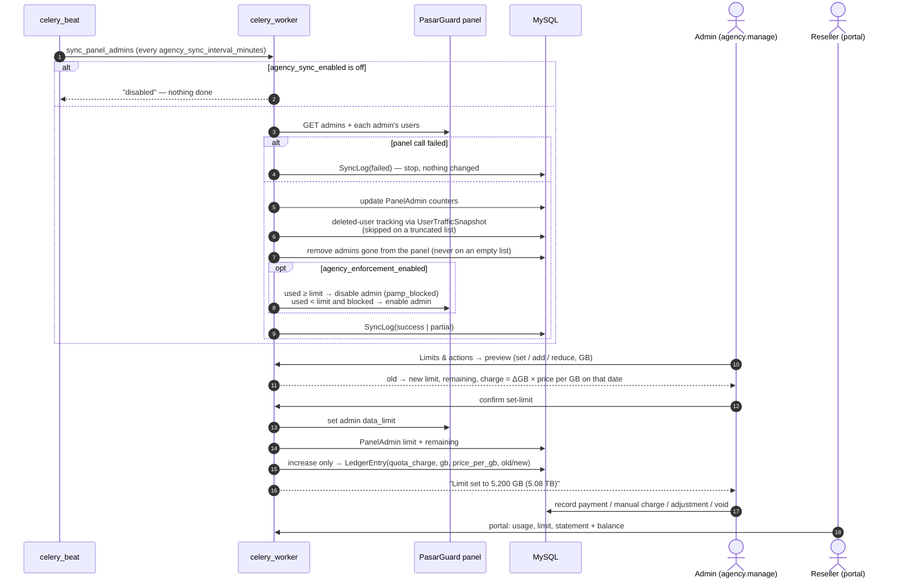

## 5b. Create a PasarGuard admin from the Agency panel

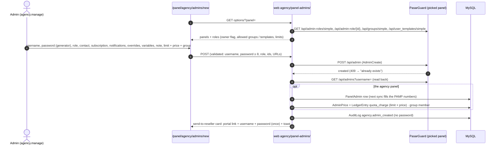

Edit (`PATCH`, only changed fields, password reset shown once) and delete
(`DELETE`, typed username; local row + group membership removed, ledger kept)
follow the same panel-first rule.

## 5c. Group manager gives volume → staff approve / reject

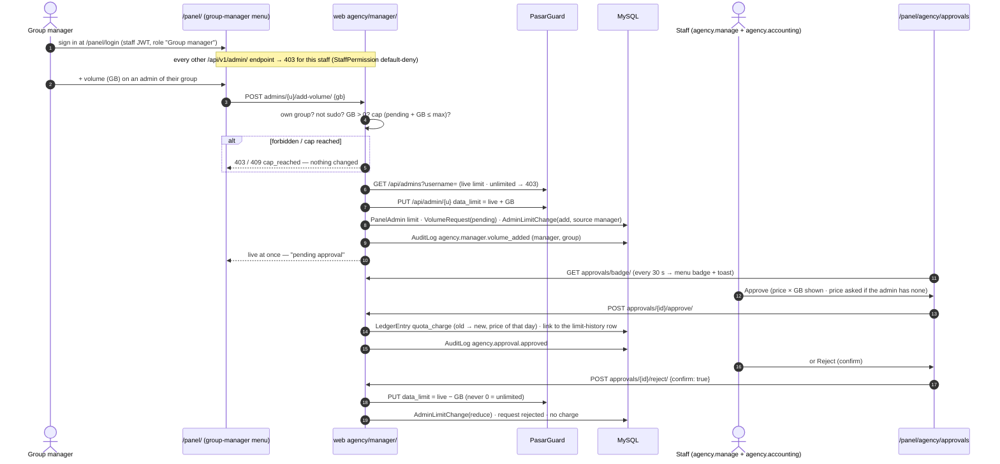

A new admin made by a manager (`POST admins/`) follows the same path: created on
PasarGuard with an allowed role and the initial GB, added to the group, request `create`.

## 5d. Agency approval from Telegram (v1.33)

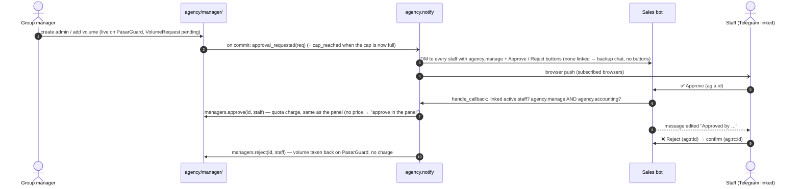

## 5e. Agency invoices, admin requests and payments (v1.34)

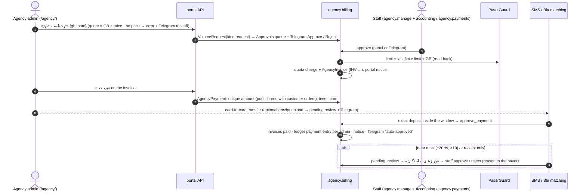

Group managers do the same from `/panel/my-groups/invoices` for their groups' admins, selecting several unpaid
invoices for one payment. Staff charges (limit raise, manual charge with GB) and approved group-manager volume
issue invoices the same way.

## 5f. Agency access rules (v1.35)

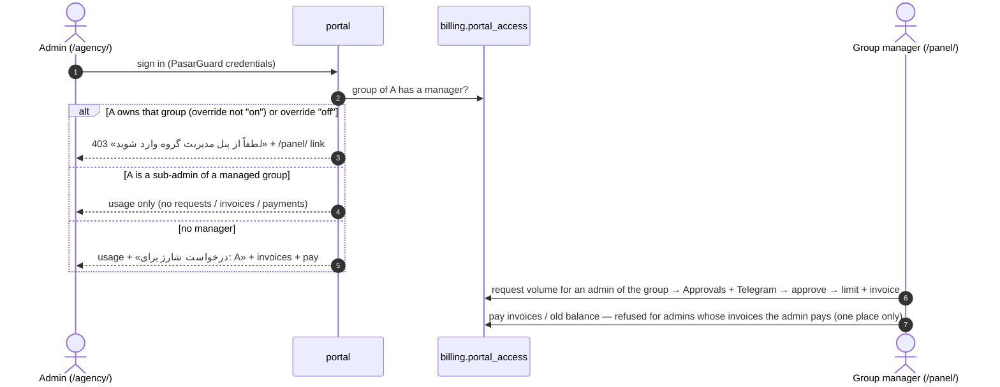

## 5g. Invoices and the ledger (v1.35.1)

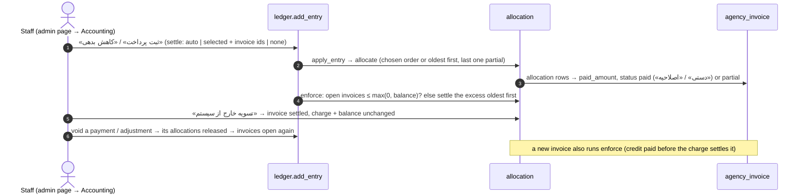

## 5h. Group manager pays the whole group debt (v1.35.2)

```mermaid
sequenceDiagram
    autonumber
    actor G as Group manager (/panel/my-groups/invoices) or direct admin (/agency/invoices, v1.38.2)
    participant V as ManagerPayAllView / PortalPayAllView
    participant B as billing
    participant P as checkout (SMS / Blu)

    G->>V: GET manager/debt/ (portal/debt/) → «کل بدهی» + «ریز بدهی»
    G->>V: POST manager/payments/all/ (portal/payments/all/) {expected_total}
    V->>B: pay_all: lock admins, debt_breakdown
    alt total changed
        B-->>G: 409 total_changed + new total → page shows it, asks again
    else same total
        B->>B: issue_settlement for each old balance
        B->>B: create_payment(all unpaid items) → one unique amount
        B-->>G: checkout (card, timer, receipt)
        P->>B: matching deposit → approve_payment → allocations → invoices paid, ledger down
    end
```

## 5i. Admin profile title / support link (v1.35.3)

```mermaid
sequenceDiagram
    autonumber
    actor G as Group manager / staff
    participant A as admin_crud.build_payload
    participant P as PasarGuard
    actor C as Happ (subscription update)

    G->>A: support_url "https://t.me/x⁠" (U+2060 from Telegram), profile_title
    A->>A: clean_field → "https://t.me/x" (ASCII), title without invisible marks
    A->>P: PUT /api/admin/{username} {support_url, profile_title}
    C->>P: GET subscription → headers support-url (raw), profile-title (base64) → valid
```

## 5j. Group manager sees full reseller stats (v1.36)

```mermaid
sequenceDiagram
    autonumber
    actor G as Group manager («ادمین‌های گروه»)
    participant V as manager API
    participant R as Redis (60 s)
    participant P as PasarGuard

    G->>V: GET manager/me/ → cards (+ full PAMP numbers if agency.gm.full_stats)
    G->>V: GET manager/admins/live/?u=… (own groups only)
    V->>R: cached?
    alt miss
        V->>P: GET /api/system/users?admin_username=X · GET /api/users?admin=X&sort=-online_at&limit=1
        V->>R: store 60 s
    end
    V-->>G: users by status, online, last activity
    G->>V: «جزئیات» → GET manager/admins/X/stats/
```

## 5k. Group-manager notifications (v1.37)

```mermaid
sequenceDiagram
    autonumber
    participant B as billing.notice(manager=…)
    participant DB as agency_notice
    participant W as Web Push (manager's browsers)
    actor G as Group manager (header bell)

    B->>DB: create notice (invoice issued / payment / request decision)
    B->>W: on commit: push_to_staff(staff_ids=[manager.staff])
    G->>DB: bell polls GET manager/notices/ every 45 s → count (+ chime if sound on)
    G->>DB: open item → POST {id} · «همه خوانده شد» → POST {read: true}
    G->>DB: «همهٔ اعلان‌ها» → /my-groups/notifications (GET ?page=)
```

## 5l. Staff page → Group manager role (v1.25.2)

```mermaid
sequenceDiagram
    autonumber
    actor S as Staff with roles.manage
    participant P as Panel (Roles & staff)
    participant API as admin/staff/
    participant M as agency.managers
    S->>P: edit staff, role = Group manager
    P->>API: GET staff/group-manager-options/ (groups + PasarGuard roles, owner roles left out)
    S->>P: tick groups, allowed roles per group, cap
    P->>API: PATCH staff/<id>/ {role, group_manager: {assignments, max_unapproved_gb}}
    API->>M: sync_from_staff (same transaction as the staff save)
    alt role is Group manager
        M->>M: link / create GroupManager (same username + password hash)
        M->>M: _clean_assignments (owner role / unknown group → 400, nothing saved)
        M-->>API: manager + warnings (no_group / no_role)
    else role removed / superadmin
        M->>M: unlink, disable manager, end its portal sessions, audit agency.manager.unlinked
    end
    API-->>P: staff row incl. group_manager {assignments, cap, warnings}
    Note over P: Agency → Group managers edits the same record — both pages show the same groups
```

## 6. Bot and Mini App login

```mermaid
sequenceDiagram
    autonumber
    actor U as Telegram user
    participant T as Telegram
    participant Bot as bot_sales
    participant API as web
    participant DB as MySQL

    U->>T: /start (or any message)
    T->>Bot: update (long polling)
    alt force_share_phone on and no account with this telegram_id
        Bot-->>U: welcome + "share phone" button (no account created)
        U->>Bot: shares contact
        Bot->>Bot: contact.user_id == sender? else refuse
        Bot->>DB: handle_contact — normalize phone, find account by phone
        alt account with that phone, no Telegram
            DB-->>Bot: link telegram_id to it (username + password kept), audit user.linked_telegram
        else account linked to another Telegram id
            Bot-->>U: refused, contact support
            Bot->>T: DM staff (users.manage) / backup chat, audit user.telegram_link_conflict
        else no account
            DB-->>Bot: new User(source=bot) — random username + password sent once
        end
    else gate off / account exists
        Bot->>DB: ensure_bot_user(telegram_id)
    end
    Bot->>T: getChatMember for each required channel
    alt missing channel
        Bot-->>U: join channels (asked again on any message)
    end
    Bot-->>U: main menu (screen edited in place)

    U->>T: opens the Mini App
    T->>API: SPA loads, POST /auth/telegram/miniapp/ {initData}
    API->>API: HMAC check with the sales-bot token, auth_date ≤ max age
    API->>DB: phone gate on and no account → 403 phone_required (nothing created) · <br/>the SPA asks Telegram for the contact → bot handle_contact → retry
    API->>DB: ensure_bot_user(telegram_id) — existing account
    API-->>T: JWT pair — the SPA never shows a login form inside Telegram
```

## 6b. Site / panel sign-in with stale browser state (v1.30.2)

```mermaid
sequenceDiagram
    autonumber
    actor U as Customer / operator
    participant SPA as SPA (lib/api.js)
    participant API as web

    SPA->>SPA: boot — pruneStoredTokens (wrong kind / expired refresh → removed)
    SPA->>API: GET /auth/me/ (or /admin/auth/me/) with stored token
    alt 5xx / no response (deploy)
        SPA->>API: retry 3× with backoff — never a logout
    else 401
        SPA->>API: POST refresh (bare request, no Authorization)
        alt 200
            API-->>SPA: new pair → original request repeated
        else 401 / 400 / 403
            SPA->>SPA: clearAuthState → login form + "session expired"
        end
    end
    U->>SPA: username + password
    SPA->>SPA: clearAuthState (this app only)
    SPA->>API: POST /auth/login/ or /admin/auth/login/ — no Authorization header
    API->>API: FreshAuthMixin — no authenticator runs (old header / cookies ignored)
    API-->>SPA: tokens, Cache-Control no-store, Set-Cookie sessionid/csrftoken expired
    U->>SPA: logout
    SPA->>SPA: clearAuthState
    SPA->>API: POST logout {refresh} → refresh token revoked
```

## 6c. Permanent delete of a soft-deleted user (v1.31.2)

```mermaid
sequenceDiagram
    autonumber
    actor SA as Super Admin
    participant UI as Deleted users page
    participant API as /admin/deleted-users/…
    participant P as accounts.purge
    participant PG as PasarGuard
    participant DB as MySQL

    SA->>UI: «حذف دائمی» (row) or select + bulk
    UI->>API: GET purge-preview/?ids= (users.purge + is_superadmin, else 403)
    API->>P: preview → counts + GET /api/user/<name> per service
    API-->>UI: removes / kept / panel accounts (exists, unknown)
    UI->>SA: ConfirmDialog — list + «also delete on PasarGuard» (ON if any exists)
    SA->>API: POST <id>/purge/ or bulk-purge/ {delete_on_panel}
    opt delete_on_panel
        P->>PG: GET every account first (any error → stop, nothing deleted)
        P->>PG: DELETE + GET (404 = gone) per account
    end
    P->>DB: atomic: delete tickets (+files on commit), CRM rows, notifications,<br/>services, tokens, deletion archives · anonymize the user row
    P->>DB: audit user.purged (counts only, no personal data)
    API-->>UI: ok / per-user failures with the reason
```

Orders and payments are never touched: Accounting, Analytics and Transactions show the
same totals, with the customer as «کاربر حذف‌شده #id».

**Automatic purge (v1.32).** Settings → «حذف دائمی خودکار» (Super Admin, off by default, N = 30
days): the daily beat task `accounts: auto-purge deleted users` calls the same `purge_user`
(`delete_on_panel=True`, staff "system") for every user deleted more than N days ago. A
PasarGuard problem purges nothing for that user (same read-first rule); it stays in the trash,
is retried the next day, and staff with `users.purge` get one alert per day. Each purge writes
`user.purged`, each run `users.auto_purged` (ids + error codes only). The Deleted users page
shows the next run and each row's purge date.

## 7. Ticket lifecycle and notifications

```mermaid
sequenceDiagram
    autonumber
    actor C as Customer
    participant API as web /tickets/
    participant DB as MySQL
    participant W as celery_worker (notify)
    participant WS as daphne /ws/admin/tickets/
    actor S as Staff (scope covers topic)

    C->>API: GET /tickets/topics/
    API-->>C: topics with available / locked + renew hint (never purchased → only pre-purchase)
    C->>API: POST /tickets/ (topic, subject, body, ≤3 files)
    API->>API: topic active? needs active service? open tickets < limit?<br/>files: sniffed type, Pillow decode, ≤5 MB
    API->>DB: Ticket(open, number) + message + attachments + event created
    API-)W: notify new_ticket (on commit)
    W->>WS: event + badge to each staff in scope (or the assignee)
    W-->>S: bot DM if Telegram linked, email if set
    S->>API: GET /admin/tickets/ (inbox, only scoped topics) → detail (marks read)
    alt internal note
        S->>API: POST reply internal=true
        API->>DB: staff-only message + event internal_note (status unchanged)
    else answer
        S->>API: POST /admin/tickets/{id}/reply/
        API->>DB: status awaiting_user, first_response_at, auto-assign to the replier,<br/>event staff_replied, AuditLog
        API-)W: notify staff_reply
        W-->>C: site bell (real-time, links to the chat) + email + bot message with Reply / Open
    end
    C->>API: POST /tickets/{id}/reply/
    API->>DB: status awaiting_admin, event user_replied
    API-)W: notify user_reply → assignee only
    opt staff
        S->>API: assign (target must cover the topic) · status · priority
        API->>DB: event + AuditLog
    end
    loop beat every hour
        W->>DB: awaiting_user longer than tickets_auto_close_days → closed (system), event auto_closed
        W-->>C: site notification
    end
    C->>API: POST /tickets/{id}/reopen/ (within tickets_reopen_days, under the open limit)
    API->>DB: status awaiting_admin, event reopened
```

## 8. Tickets in the bot

```mermaid
sequenceDiagram
    autonumber
    actor C as Customer (Telegram)
    participant Bot as bot_sales
    participant Svc as tickets.services
    participant W as celery_worker (notify)
    actor S as Staff (linked Telegram)

    C->>Bot: 🎫 Support / tickets → New ticket
    Bot-->>C: allowed topics as buttons (+ renew hint if all services expired)
    C->>Bot: topic → subject (typed) → message (text or photo / PDF)
    Bot->>Svc: open_ticket(channel=bot) — same rules as the site
    Svc-)W: new_ticket
    W-->>S: DM: #number + Reply · Open · Assign to me · Close
    S->>Bot: Assign to me / Reply (force-reply) → text or photo
    Note over Bot: staff callbacks st:* skip the customer gate,<br/>scope + permission checked, no customer account
    Bot->>Svc: staff_reply(channel=bot)
    Svc-)W: staff_reply
    W-->>C: bot message with Reply / Open + site bell + email
    C->>Bot: Reply → text / photo → user_reply(channel=bot)
    C->>Bot: Close / Reopen
```

## 9. Staff Telegram linking

```mermaid
sequenceDiagram
    autonumber
    actor S as Staff
    participant P as Panel API /admin/tickets/telegram-link/
    participant R as Redis cache
    participant T as Telegram
    participant Bot as bot_sales
    participant DB as MySQL

    S->>P: POST (logged in)
    P->>R: sha256(code) → staff id, 10 min
    P-->>S: code + deep link t.me/<bot>?start=staff-CODE
    S->>T: opens the link (or sends /start staff-CODE)
    T->>Bot: /start staff-CODE
    Bot->>R: look up and delete the code (single use)
    alt valid and this Telegram not linked to another staff
        Bot->>DB: Staff.telegram_id, telegram_linked_at + AuditLog
        Bot-->>S: linked ✅
    else
        Bot-->>S: invalid / expired / already linked
    end
    Note over Bot: no customer account is created for this message
```

## 10. CRM inactivity follow-up

```mermaid
sequenceDiagram
    autonumber
    participant B as celery_beat (hourly)
    participant W as celery_worker
    participant DB as MySQL
    actor C as Customer
    actor S as Staff (crm.manage)

    Note over W,DB: service sync keeps Service.online_at from PasarGuard
    B->>W: crm_detect_task
    W->>DB: services synced < 24 h: active + no connection for N days → no_connection case,<br/>on hold / never connected N hours after purchase → never_connected case (one open per service)
    W->>DB: stage → at_risk (CrmEvent)
    opt crm_auto_message on, inactive N days
        W-->>C: friendly message (site + bot) from the template, once per case
    end
    C->>DB: opens a "Connection problem" ticket → linked to the open case
    S->>DB: queue "نیاز به پیگیری" → case: reason, notes, assignee
    alt help the customer
        S-->>C: message from a template (site / bot / email)
        S->>DB: or open a ticket on their behalf (linked to the case)
    end
    S->>DB: close with outcome resolved / still inactive / lost
    loop next runs
        W->>DB: the service connected again → case closed (resolved, by the system), stage recomputed
    end
```

## 11. Pre-expiry warning and win-back

```mermaid
sequenceDiagram
    autonumber
    participant B as celery_beat
    participant W as celery_worker (crm.retention)
    participant DB as MySQL
    actor C as Customer
    actor S as Staff (crm.manage)

    B->>W: every 30 min: run_warnings
    W->>DB: due thresholds (data % / days left) → ServiceWarning (unique per service period)
    W-->>C: site bell now (→ /renew/<service>)
    alt quiet hours (default 00:00–08:00 Tehran)
        W->>DB: bot / email due at the end of the quiet hours
    else
        W-->>C: bot message with 🔄 renew button + email
    end
    C->>DB: renews within N days → warning converted
    Note over W,DB: hourly: run_winback
    W->>DB: service expired / used up → ServiceEndMark
    W->>DB: still ended after the grace (24 h), no other live service → winback case
    opt auto first message (off by default)
        W-->>C: win-back message (renew link)
    end
    S->>DB: queue "بازگشت مشتری": reason, owner, notes
    S->>DB: discount code (percent, N days, one per customer)
    S-->>C: win-back message from a template with {renew} {code} {percent}
    C->>DB: checkout with the code → order amount −percent (code reserved), paid → code used
    W->>DB: live again within the window → case closed won_back + recovered revenue
    S->>DB: otherwise: close as lost with a reason
```

## 12. Analytics (read-only)

```mermaid
sequenceDiagram
    autonumber
    actor A as Admin (accounting.view + crm.view)
    participant UI as /panel/analytics
    participant API as web crm/analytics/<what>/
    participant DB as MySQL

    A->>UI: overview · finance · retention · support, period (preset or Jalali range)
    UI->>API: GET ?preset= | ?from=&to=
    API->>DB: approved payments (revenue), orders (coverage, discounts), services, CRM profiles / cases, ticket events
    Note over API: computed on request — nothing is written
    API-->>UI: figures + series (Jalali months)
    A->>UI: Export
    UI->>API: GET financial/?export=csv|xlsx&lang=
    API-->>A: file (UTF-8 BOM CSV / RTL Excel in fa)
```

## 13. Domain change (Settings → Domain & Cloudflare)

```mermaid
sequenceDiagram
    autonumber
    actor A as Super admin
    participant UI as /panel/settings/domain
    participant API as web (settings_app/domain.py)
    participant CF as Cloudflare API
    participant DNS as Public DoH resolvers
    participant H as Host (scripts/domain.sh, cron 1 min)
    participant N as nginx
    participant C as certbot

    A->>UI: new domain (+ www), zone or manual DNS
    UI->>API: POST domain/start/
    API->>CF: zone check: list records + temporary TXT create / delete (DNS edit?)
    API->>CF: A @ / www / mail → server IP (DNS-only)
    UI->>API: Check DNS
    API->>DNS: name → A ? (must be this IP)
    UI->>API: Request certificate
    API->>H: backups/.domain-request.json {cert}
    H->>C: certbot certonly --webroot (@, www, mail)
    H->>H: mail server: DKIM key for the new domain (selector mail)
    H-->>API: .domain-status.json (ok + expiry | reason) + DKIM record
    API->>CF: MX, SPF (ip4), DMARC p=none, DKIM TXT
    API->>DNS: MX / TXT answered? (apply waits)
    A->>UI: Switch (confirm)
    UI->>API: POST domain/<id>/apply/
    API->>H: request {apply, old, new, transition_days}
    H->>N: render nginx/domain/active.conf (new, www.new → 301 new, old → 301), nginx -t, reload
    H->>H: .env DOMAIN / ALLOWED_HOSTS / CSRF / PUBLIC_BASE_URL / MAIL_DOMAIN / sender
    H->>H: recreate app containers (web + daphne rolling, celery, bots, mailserver)
    H->>N: verify https://new/api/v1/health/ = 200, www.new → 301 new, old → 301, mail server = mail.new
    alt any step fails
        H->>H: restore .env + nginx config + containers
        H-->>API: status: rolled back + reason
    else ok
        H-->>API: status ok
        API->>API: site_config.site_domain, Telegram menu button, audit
    end
    Note over API: beat (5 min): transition over → request {retire}
    H->>N: old domain removed, .env without the old names
    opt rollback (panel or ./scripts/domain.sh rollback)
        H->>N: same switch back to the previous domain
    end
```

## 13b. Access mode switch (Direct / Cloudflare proxy / Iran tunnel)

```mermaid
sequenceDiagram
    autonumber
    actor A as Super admin
    participant UI as Domain & Cloudflare page
    participant W as celery_worker (access_switch_task)
    participant CF as Cloudflare API
    participant DNS as public DoH
    participant P as new path (Iran IP / this server / CF edge)

    A->>UI: mode (+ Iran IPs, tunnel sources, PROXY ports)
    UI->>W: request_switch(mode)
    W->>CF: zone + proxy mode: SSL/TLS = Full (strict) (set, else stop)
    W->>P: HTTPS for the domain (SNI) → 200 + our cert + X-Caspin-Instance
    alt path broken
        W-->>UI: failed (nothing changed)
    else ok
        W->>CF: A @ / www → target (mail.* never), previous records saved
        W->>DNS: until public DNS answers the target
        W->>P: check again
        alt broken
            W->>CF: put the previous records back
            W-->>UI: reverted + reason
        else ok
            W-->>UI: ok — mode shown in the header
        end
    end
    Note over W: nginx re-render (scripts/domain.sh access) keeps www → 301 https://domain in every mode
```

## 14. Deploy (`./update.sh`)

```mermaid
sequenceDiagram
    autonumber
    actor O as Operator (shell or panel Update button)
    participant H as Host (update.sh / watch-update.sh)
    participant D as Docker
    participant DB as MySQL
    participant N as nginx

    alt panel Update button
        O->>H: sentinel file → watch-update.sh (cron, 2 min) runs update.sh
    else shell
        O->>H: ./update.sh
    end
    H->>DB: mysqldump → backups/pre-update-<ver>-<ts>.sql.gz
    H->>D: tag running app images :rollback
    H->>H: git pull
    H->>D: build images (backend, frontend-user, frontend-admin, nginx)
    H->>D: one-off container (new image): migrate + seed + collectstatic
    Note over D: old release still serving — migrations must be backward compatible
    loop web, daphne, frontend_user, frontend_admin
        H->>D: start new container next to the old one
        D-->>H: healthy (compose healthcheck)
        H->>D: remove the old container
        Note over N: nginx re-resolves names every 2 s and retries —<br/>no failed requests
    end
    H->>D: up the rest only where changed (celery, bots, mail) — never two beats/bots
    H->>N: nginx reload, Docker cleanup (keep :latest + :rollback)
    H-->>O: "now on version X"
    opt something is wrong
        O->>H: ./update.sh --rollback (images, restore the dump if a migration must be undone)
    end
```

Release routine (development side): tests on the isolated stack
(`./scripts/test.sh`), bump `VERSION`, PROGRESS entry, commit, tag `vX.Y.Z`,
push, `./update.sh`, GitHub release ([development.md](development.md)).

## 15. Disk full protection (v1.25.2)

```mermaid
sequenceDiagram
    autonumber
    participant B as celery beat
    participant W as worker (ops)
    participant H as host cron (disk-report.sh)
    participant T as Telegram (backup chat + monitoring staff)
    loop every 5 min
        B->>W: resource_sample_task
        W->>W: check_disk_alert() before any DB write
        alt ≥ 80 % (warn) / ≥ 90 % (critical), new level or repeat due
            W->>T: alert + biggest folders
        else back below 77 %
            W->>T: back to normal
        end
    end
    H->>H: 03:17 daily: du of folders / volumes / binlogs → backups/.disk-report.json
    B->>W: daily disk report
    W->>T: only if above warn, growth ≥ 1 GB/day, or report missing / stale
```

## 15b. Container memory watch (v1.39.0)

```mermaid
sequenceDiagram
    autonumber
    participant H as Host cron (container-stats.sh, 5 min)
    participant F as backups/.container-stats.json
    participant B as resource_sample_task (5 min)
    participant T as Telegram (backup chat + monitoring staff)
    H->>H: docker stats + inspect (limit, OOMKilled, restarts), swap, memory pressure, load
    H->>F: write JSON (read-only sampling, no Docker socket in the app)
    B->>F: read (apps/ops/containers.py)
    alt a container ≥ 85 % of its limit, OOM / restart, swap ≥ 1.5 GB for 30 min, pressure ≥ 10 %, load > CPUs, report stale
        B->>T: one message for the new problems (each kind at most every 6 h)
    else everything back to normal after an alert
        B->>T: "back to normal" (once)
    end
```

## 16. A request is scoped to its store (multi-tenant, v1.41 · strict v1.42)

```mermaid
sequenceDiagram
    autonumber
    participant C as Browser / app
    participant M as TenantMiddleware
    participant Q as Scoped manager (TENANT models)
    participant DB as MySQL
    C->>M: request, Host header
    alt active TenantDomain or one of our own hosts
        M->>M: context = that tenant (our hosts → the default tenant)
    else any other host
        M-->>C: 404 unknown site
    end
    Q->>Q: queryset filter tenant__tenant_scope (read when the SQL is compiled)
    Q->>DB: ... WHERE tenant_id = current
    Note over Q,DB: new rows get tenant = current · a customer JWT carries tid and is refused on another store
    alt web process and no tenant set (code outside a request)
        Q-->>C: NoTenant → 500 (strict · TENANCY_STRICT=false = warning + default tenant)
    else Celery · bots · daphne · manage.py
        Q->>DB: ... WHERE tenant_id = default tenant
    end
    Note over Q,DB: tenant_id is NOT NULL on tenant tables · usernames / codes / slugs are unique per store
```


## 16b. Our staff open a reseller store · store mode (multi-tenant Phase 2, v1.43)

```mermaid
sequenceDiagram
    autonumber
    actor S as Our staff (agency.manage)
    participant API as web admin/agency/panel-admins/<u>/store/
    participant ST as tenancy.stores
    participant DB as MySQL
    actor R as Visitor on store.example
    participant M as TenantMiddleware
    S->>API: POST {name} (Agency → admin → «فروشگاه»)
    API->>ST: enable(username)
    ST->>DB: tenant (draft) · tenant_branding (name) · copy of our pages · audit store.enabled
    S->>API: PATCH {status: active}
    ST->>DB: status · audit store.updated · host cache cleared
    R->>M: GET store.example/api/v1/config/
    alt active store with an active domain
        M->>M: context = that store
        M-->>R: the store's branding / theme / pages
    else draft / suspended / closed or no domain
        M-->>R: 404 unknown site
    end
    Note over M: on a store's domain: platform paths 404 · admin views without store_ok → 403 (store mode)
    Note over R: the panel on store.example/panel/ shows only the store menu (v1.44) · the site shows only the store's name
```

## 16c. Store domain + TLS (multi-tenant Phase 3, v1.45)

```mermaid
sequenceDiagram
    autonumber
    actor S as Our staff (agency.manage)
    participant API as admin/agency/panel-admins/<u>/store/domains/
    participant DM as tenancy.domains (Celery tick, every minute)
    participant F as backups/.tenant-domains.json · .tenant-status.json
    participant H as scripts/tenants.sh (host cron, every minute)
    participant LE as Let's Encrypt
    participant N as nginx
    S->>API: POST {host, mode direct | tunnel, www}
    API-->>S: exact records · A host (+ www) → Finland IP or Iran IP · TXT _caspin-verify.host = token
    loop every 5 min (or «بررسی الان»)
        DM->>DM: DoH: TXT token + A on our IP · proxied (Cloudflare edges) → GET http://host/.well-known/caspin/token must reach THIS server
    end
    DM->>F: verified → host in the wanted list (state cert_pending)
    H->>F: read wanted hosts
    H->>H: pre-check · random file in the ACME webroot fetched as http://host/… through the PUBLIC path (direct · Iran tunnel port forward without PROXY protocol · their Cloudflare)
    alt pre-check fails
        H->>F: challenge_error (Let's Encrypt not asked · retried in 5 min)
    else
        H->>LE: certbot certonly --webroot (HTTP-01 · nginx serves the challenge on 80 and 443 for every name)
        LE->>N: GET /.well-known/acme-challenge/… (direct → our :80 · tunnel → Iran :80 → our :80 · Cloudflare → our :80 or :443)
        H->>N: nginx/tenants/host.conf → nginx -t → reload → TLS verify (SNI) → restore all on failure
        H->>F: cert_ok · nginx_ok · cert_expires (or cert_error · 3 failures → failed)
    end
    DM->>N: health · TLS to the mode's IP (or their Cloudflare) · probe answered by THIS server
    DM->>DM: active · host cache + ALLOWED_HOSTS refreshed · staff alert
    Note over DM: active · health every 5 min (alert after 30 min down) · DNS daily · certificate expiry alert at 14 days · renewal = certbot container renew + nginx reload every 6 h
    Note over S: remove → watcher deletes the vhost + certificate · the reseller sees the state read-only on their store dashboard
```

## 16d. A store sale · quota guard + set_owner (multi-tenant Phase 4, v1.46)

```mermaid
sequenceDiagram
    autonumber
    actor C as Store customer (store.example)
    participant API as web (store context)
    participant Q as tenancy.quota
    participant W as Celery worker
    participant PG as PasarGuard
    actor R as Reseller (agency portal)
    C->>API: POST /orders/ (the store's plan)
    API->>Q: check(plan volume) · available = admin_remaining − open orders − unapplied renewals (live when < 10 % would be left)
    alt not enough · unlimited plan for a limited reseller · no reseller admin
        Q-->>C: 400 code quota «این خرید فعلاً در دسترس نیست»
        Q->>R: portal notice (once an hour) · staff alert
    else enough
        API-->>C: invoice (payment flow unchanged)
    end
    Note over API,W: payment approved → fulfill_order.delay queued in the store context (header caspin_tenant)
    W->>W: task_prerun → tenant = the store
    W->>Q: check again (the order itself excluded)
    alt short now
        W-->>W: order stays paid · retry_unfulfilled_orders (per store) tries every minute
    else
        W->>PG: POST /api/user (our admin token)
        W->>PG: PUT /api/user/NAME/set_owner?admin_username=reseller
        W->>PG: GET /api/user/NAME · admin.username must be the reseller (else «ساخت ناموفق»)
    end
    Note over Q,R: every 5 min · 20 % / 10 % left → portal notice + staff alert once per level · store dashboard banner
```

## 16e. A store's deposit SMS (multi-tenant Phase 5, v1.47)

```mermaid
sequenceDiagram
    autonumber
    actor P as Reseller's Android phone (SMS Bridge)
    participant N as nginx store.example
    participant M as TenantMiddleware
    participant API as sms/inbound (device token)
    participant DB as MySQL (store context)
    participant L as Live socket staff_payments_t<store>
    P->>N: POST https://store.example/api/v1/payments/sms/inbound/ · X-Device-Token
    N->>M: Host store.example
    M->>M: tenant = the store (sms paths answer on stores · Blu still 404)
    M->>API: SmsDeviceAuthentication · token looked up among THIS store's devices (another store's token → 401)
    API->>DB: sender among the store's bank numbers · exact amount among the store's open orders (its own pool)
    alt exact match
        API->>DB: approve_payment (unchanged) · order paid → fulfil queued in the store context
        API->>L: event to the store's panel only
    else near / rounded rules (store orders only · agency payments never)
        API->>DB: pending review in the store's queue
    end
    Note over API: alerts in a store context → that store's staff only (never our staff / backup chat)
```

## 16f. Watching real payments (v1.48, `manage.py watch_payments`)

```mermaid
sequenceDiagram
    autonumber
    participant W as watch_payments (our store only)
    participant DB as MySQL (read-only)
    participant T as alert_staff → staff DM · backup chat
    loop every 15 s until N payments
        W->>DB: SMS with an amount · Blu deposits · receipt uploads since start
        alt matched automatically (order / agency payment) · receipt approved / rejected
            W->>W: AUTO · count it once per order
        else held for review (sms_mismatch / blu_mismatch payment, even if staff approve it)
            W->>T: REVIEW «پرداخت خودکار تطبیق نشد — بررسی دستی» + why it was held
        else no match after the grace time · receipt still pending
            W->>T: FAIL «پرداخت تطبیق داده نشد» + the SMS / Blu note
        end
    end
    W->>T: summary (silent when everything was AUTO) · --want-order: until a customer order is AUTO
```

## 16g. A store's own Telegram bot + Mini App (multi-tenant Phase 6, v1.49)

```mermaid
sequenceDiagram
    autonumber
    actor O as Our staff («فروشگاه»)
    participant API as Django (our host)
    participant TG as Telegram
    participant W as Celery worker
    actor C as Store customer
    O->>API: POST store/bot/ {token}
    API->>TG: getMe (never our bots · one store per bot)
    API->>TG: setWebhook(our host /api/v1/telegram/hook/ID/, secret_token)
    API->>TG: menu button → https://store-domain/ · description from branding
    C->>TG: /start in the store bot
    TG->>API: POST /api/v1/telegram/hook/ID/ + secret header
    alt wrong secret
        API-->>TG: 403
    else store suspended · update_id seen before
        API-->>TG: 200 (dropped)
    else ok
        API->>W: store_bot_update_task(ID, update) in the store context
        API-->>TG: 200
        W->>W: sales bot handlers · the store's customers, plans, texts · staff flows off
        W->>TG: sendMessage with the store's token
    end
    C->>API: opens the Mini App on https://store-domain/ (initData)
    API->>API: validate with the STORE's token (ours refused there)
    API-->>C: JWT for the store's customer
    loop every 10 min
        W->>TG: getWebhookInfo · wrong webhook set again · one alert to us when broken
    end
```

## 16h. A reseller's own staff (multi-tenant Phase 8, v1.52)

```mermaid
sequenceDiagram
    autonumber
    actor O as Our staff («فروشگاه»)
    actor R as Reseller (store owner)
    actor K as Store staff
    participant API as Django (store's domain)
    O->>API: PUT store/ceiling/ {codes ⊆ STORE_CODES} (our host)
    API->>API: strip codes above it from the store's roles · owner role = ceiling · audit
    O->>API: POST store/owner/ {username} → password once
    R->>API: login on https://store-domain/panel/ (refused on our host / another store)
    R->>API: POST roles/ {name, codes} → codes ⊆ ceiling ∩ R's own, else 403
    R->>API: POST staff/ {username, role} → staff.tenant = store, never Super Admin
    K->>API: login on the store's domain · has_perm = role ∩ ceiling
    K->>API: Telegram link → /start staff-CODE in the STORE's bot (redeem checks the store)
    API-->>K: ticket DMs through the store's bot
```
