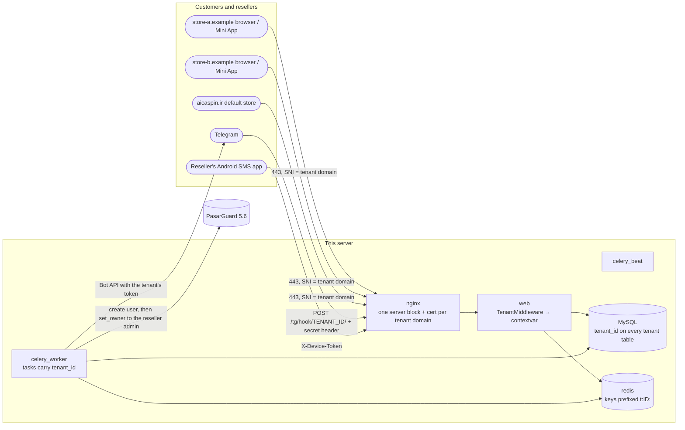
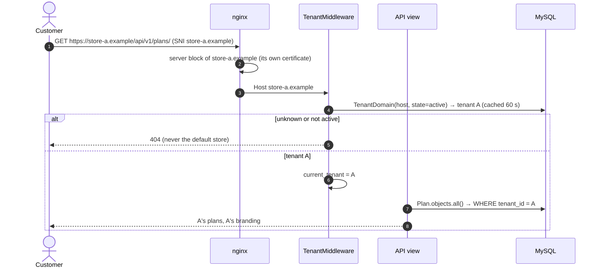
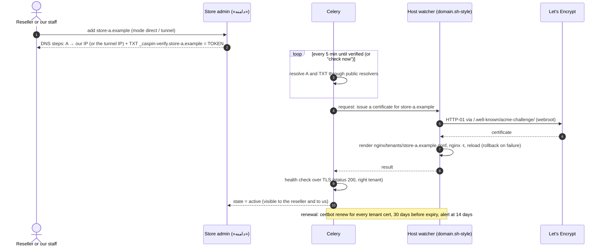
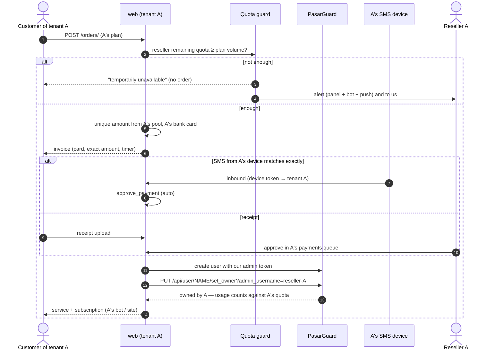
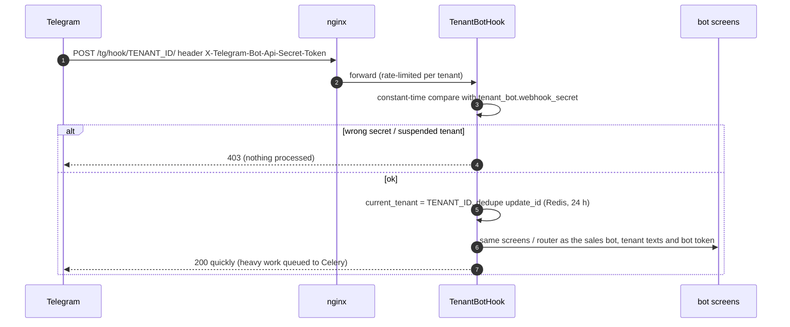
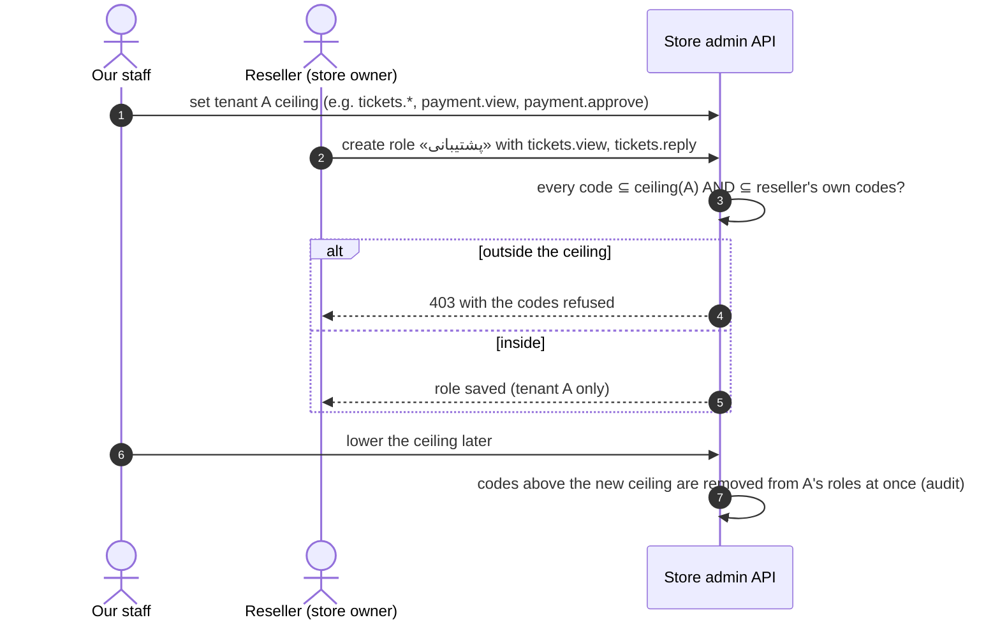
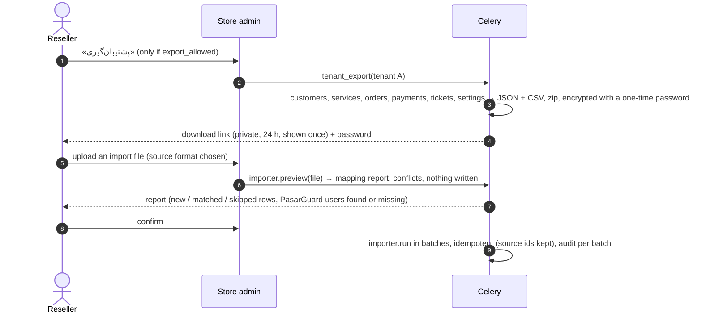

# Multi-tenant reseller storefronts — design

> **Status: proposal, waiting for approval. Nothing on this page is built.** Written 2026-11-04 against v1.38.4.
> When a phase is approved and built, the matching parts move into `architecture.md` / `erd.md` / `flows.md` and this page
> keeps only what is still planned.

Every agency admin (reseller) can get a white-label store — site, Telegram Mini App and their own Telegram bot — on their own
domain, served by the same codebase and database. Our current store becomes the **default tenant** and keeps working
unchanged. The reseller sells their own plans at their own prices, customers pay to the reseller's bank cards, services are
created under the reseller's PasarGuard admin (so they use the reseller's quota, which we keep invoicing per GB), and the
reseller runs the store — catalog, customers, orders, payment queue, tickets, CRM, discounts, branding, domain, bot, staff — from
an extended `/agency/`.

Contents: [1 Decisions](#1-decisions-and-what-needs-your-answer) · [2 Architecture](#2-architecture) ·
[3 Tenant scoping](#3-tenant-scoping-the-isolation-guarantee) · [4 Data model](#4-data-model-erd-changes) ·
[5 Changes per app](#5-changes-per-existing-app) · [6 Flows](#6-flows) · [7 Domains and TLS](#7-domains-tls-and-routing) ·
[8 Bots](#8-telegram-bots-and-the-mini-app) · [9 Payments and SMS](#9-payments-unique-amounts-and-the-sms-app) ·
[10 PasarGuard and quota](#10-pasarguard-ownership-and-quota) · [11 Reseller staff](#11-reseller-staff-and-permissions) ·
[12 Email](#12-email-per-tenant) · [13 Rate limits](#13-rate-limits) · [14 Backups and export](#14-backups-and-tenant-export) ·
[15 Import](#15-import-from-other-systems-last-phase) · [16 Security](#16-security) · [17 Filtering risk](#17-filtering-and-abuse-risk-of-reseller-domains) ·
[18 Migration](#18-moving-todays-data-into-the-default-tenant) · [19 Capacity](#19-server-capacity) ·
[20 Phases](#20-phased-plan-and-size) · [21 Risks](#21-risks)

---

## 1. Decisions, and what needs your answer

Decided (from the brief): one codebase, one MySQL database, tenant chosen by the `Host` header; our store is the default tenant;
full feature parity per tenant; reseller-set plans and prices; services under the reseller's PasarGuard admin with a quota guard;
payments to the reseller's cards, reviewed by the reseller, auto-confirmed by our Android SMS app; tenant-owned customers (the
same phone / Telegram may exist in several tenants); reseller sub-staff with a grant ceiling we control; domain + bot set up
from either side; tenant bots by webhook; per-tenant export (switchable); importers last; a monthly-fee hook (off).

**Please confirm or choose:**

| # | Question | My recommendation |
|---|---|---|
| D1 | Store admin UI: build store pages inside the `/agency/` portal SPA, or reuse the existing admin panel pages (`/panel/` code) in a tenant-scoped mode, entered from `/agency/`? | **Reuse the admin panel pages** in tenant mode (the reseller signs in at `/agency/`, gets a store-admin session and the panel UI with a store menu). Plans, users, payments queue, tickets, CRM, discounts, branding already exist there; rebuilding them in the portal doubles the UI work and the bugs. Group managers already prove the pattern (restricted menu on the same panel). |
| D2 | Where does the reseller's store admin live? | On **their own domain** at the admin path (`https://store.example/panel/`), and also reachable from our `/agency/` → «فروشگاه من». |
| D3 | Default tenant domain | The current active domain (today `aicaspin.ir`; `caspintunel.com` when you move to it). The default tenant is a row, not a hard-coded host. |
| D4 | One customer account per (tenant, phone/Telegram) — confirmed? | Yes. A customer of two stores has two accounts. Nothing is shared across tenants except our infrastructure. |
| D5 | Who can open a store? | Only resellers **you enable** (Agency → admin → «فروشگاه» → enable). Group-managed sub-admins: no store (their account is with the group manager). Group owners with a manager: through the manager, later. |
| D6 | Reseller minimum quota to sell | Block a sale when the reseller's remaining PasarGuard quota < plan volume; warn at 20 % / 10 % remaining. Thresholds editable per tenant by us. |
| D7 | Iran tunnel per tenant | Same three modes as our access mode, chosen per tenant domain (A to our IP, A to an Iran tunnel IP, or behind their Cloudflare). |

## 2. Architecture

- **Tenant** = one store. `tenant_id` is resolved once per request from the `Host` header against *verified* `TenantDomain`
  rows (exact match, `www.` redirects like today). Unknown host → 404 (never the default store — a stranger's domain pointed at
  our IP must not show our shop).
- **Same SPAs, branded at runtime**: the user SPA already reads `/api/v1/config/` and `/api/v1/theme/`; these answer per
  tenant. The admin SPA runs in "store mode" for reseller staff (D1).
- **One web pool, one worker pool.** No process per tenant. Bots by webhook (§8). Celery tasks take `tenant_id` and set the
  tenant context before touching models.
- **Platform vs tenant data.** Platform tables (panels, agency ledger / invoices / payments, Blu, ops, backups, health, our
  staff) stay global. Customer-facing tables get `tenant_id` (§4).

## 3. Tenant scoping (the isolation guarantee)

MySQL has no row-level security, so isolation is enforced in four layers, each tested:

1. **Model field.** Every tenant table has `tenant = ForeignKey(Tenant, on_delete=PROTECT, db_index=True)` — denormalized on
   child tables too (payment, ticket message, service…), so every list query filters one indexed column and a child can be
   checked against its parent (`save()` refuses `child.tenant != parent.tenant`).
2. **Context + middleware.** `TenantMiddleware` sets a `contextvars` value (`current_tenant`) from the host; the SMS API sets it
   from the device token; the bot webhook from the URL + secret; Celery tasks from their `tenant_id` argument; management
   commands must pass `--tenant` or `--all-tenants`. No context → tenant-scoped queries **raise** (fail closed).
3. **Default manager.** `TenantManager` filters `tenant=current_tenant()` on every queryset of a tenant model; `Model.unscoped`
   is the only way around it and is allowed only in platform code paths (our staff with the tenant filter, ops, migrations),
   listed in one allow-list file. `create()` fills `tenant` from the context.
4. **Tokens and sessions.** Customer JWTs and store-staff JWTs carry `tid`; a token used on another tenant's host → 401. Cache
   keys, rate-limit buckets, WebSocket groups and media paths are prefixed `t:<id>:` / `tenants/<id>/`.

**Tests that guarantee it** (run on every release):

- *Inventory test*: every model holding customer data has a `tenant` field and `TenantManager` (fails when someone adds a model
  without it, or a new model is not classified in `tenancy/registry.py`).
- *Cross-tenant API sweep*: two tenants with the same fixtures (same usernames, phones, amounts); for **every** URL pattern
  (generated from the resolver, like `test_mobile_nav`), as tenant A's customer and staff: list / detail / write on B's ids →
  404, lists never contain B's rows, counts and totals equal A's only.
- *Unscoped-access lint*: `.unscoped` / `all_tenants()` used outside the allow-list → test failure.
- *Context tests*: a Celery task without `tenant_id`, an SMS from a device of tenant A matching a B order, a bot update with a
  wrong secret, a JWT replayed on another host — each refused.
- *Unique-amount test*: the same amount open in A and B; an SMS on A's device approves only A's order.

## 4. Data model (ERD changes)

```mermaid
erDiagram
    tenant ||--o{ tenant_domain : has
    tenant ||--o| tenant_bot : has
    tenant ||--o| tenant_branding : has
    tenant ||--o{ tenant_setting : overrides
    tenant ||--o{ tenant_permission_ceiling : allows
    tenant ||--o{ tenant_export : exports
    tenant ||--o{ import_job : imports
    tenant ||--o| tenant_billing : fee
    agency_panel_admin ||--o| tenant : "reseller (owner)"
    tenant ||--o{ user : customers
    tenant ||--o{ staff : "store staff"
    tenant ||--o{ plan : sells
    tenant ||--o{ bank_card : receives
    tenant ||--o{ sms_app_device : confirms

    tenant {
        bigint id PK
        string slug UK
        string name
        string reseller_username FK "agency_panel_admin, null = default tenant"
        string status "draft | active | suspended | closed"
        bool is_default "exactly one"
        bool export_allowed "set by us"
        int quota_warn_percent "default 20"
        json limits "orders/min, staff count, bots"
        datetime created_at
    }
    tenant_domain {
        bigint id PK
        bigint tenant_id FK
        string host UK "store.example (lowercase, IDNA)"
        string role "site | admin | both"
        string mode "direct | tunnel | cloudflare"
        string verify_token "TXT _caspin-verify.HOST"
        string state "pending_dns | verified | cert_pending | active | failed | removed"
        datetime cert_expires_at
        datetime last_check_at
        string last_error
    }
    tenant_bot {
        bigint id PK
        bigint tenant_id FK
        string username
        text token_enc "encrypted"
        string webhook_secret_enc "encrypted, X-Telegram-Bot-Api-Secret-Token"
        string state "unset | ok | error"
        datetime last_update_at
    }
    tenant_branding {
        bigint tenant_id PK
        string title_fa
        string title_en
        string logo
        string favicon
        json palette "theme colours, light / dark"
        json support "telegram, phone, url"
        json bot_texts "overrides of bot/texts.py keys"
    }
    tenant_setting {
        bigint id PK
        bigint tenant_id FK
        string key "only keys in TENANT_KEYS"
        text value
    }
    tenant_permission_ceiling {
        bigint id PK
        bigint tenant_id FK
        string permission_code "what the reseller may grant"
    }
    tenant_export {
        bigint id PK
        bigint tenant_id FK
        string requested_by
        string state "queued | running | ready | expired | failed"
        string file "private media, tenants/ID/exports/"
        datetime expires_at
    }
    import_job {
        bigint id PK
        bigint tenant_id FK
        string importer "csv | mirza | wizwiz | marzban_bot | pasarguard_users ..."
        string state "uploaded | previewed | running | done | failed"
        json mapping
        json report "counts, conflicts, skipped rows"
    }
    tenant_billing {
        bigint tenant_id PK
        bool fee_enabled "off for now"
        decimal monthly_fee
        date next_due
    }
```

**`tenant_id` added to** (NOT NULL after the backfill, §18):

| App | Tables |
|---|---|
| accounts | `user`, `deleted_user_archive`, `staff` (**nullable** = platform staff), `role` (nullable = platform role) |
| panel / plans | `service` (denormalized from user), `plan` |
| orders | `order`, `scheduled_renewal`, `manual_invoice` |
| payments_sms | `payment`, `bank_card`, `sms_source`, `sms_app_device`, `sms_message` |
| notifications | `notification`, `notification_delivery`, `push_subscription` (nullable — staff / reseller rows) |
| telegram | `required_channel` (per tenant bot), `telegram_stats` |
| settings_app | `site_config` → replaced by `tenant_branding`, `theme`, `page` |
| tickets | `ticket_topic`, `ticket`, `ticket_message`, `ticket_attachment`, `ticket_event`, `ticket_canned_reply` |
| crm | all 11 tables (`crm_tag` … `crm_discount_code`) |
| common | `audit_log` (nullable — platform actions) |

**Stays global:** `panel`, every `agency_*` table, `blu_transaction`, `blu_collector`, `setting` (platform keys), `email_settings`
(platform relay), `domain_config`, `domain_change`, `app_release`, `telegram_config` (our two bots), all `ops` tables, `permission`.

**Unique constraints that become per-tenant** (composite with `tenant_id`): `user.username`, `user.telegram_id`,
`user.referral_code`, `crm_discount_code.code`, `crm_tag.name`, `crm_warning_rule (kind, threshold)`, `page.slug`, `theme.name`.
`order.amount_unique_lock` becomes `(tenant_pool, amount_unique_lock)` (§9). `payment.number` (TX) and `ticket.number` stay global
sequences (simple, never collide) but are shown per tenant.

## 5. Changes per existing app

| App | Change |
|---|---|
| `common` | `tenancy/` package: `Tenant*` models, `current_tenant` contextvar, `TenantMiddleware`, `TenantManager`, registry + allow-list, cache-key helper, `tenant_task` Celery decorator. `DynamicAllowedHostsMiddleware` reads verified tenant domains. Audit rows get `tenant`. |
| `accounts` | Customer auth per tenant (login / register / reset / Mini App all resolve the tenant first); phone normalization unchanged, uniqueness per tenant; JWT `tid` claim; `Staff.tenant` + store roles; grant ceiling (§11). Reseller owner = a `Staff` row of their tenant linked to the `PanelAdmin` (like group managers today). |
| `plans` | Plans per tenant; reseller sets prices; panel groups limited to what the reseller's PasarGuard role allows. |
| `panel` | Provisioning uses our admin token, then `PUT /api/user/{username}/set_owner?admin_username=<reseller>` (verified in PasarGuard 5.6.0 openapi); account-name check per panel stays global (one PasarGuard namespace). Quota guard before every sale / renewal / add-on (§10). Sync unchanged (global). |
| `orders` | Orders per tenant; `create_order` checks quota + tenant status; unique amounts from the tenant's pool; renewals / scheduled renewals unchanged otherwise. |
| `payments_sms` | Cards, sources, devices, SMS log per tenant; matching only inside the device's tenant; `approve_payment` unchanged (it is the only approve path); Blu stays default-tenant only + agency payments. Receipts under `tenants/<id>/receipts/`. |
| `notifications` | `notify_user` sends through the tenant's bot and tenant-branded email; site notifications per tenant; Web Push works per origin automatically (each domain has its own service worker scope) — one VAPID key pair for all. |
| `telegram` | Webhook endpoint for tenant bots (§8); our two bots unchanged (polling); screens / texts take the tenant's branding and overrides; forced channels per tenant. |
| `settings_app` | `tenant_branding` replaces `site_config` for tenants (the default tenant's row is migrated from `site_config`); `TENANT_KEYS` = settings a tenant may override (checkout timer, ticket limits, retention quiet hours, alerts…); platform-only keys stay global; themes / pages per tenant. |
| `tickets` | Topics, tickets, canned replies, scopes per tenant; attachments under `tenants/<id>/tickets/`. |
| `crm` | Everything per tenant (profiles, cases, templates, retention rules, discount codes, analytics). Analytics already read-only — they gain the tenant filter. |
| `agency` | New «فروشگاه» tab on the staff admin page and in `/agency/`: enable, domain, bot, export permission, limits, status. Store sales feed the reseller's usage; our per-GB invoicing is unchanged. |
| `adminpanel` | Every view runs under the tenant context; our staff get a **tenant filter** (default: all) and a tenant column; store staff are confined to theirs. `StaffPermission` checks the ceiling for store roles. |
| `ops` | Health per tenant domain (cert days left, DNS still pointing to us, bot webhook state); alerts to us and to the reseller. Backups stay global. |
| frontends | User SPA: no code per tenant — branding from the API, `manifest` / favicon per host. Admin SPA: store mode (menu filtered by the store role, tenant filter for us). Portal `/agency/`: «فروشگاه من» entry. |

## 6. Flows

### 6.1 A request to a tenant store

### 6.2 Domain onboarding (reseller or our staff)

### 6.3 Purchase in a tenant store

### 6.4 Tenant bot update (webhook)

### 6.5 Reseller grants a permission to their staff

### 6.6 Tenant export and import (preview first)

## 7. Domains, TLS and routing

- **Ownership proof**: TXT `_caspin-verify.<host>` = random token, plus the A record pointing to our IP or a configured tunnel
  IP. Re-checked daily; a domain that stops pointing to us is marked and alerted (after 3 days: store shows "moved").
- **Certificates**: HTTP-01 per domain (webroot, the reseller's DNS is not ours, so DNS-01 through our Cloudflare is not
  possible). One certificate per host (`store.example` + `www.store.example`), stored under `nginx/letsencrypt/` with its own
  lineage. Renewal by the existing `certbot` container (`certbot renew` covers webroot lineages too). Let's Encrypt limits: 50
  certificates per registered domain per week and 300 new orders per account per 3 hours — far above our need; we queue issuance
  one at a time. **Behind the Iran tunnel**, HTTP-01 must reach our port 80 through the tunnel (the tunnel provider must forward
  80); otherwise use the "manual certificate" path the reseller uploads.
- **nginx**: one generated file per tenant host in `nginx/tenants/` (template + render, like `paths/active.conf`), all routes as
  the default site (site, admin path, `/api/`, `/ws/`, `/media/`), plus the bot hook. Changes only through a host watcher
  (`scripts/tenants.sh apply-request`, cron every minute): render → `nginx -t` → reload → verify over TLS → rollback. The
  container never reloads the host by itself (same rule as `domain.sh`).
- **Health**: every 5 min per active domain — TLS handshake, days to expiry, `GET /api/v1/health/` returns the right tenant;
  shown in the store admin and in our Agency → «فروشگاه».
- **Both sides**: the reseller adds / removes their domain; our staff can do the same on their behalf; every step is audited and
  visible to both.

## 8. Telegram bots and the Mini App

- **Webhook mode for every tenant bot**: `setWebhook(url=https://<our platform host>/tg/hook/<tenant_id>/, secret_token=…,
  allowed_updates=[…])`. One endpoint, per-tenant secret (Telegram sends it in `X-Telegram-Bot-Api-Secret-Token`), no process per
  bot. The hook answers within a second and queues heavy work; `update_id` deduplicated. The webhook URL is on **our platform
  host** (not the tenant's domain), so a tenant domain problem does not stop the bot.
- **Setting the token** (reseller or us): `getMe` check, store encrypted, set webhook, set the menu and the Mini App button to
  `https://<tenant domain>/`. Clearing the token deletes the webhook.
- **Mini App**: initData is validated with **that tenant's** bot token (today: the sales-bot token). The phone gate and
  `handle_contact` run per tenant.
- **Our two bots** (sales, backup) stay as they are (polling containers) for the default tenant and for us.
- Cost: no extra memory per bot; one HTTP request per update through `web` (bots are low-traffic compared with the site).

## 9. Payments, unique amounts and the SMS app

- **Cards per tenant**; the checkout shows only the tenant's cards. Card numbers encrypted at rest (shown to that tenant's
  customers only).
- **Unique-amount pools**: today one global pool (`order.amount_unique_lock` unique, agency payments share it). New: pool key =
  the **set of SMS devices / bank accounts that confirm the payment**. Default tenant + agency payments + Blu keep the current
  pool; each reseller tenant has its own pool (`unique (pool_id, amount_unique_lock)`). Two tenants can show the same amount at
  the same time because their SMS come from different devices.
- **Matching**: an SMS is matched only against open orders of the device's tenant (device token → tenant). Every existing rule
  stays (exact match only, near-miss review, rounded rule, received_at window, idempotent batch).
- **Review**: the reseller's payments queue (live WebSocket per tenant), Telegram alert through **their** bot, push, sound.
- **Android SMS app (improved)**: first screen asks for **store domain + device token** (or scans a QR from the store admin);
  the app calls `https://<domain>/api/v1/payments/sms/ping/` to confirm and shows the store name. The same APK works for every
  tenant (no per-tenant build); downloads from the store admin. Bank sender numbers per tenant. *iPhone Shortcut per tenant*:
  optional, same builder with the tenant domain (signing remains manual, as today).
- **Blu** stays ours only (default tenant + agency payments).

## 10. PasarGuard ownership and quota

- Create the PasarGuard user with **our** admin token (no reseller password stored), then `set_owner` to the reseller's admin
  — PasarGuard then counts the user's traffic against the reseller (their `data_limit` / remaining). Read back and mirror as today.
- **Quota guard** before order creation, renewal, add-on and manual invoice with a service action: remaining (from the agency
  sync, at most 2 min old; live GET when within 10 % of the limit) − open reservations of that tenant ≥ requested volume.
  Not enough → sale blocked with a friendly message, reseller alerted, we are alerted. Unlimited reseller admins are not blocked.
- **Warnings** at `quota_warn_percent` (default 20 %) and 10 %: store admin banner + bot + push; the reseller can request volume
  with the existing «درخواست شارژ» (our approvals + per-GB invoicing unchanged).
- Account names stay unique across the whole panel (one PasarGuard namespace) — the existing `check_account_name` applies.

## 11. Reseller staff and permissions

- A store has **store roles** (`role.tenant = A`) and **store staff** (`staff.tenant = A`); sign-in on the store's admin path
  with the store's own JWT audience (`tid` claim).
- **Ceiling**: we set, per tenant, the permission codes a reseller may hold and grant (`tenant_permission_ceiling`; a default
  template for new stores). The reseller's own store-owner role = the ceiling. A store role can only contain codes ⊆ ceiling
  ⊆ the reseller's role; lowering the ceiling strips codes from that tenant's roles immediately.
- Platform-only codes are never in a ceiling (settings.manage, paths, domain wizard of our host, users.purge of other tenants,
  agency.*, accounting of the platform…). A test checks the list.

## 12. Email per tenant

- Default: sent by our relay from `noreply@<our domain>` with the **tenant's store name** as the display name and the tenant's
  support address as `Reply-To` — no DNS work for resellers, deliverability stays ours.
- Optional per tenant: their own SMTP relay (encrypted credentials, test button) to send from their domain; then SPF / DKIM are
  their responsibility (instructions shown). Our mail server never hosts tenant domains.

## 13. Rate limits

- Existing DRF throttles become per tenant + per client IP (`t:<id>:` in the bucket key) so one store's traffic cannot use
  another's budget; auth throttles stay strict.
- Per-tenant caps (in `tenant.limits`, we set them): orders per minute, SMS inbound per minute per device, bot updates per second,
  tickets per hour, staff count. Over the cap → 429 for that tenant only + an alert to us.
- nginx: `limit_req` zone per server name for `/api/` and the bot hook.

## 14. Backups and tenant export

- **Our backups unchanged**: full DB dump to Telegram, retention as today (every tenant's data is in it).
- **Tenant export** (when `export_allowed`, which we switch per reseller): JSON + CSV of customers, services, orders, payments,
  tickets, discount codes, settings and branding; zip encrypted with a one-time password; private download for 24 h; audited;
  at most one export per 6 h. No secrets (bot token, card numbers masked except the last 4).
- Restore of a single tenant from our full backup is a manual, staff-only operation (documented runbook), never self-service.

## 15. Import from other systems (last phase)

Pluggable importers (`tenancy/importers/<name>.py`) with one interface: `detect(file)`, `preview(file) → mapping report`,
`run(file, mapping)` (idempotent, source ids stored, batches of 500, audit). PasarGuard users are **linked, never created**:
an imported service is matched to an existing PasarGuard user owned by the reseller (by username / note / sub link);
missing ones are listed in the report.

**Source formats to support (in this order):**

| Importer | What it reads |
|---|---|
| `csv` / Excel | our template: customers (name, phone, Telegram id, balance), services (PasarGuard username), orders / payments (optional) |
| `pasarguard_users` | the reseller's users straight from PasarGuard (owner = reseller) → customers + services, linked by Telegram id or note |
| MySQL dumps of common Iranian VPN sales bots | e.g. **MirzaBot**, **WizWiz**, Marzban / PasarGuard sales bots built on the usual PHP + MySQL templates, 3x-ui / Hiddify bot databases — each needs a sample to map its tables |
| JSON exports | bots that export users / orders as JSON |

**What I need from you before phase 10:** for each source the resellers actually use — the name / repository of the bot, one
**anonymized** sample dump or export (a few hundred rows is enough), and which fields matter (balance? wallet? referral?). Also
your rule for customer balances (import as a store credit, or ignore).

## 16. Security

- **Isolation** — §3; it is the release gate of every phase.
- **Secrets**: bot tokens, webhook secrets, tenant SMTP passwords: `EncryptedTextField` (Fernet, `FIELD_ENCRYPTION_KEY`); never
  returned by an API (write-only, "set" / "not set"), never audited in clear, masked in logs. Card numbers encrypted at rest.
- **Auth**: tokens carry `tid`; sign-in endpoints still never authenticate (`FreshAuthMixin`); CSRF / CORS origins per verified
  domain; cookies are not used for the API.
- **Media**: private files under `tenants/<id>/…`, served only through the auth-checked API (`X-Accel-Redirect`), tenant checked.
- **Our staff**: see everything with a tenant filter; every action on a tenant's data is audited with the tenant.
- **Store staff**: can never reach platform endpoints (default-deny like group managers today).
- **Suspension**: one switch per tenant — store shows a maintenance page, bot answers "temporarily unavailable", sales blocked,
  existing services untouched.
- **Domains**: only verified hosts are routed; a removed domain's nginx file and certificate are removed.

## 17. Filtering and abuse risk of reseller domains

- All tenant domains in "direct" mode resolve to **our IP**. If Iran filters one tenant domain, only SNI is affected; if a tenant
  attracts an **IP block** or abuse complaints (phishing, spam), every store on that IP — and our default store — suffers.
- **The PasarGuard nodes on this host share our IP today.** A VPN node IP is exactly what gets filtered; that is a reason to move
  the nodes off this host before onboarding stores (§19).
- Mitigations: stores in "tunnel" mode through Iran tunnel IPs (as our access mode), the ability to put a tenant on its own
  tunnel / IP later, terms of use + suspension switch, daily DNS checks, abuse contact on every store footer, our default store
  can switch access mode independently.

## 18. Moving today's data into the default tenant

Backward compatible, two releases per step (CLAUDE.md migration rule):

1. **Release A**: create `tenant` (+ default row from `site_config`, our domain as a verified `tenant_domain`), add nullable
   `tenant_id` to every tenant table; a data migration fills `tenant_id = default` in batches (today's DB is 23 MB — seconds).
   Code still ignores it.
2. **Release B**: `TenantMiddleware` + managers active; all hosts that are not the default domain → 404; composite unique
   constraints added *next to* the old ones.
3. **Release C**: `tenant_id` NOT NULL; old single-column unique constraints dropped; isolation test suite is a required check.

Rollback at every step = previous image (the columns are additive). Pre-update dump as always.

## 19. Server capacity

**Today (2026-11-04):** 2 vCPU, 3.7 GiB RAM, about 2.8 GiB used and ~1 GiB of 2 GiB swap in use, short memory stalls; disk 38 GB
at 64 %. Our containers use about 1.2 GiB; three PasarGuard nodes + x-ui + tunnel ~0.7 GiB; the rest is dockerd, page cache.
**This is not enough for stores** — it is already swapping without them.

**Upgrade to 4 vCPU / 8 GB before phase 1** (and grow the disk to 80 GB: per-tenant media, certificates, exports, logs).

**Estimate with 20 active stores** (≈ 2,000 customers, ≈ 200 orders/day, ≈ 20 bots by webhook): web load is small (bots and
customers are bursty but light); the biggest costs are gunicorn workers, Celery throughput (provisioning, notifications,
retention per tenant) and MySQL buffer pool. 50+ stores or > 1,000 orders/day → move MySQL to its own 4 GB instance first.

**Per-container memory limits** (compose `mem_limit`, set in `docker-compose.prod.yml`; numbers for 8 GB):

| Container | Limit | Notes |
|---|---|---|
| web | 1.5 GB | gunicorn 5 workers (2 × vCPU + 1) |
| daphne | 384 MB | WebSockets for every store |
| celery_worker | 1.5 GB | concurrency 4, `--max-tasks-per-child=200` |
| celery_beat | 256 MB | |
| db | 2.5 GB | `innodb_buffer_pool_size=1536M` |
| redis | 384 MB | `maxmemory 256mb`, `allkeys-lru` for cache DB only |
| nginx | 256 MB | one server block + cert per store |
| bot_sales / bot_backup | 256 MB each | our two polling bots |
| frontend_user / frontend_admin | 64 MB each | static files |
| mailserver | 384 MB | |
| certbot | 128 MB | |
| **Total limits** | ≈ 7.9 GB | real use expected ≈ 3.5–4.5 GB; leaves page cache |

**Moving the PasarGuard nodes off this host: yes, worth it.** They use ~0.7 GiB and CPU in bursts (VPN traffic), but the main
reason is the **shared IP**: a filtered or attacked node IP takes our stores and our panel with it, and node traffic spikes slow
checkout. A small separate VPS for the nodes (or putting them on existing node servers) costs less than the memory headroom it
frees, and separates "sales platform" from "VPN data plane". If they must stay, give them `mem_limit`s too and keep the 8 GB plan.

## 20. Phased plan and size

Size = my estimate of working days for build + tests + browser checks + docs (one developer), and the releases it becomes.

| Phase | Content | Size | Releases |
|---|---|---|---|
| **0 — Prepare** | Server 4 vCPU / 8 GB / 80 GB, container limits, move PasarGuard nodes, monitoring of memory per container | 1–2 days (ops) | v1.39.0 (limits) |
| **1 — Tenant core** | `tenancy/` (models, contextvar, middleware, managers, registry, allow-list), `tenant_id` on all tenant tables + default backfill (Release A→C), JWT `tid`, isolation test suite (inventory, API sweep, lint) | 6–8 days | 3 (A, B, C) |
| **2 — Store admin + branding** | Store mode of the admin SPA (D1), «فروشگاه» tab for us, `tenant_branding`, `TENANT_KEYS`, pages / themes per tenant, user SPA branding per host | 5–6 days | 2 |
| **3 — Domains & TLS** | TXT + A verification, HTTP-01 per host, nginx per-tenant files via host watcher, health, both-sides UI, renewal + alerts | 5–7 days | 2 |
| **4 — Catalog & PasarGuard** | Plans per tenant, `set_owner` provisioning, quota guard + warnings, renew / add-on per tenant | 4–5 days | 1–2 |
| **5 — Payments & SMS** | Cards / sources / devices per tenant, unique-amount pools, matching per tenant, reseller payments queue, Android SMS app update (domain + token, QR) | 6–8 days | 2 (+ APK) |
| **6 — Bots & Mini App** | Webhook endpoint, tenant bot setup (both sides), screens with tenant texts, Mini App per tenant | 5–6 days | 1–2 |
| **7 — Tickets, CRM, retention, discounts, analytics, notifications, push, email** | Scope everything, tenant email display name / optional relay, per-tenant rate limits | 6–8 days | 2 |
| **8 — Reseller staff** | Store roles, ceiling, sign-in on the store admin path | 3–4 days | 1 |
| **9 — Pilot** | One reseller, one domain, real sales for 2 weeks; daily isolation + health review; fixes | 2–3 days + 2 weeks | fixes |
| **10 — Tenant export** | Export job, encrypted zip, permission switch | 2–3 days | 1 |
| **11 — Importers** | Framework + `csv` + `pasarguard_users`; then one per source bot from your samples | 4 days + 2–3 per source | 1 each |
| **12 — Fee hook** | `tenant_billing`, monthly invoice generator (off), suspension on unpaid (off) | 1–2 days | 1 |

Total before the pilot (0–8): about **41–54 working days**. Every phase ends with the isolation suite green, browser checks
(phone + desktop, fa / en, light / dark) and the docs moved into architecture / erd / flows.

**Pilot rollout**: pick one reseller with steady sales and a domain they control → staging store on a test subdomain of our
domain first → their domain → 2 weeks with sales capped (`tenant.limits`) → open to more resellers in small groups.

## 21. Risks

| Risk | Impact | Mitigation |
|---|---|---|
| A missed tenant filter leaks data between stores | severe | four-layer scoping, fail-closed context, inventory + API sweep tests as a release gate, unscoped allow-list |
| Shared IP filtered / blocked | all stores down | move nodes off host, tunnel mode per store, suspension switch, monitoring |
| Reseller quota runs out mid-checkout | paid order cannot be provisioned | guard before the invoice, re-check before provisioning, paid-but-blocked → staff + reseller alert, retry when quota arrives |
| Let's Encrypt failures (DNS changed, tunnel without port 80) | store without TLS | state machine with clear errors, manual-certificate path, alerts 14 days before expiry |
| Bot token leaked by a reseller | their bot hijacked | token encrypted, webhook secret rotated on every token change, one-click reset |
| Load growth on a small server | slow checkout | upgrade before phase 1, container limits, DB split at 50+ stores |
| Unique amounts collide across stores | wrong approval | per-pool constraint, device→tenant matching, unique-amount test |
| Importer maps balances / services wrongly | wrong customer state | preview + report first, idempotent runs, no PasarGuard writes during import |
| Support load (our staff see everything) | slower operations | tenant filter everywhere, per-tenant alerts go to the reseller first |
